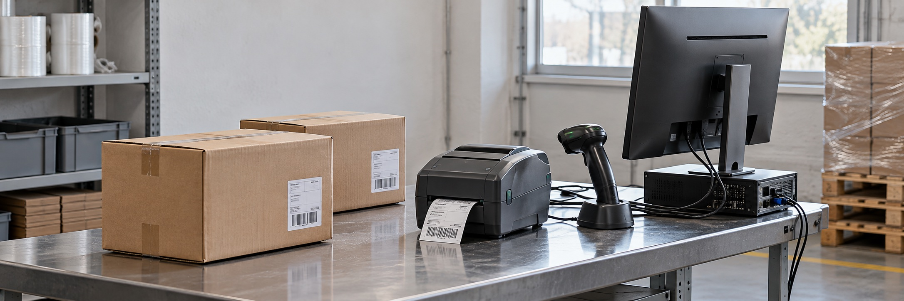
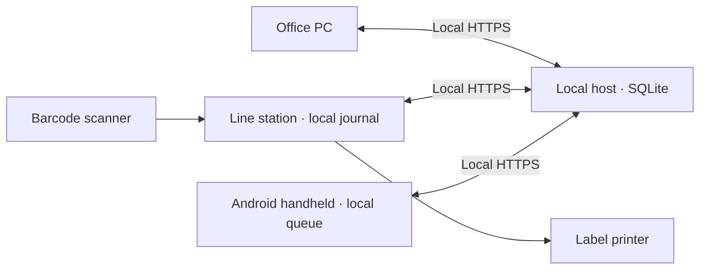
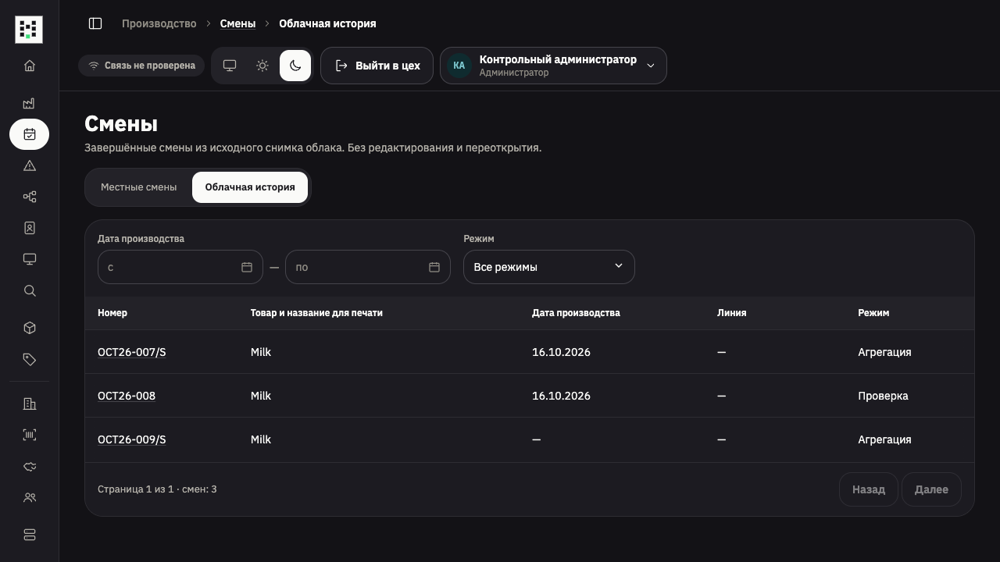
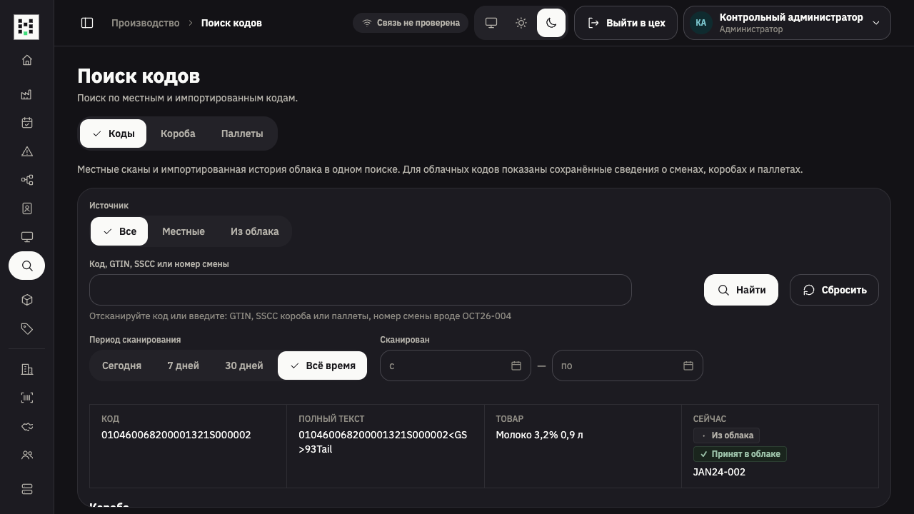

<p>
  <picture>
    <source media="(prefers-color-scheme: dark)" srcset="./docs/assets/readme/logo-en-dark.svg">
    
  </picture>
</p>

**English** / [Русский](./README.ru.md)

# Production marking in your local network

Markiro Standalone runs scanning, aggregation, label printing and production
reports on Windows PCs connected to a local host.

> **Only the offline edition is currently available.**
> A hosted online edition is not available. The office and production workflows
> described here run inside your site's local network.

[Download for Windows](https://github.com/thevladbog/markiro/releases/tag/standalone-v1.0.0) / [Installation guide](./docs/runbooks/standalone-install.md) / [Support](./SUPPORT.md)



_Generated illustration of a packing workplace, not a photograph of a customer installation._

## One site, one local host

Install the host on one Windows PC. It keeps the site's main SQLite database
and serves office PCs, line stations and compatible Android handheld terminals
over HTTPS. The host can also be the line station, so a single PC is enough
for a small installation.

Internet access is not required for day-to-day production. Stations keep local
journals and retry synchronization when their connection to the host returns.
A disconnected station can continue within the data and SSCC ranges it has
already received; new configuration and shared operations need the host.



## From scanning to a production report

| Work                     | What you can do                                                                                                                                   |
| ------------------------ | ------------------------------------------------------------------------------------------------------------------------------------------------- |
| Run a shift              | Select a product and line, scan codes, track progress and close the shift.                                                                        |
| Build packaging          | Aggregate codes into boxes and pallets, allocate SSCCs, reprint labels and disaggregate packaging.                                                |
| Check a code             | Search local and imported cloud history together, filter the source and inspect known shift and packaging details.                                |
| Print labels             | Use templates, product data and production dates with the application's shared preview and print model.                                           |
| Prepare documents        | Generate supported Excel, CSV, XML for Chestny ZNAK and printable forms locally. File generation is separate from submission to the state system. |
| Protect the installation | Back up and restore host data, manage office users and devices, load signed licenses and install signed update packages.                          |

### Office and traceability



Imported shifts remain available as historical cards. Reports can be generated
again in the offline application using the retained final state.



The shared code search distinguishes local and imported records. It shows known
ownership and packaging data without inventing source events that were not exported.

_These are real Markiro Standalone 1.0.0 components captured with demonstration
data and a controlled host transport. The current application interface is Russian._

## Install and start working

The published installer targets **Windows 10/11 x64** and offers three PC roles:
host, station and office.

1. Download the installer from the [stable standalone release](https://github.com/thevladbog/markiro/releases/tag/standalone-v1.0.0).
2. Install the host on the site's main PC and complete the first-run setup.
3. Set up products, lines, operators, label templates and equipment in the office.
4. Connect other PCs and compatible handhelds using a pairing code, then start a shift.

Keep the host accessible over the local network. If WebView2 is missing,
the default installer downloads it from Microsoft; prepare it in advance for
a PC without Internet access. Installation prerequisites differ from the
application's offline production operation.

See the [IT installation guide](./docs/runbooks/standalone-install.md),
[backup and recovery guide](./docs/runbooks/standalone-backup-restore.md)
and [handheld documentation](./apps/handheld/README.md).

### Updates and licensing

Updates are delivered as an installer plus a signed `.update.jws` manifest.
Keep both files together and use **Information → Update from file** in the office.
Stop production and printing before installation; update the host first,
then the other PCs.

License requests and license files can be transferred as files. Production does
not require a permanent connection to the licensing service.

### Move existing history

The import workflow accepts prepared reference-data and shift-history exports.
It retains the final shift states needed for reports and duplicate checks.
Already imported codes appear in the shared code search without another import.

To replace a trial dataset, choose the replacement mode. It requires a verified
backup before replacing data and preserves the installation's license,
printers and connected devices.

Follow the [cloud cutover guide](./docs/runbooks/standalone-cloud-cutover.md).
Historical import is a migration path, not a dependency on an available
online edition.

## Work on the source

The offline application lives in `apps/standalone`:

```text
apps/standalone/
  host/         Rust LAN service and master SQLite database
  proto/        Host/device protocol and shared fixtures
  src-tauri/    Desktop shell, local storage and hardware access
  src/          React office and shop-floor interface
apps/handheld/  Android terminals, including local-host support
packages/
  domain/       GS1, KM, GTIN, SSCC, label and report rules
  ui/           Shared components, tokens and themes
```

The repository also retains cloud API, web cabinet, SaaS administration,
kiosk and integration code. Their presence does not mean a hosted product is
currently available. Local standalone development does not require running
that cloud stack, Docker or PostgreSQL.

### Local development

Use Node.js 24+, Corepack with the declared pnpm version, Rust stable and the
native build prerequisites for Tauri 2 on your development OS.

```bash
corepack enable
corepack pnpm install --frozen-lockfile
corepack pnpm turbo run build --filter='@markiro/standalone^...'
cargo run --manifest-path apps/standalone/Cargo.toml -p markiro-host -- run --data-dir apps/standalone/.markiro-host
```

In another terminal:

```bash
corepack pnpm --filter @markiro/standalone tauri dev
```

The app initially looks for the host at `https://127.0.0.1:45710`.
Use a separate development data directory. Do not point a development build
at a customer's installation.

### Verification

```bash
corepack pnpm --filter @markiro/standalone test
corepack pnpm --filter @markiro/standalone typecheck
corepack pnpm --filter @markiro/standalone lint
corepack pnpm --filter @markiro/standalone build
cargo test --manifest-path apps/standalone/Cargo.toml --workspace
corepack pnpm test:standalone-release:contract
```

The webview build must exist before Cargo builds the desktop crate. Shared
package changes require rebuilding their dependencies before consumer checks.
CI also builds the Windows installer and runs an installation/crash/reinstallation/
uninstall smoke test. These checks do not replace testing the site's actual
scanners, printers and network.

## Documentation and project policy

- [Standalone development notes](./apps/standalone/README.md) and [agent instructions](./AGENTS.md)
- [Installation](./docs/runbooks/standalone-install.md), [backup and recovery](./docs/runbooks/standalone-backup-restore.md), [data migration](./docs/runbooks/standalone-cloud-cutover.md)
- [Label examples](./examples/labels/README.md)
- [Security reporting](./SECURITY.md), [support](./SUPPORT.md) and [contribution policy](./CONTRIBUTING.md)

Copyright © 2026 Vladislav Bogatyrev. Proprietary software, all rights reserved.
See [LICENSE](./LICENSE).
