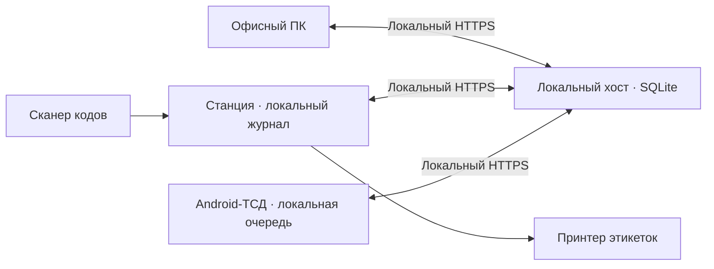

<p>
  <picture>
    <source media="(prefers-color-scheme: dark)" srcset="./docs/assets/readme/logo-dark.svg">
    
  </picture>
</p>

[English](./README.md) / **Русский**

# Маркировка в локальной сети

«Маркиро Автоном» объединяет сканирование, агрегацию, печать этикеток
и производственные отчёты на Windows-ПК с локальным хостом.

> **Сейчас доступна только офлайн-версия.**
> Облачный онлайн-контур пока недоступен. Описанные здесь офис
> и производственные процессы работают в локальной сети предприятия.

[Скачать для Windows](https://github.com/thevladbog/markiro/releases/tag/standalone-v1.0.0) / [Установка](./docs/runbooks/standalone-install.md) / [Поддержка](./SUPPORT.md)


_Сгенерированная иллюстрация рабочего места, не фотография установки у клиента._

## Одна площадка, один локальный хост

Хост устанавливается на одном Windows-ПК. Он хранит основную базу SQLite
и обслуживает офисные ПК, станции на линиях и совместимые Android-ТСД
по HTTPS. Хост можно совместить со станцией: небольшой установке достаточно
одного компьютера.

Интернет для повседневной работы производства не нужен. Станции сохраняют
локальные журналы и повторяют синхронизацию после восстановления связи с хостом.
Без связи станция продолжает работу в пределах уже полученных данных
и диапазонов SSCC; новые настройки и общие операции требуют доступного хоста.



## От сканирования до отчёта

| Задача                | Что можно сделать                                                                                                                                                        |
| --------------------- | ------------------------------------------------------------------------------------------------------------------------------------------------------------------------ |
| Провести смену        | Выбрать товар и линию, сканировать коды, отслеживать результат и закрыть смену.                                                                                          |
| Собрать упаковку      | Агрегировать коды в короба и паллеты, выделять SSCC, перепечатывать этикетки и расформировывать упаковки.                                                                |
| Проверить код         | Искать вместе местную и перенесённую облачную историю, выбирать источник, открывать известные сведения о смене и упаковке.                                               |
| Напечатать этикетки   | Использовать шаблоны, сведения о товаре и даты производства с общей моделью предпросмотра и печати.                                                                      |
| Подготовить документы | Локально формировать поддерживаемые Excel, CSV, XML для Честного ЗНАКа и печатные формы. Формирование файла и его подача в государственную систему выполняются отдельно. |
| Сохранить данные      | Создавать и восстанавливать резервные копии, управлять пользователями и устройствами, загружать подписанные лицензии и устанавливать подписанные обновления.             |

### Офис и история кодов


Перенесённые смены доступны в виде исторических карточек.
Их отчёты можно повторно сформировать в автономе по сохранённому итоговому состоянию.


Общий поиск различает местные и импортированные записи. Он показывает известное
владение и состав упаковок, не восстанавливая события, которых не было в выгрузке.

_На скриншотах настоящие компоненты «Маркиро Автоном» 1.0.0 с демонстрационными
данными и управляемым транспортом хоста. Текущий интерфейс программы русскоязычный._

## Установить и начать работу

Готовый установщик предназначен для **Windows 10/11 x64** и предлагает
три роли ПК: хост, станция и офис.

1. Скачайте установщик из [стабильного релиза автонома](https://github.com/thevladbog/markiro/releases/tag/standalone-v1.0.0).
2. Установите хост на основном ПК площадки и пройдите мастер первого запуска.
3. Настройте в офисе товары, линии, операторов, шаблоны этикеток и оборудование.
4. Подключите остальные ПК и совместимые ТСД по коду сопряжения и откройте смену.

Хост должен быть доступен в локальной сети. Если WebView2 отсутствует,
стандартный установщик скачивает его у Microsoft; для ПК без интернета
подготовьте WebView2 заранее. Требования к первоначальной установке отличаются
от автономной работы производства.

Подробности: [памятка для ИТ](./docs/runbooks/standalone-install.md),
[резервные копии и восстановление](./docs/runbooks/standalone-backup-restore.md),
[документация ТСД](./apps/handheld/README.md).

### Обновления и лицензия

Обновление состоит из установщика и подписанного манифеста `.update.jws`.
Храните оба файла вместе и используйте **«Информация → Обновление из файла»**
в офисе. Перед установкой остановите работу и печать; сначала обновите хост,
затем остальные ПК.

Запрос лицензии и саму лицензию можно передать файлами.
Постоянное подключение к сервису лицензирования для производства не требуется.

### Перенести существующую историю

Импорт принимает подготовленные выгрузки справочников и истории смен.
Он сохраняет итоговые состояния, необходимые для отчётов и проверки дублей.
Уже импортированные коды появляются в общем поиске без повторного переноса.

Чтобы заменить пробные данные, выберите режим замены. Перед изменением данных
он требует проверенную резервную копию и сохраняет лицензию установки,
принтеры и подключённые устройства.

Порядок действий описан в [памятке переноса](./docs/runbooks/standalone-cloud-cutover.md).
Импорт истории служит для миграции и не требует доступности облачной версии
при дальнейшей работе.

## Разработка

Офлайн-приложение находится в `apps/standalone`:

```text
apps/standalone/
  host/         Локальный Rust-сервис и основная база SQLite
  proto/        Протокол хоста и устройств, общие фикстуры
  src-tauri/    Оболочка, локальное хранилище и оборудование
  src/          Офис и цех на React
apps/handheld/  Android-ТСД с поддержкой локального хоста
packages/
  domain/       Правила GS1, КМ, GTIN, SSCC, этикеток и отчётов
  ui/           Общие компоненты, токены и темы
```

В репозитории также остаются облачный API, веб-кабинет, SaaS-админка,
киоск и интеграции. Наличие их кода не означает доступность онлайн-продукта.
Для локальной разработки автонома не нужно запускать облачный стек,
Docker или PostgreSQL.

### Локальный запуск

Нужны Node.js 24+, Corepack с указанной в проекте версией pnpm, Rust stable
и системные инструменты сборки Tauri 2 для вашей ОС.

```bash
corepack enable
corepack pnpm install --frozen-lockfile
corepack pnpm turbo run build --filter='@markiro/standalone^...'
cargo run --manifest-path apps/standalone/Cargo.toml -p markiro-host -- run --data-dir apps/standalone/.markiro-host
```

В другом терминале:

```bash
corepack pnpm --filter @markiro/standalone tauri dev
```

При первом запуске приложение ищет хост по адресу `https://127.0.0.1:45710`.
Используйте отдельный каталог данных для разработки.
Не подключайте сборку разработчика к рабочей установке клиента.

### Проверки

```bash
corepack pnpm --filter @markiro/standalone test
corepack pnpm --filter @markiro/standalone typecheck
corepack pnpm --filter @markiro/standalone lint
corepack pnpm --filter @markiro/standalone build
cargo test --manifest-path apps/standalone/Cargo.toml --workspace
corepack pnpm test:standalone-release:contract
```

Перед сборкой desktop-crate в Cargo должен существовать собранный webview.
После изменения общих пакетов нужно пересобрать зависимости перед проверкой
потребителей. CI также собирает Windows-установщик и проверяет установку,
аварийное завершение, переустановку и удаление. Эти проверки не заменяют
испытаний реальных сканеров, принтеров и сети площадки.

## Документация и правила проекта

- [Разработка автонома](./apps/standalone/README.md) и [инструкции для агентов](./AGENTS.md)
- [Установка](./docs/runbooks/standalone-install.md), [резервные копии](./docs/runbooks/standalone-backup-restore.md), [перенос данных](./docs/runbooks/standalone-cloud-cutover.md)
- [Примеры этикеток](./examples/labels/README.md)
- [Сообщить об уязвимости](./SECURITY.md), [поддержка](./SUPPORT.md), [правила участия](./CONTRIBUTING.md)

Copyright © 2026 Vladislav Bogatyrev. Проприетарное ПО, все права защищены.
См. [LICENSE](./LICENSE).
