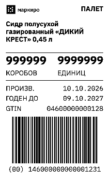
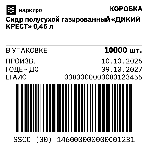
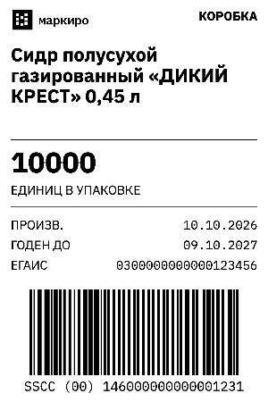
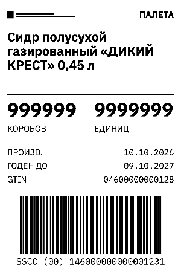

# Стандартные термоэтикетки: внедрение макетов

Ветка реализации: `codex/standard-labels-branding`, база
`origin/main` / `81b596d7bc113134d6c1aa4dd9cda4bd3a3415e0` после merge A4 PR #702.

## Результат

Обновлены 12 вариантов коробок 75×120, 100×100 и 100×150: полное или печатное
название, с датами или без дат. Для палетов обновлён 100×150 и добавлен 75×120.
Все варианты 58×40 сохраняют прежние спецификации и названия.

В шапке выводится монохромный логотип организации из настроек. Только подтверждённое
отсутствие логотипа выбирает встроенный Маркиро. Ошибка загрузки установленного
логотипа не становится разрешением подменить его. На Station и ТСД сохраняется
последний валидный кэш текущего владельца для работы офлайн.

Под наименование выделено четыре строки. На крупных палетах удалена смена;
количества, даты, реквизиты и SSCC разделены интервалами. Количества уменьшают
шрифт до указанного минимума при необходимости, без обрезки цифр.

## Обновление существующих организаций

Миграция `0185_standard_label_branding.sql` заменяет только точное совпадение
спецификации со старым стандартным шаблоном. Сохраняются ID, состояние enabled,
категория и ссылки default. Старый стандартный «Паллета 100×150» переименовывается
в «Палет 100×150» на месте. При конфликте имени строка не перезаписывается.
75×120 добавляется идемпотентно; существующая строка с таким именем не заменяется.

Пользовательские макеты, 58×40, A4/A5, сохранённые снапшоты смен и инвентаризаций
и байты дубликатов не переписываются. Неизменённые старые спецификации продолжают
печататься по прежним правилам. Повтор Windows с сохранённым растром использует
те же байты и не требует актуального логотипа; свежая генерация использует текущий
валидный кэш владельца. После завершённой доставки действует существующая
политика удаления растров; такой повтор регенерирует макет.

Новые элементы `organization_logo` и форматы текста требуют обновлённых клиентов
Station и ТСД. Перед применением миграции в рабочей среде нужен согласованный
выпуск совместимых клиентов. Эта задача не публикует и не развёртывает выпуск.
Порядок API → Station из приёмки A4 относится к выпуску A4 без этой миграции.
Для объединённого выпуска с новыми V1-логотипами действует порядок клиентов
Station/ТСД → API/0185: прежние клиенты не знают новый kind изображения.

На пустом кэше перед первой офлайн-печатью необходимо один раз синхронизировать
брендинг при доступном API.

## Печать и доступ

Логотип попадает в ZPL как `^GFA`, в TSPL как `BITMAP`, в Windows как часть
`mono-raster-v1`. Общие TypeScript/Kotlin фикстуры проверяют точные байты при
203 и 300 dpi. RAW и Windows-driver остаются независимыми режимами.

Station читает логотип только для организации текущего durable owner и текущего
credential digest; совпадение digest само по себе не открывает кэш другой организации.

Для ТСД добавлены приватные read-only маршруты
`GET /station/handheld-branding` и `GET /station/handheld-branding/logo/:revision`.
Кабинет и ключ обычной станции не имеют доступа к этим маршрутам. Проверяются
tenant, вид устройства, ревизия, MIME, размер, SHA-256 и размеры изображения.
Кэш привязан к серверу, организации, устройству и credential владельцу.

## GS1

100-миллиметровые шаблоны используют 4 dots при 203 dpi (X ≈ 0,5005 мм),
высоту штрихов не меньше 32 мм и свободные зоны не меньше 10X.
75×120 сохранён по прямому решению пользователя с ограничением:
X ≈ 0,3754 мм при 203 dpi меньше минимума 0,495 мм для общей логистической
дистрибуции ([GS1 Logistic Label Guideline](https://ref.gs1.org/guidelines/logistic-label/)). Это явно записано в `gs1Constraint` и показано в превью кабинета
и Station. Наличие SSCC не означает полной сертификации этикетки GS1.
Физическое качество, бумага, настройки драйвера и сканирование требуют
отдельного испытания отпечатка.

## Совместимость с A4

Реализация перенесена на main после merge A4 PR #702. Перенесён только
коммит термоэтикеток; изменения A4 повторно не включены в диапазон PR.
Миниатюра термоэтикетки вынесена в `thermal-thumbnail.ts`, а обзорное превью
A4 сохраняет оптимизацию из main. Исторические ресурсы A4 выбираются только
при наличии sheet snapshot; термоэтикетки продолжают использовать сохранённый bitmap.

На объединённом коде повторно прошли 18 браузерных сценариев A4/термоэтикеток,
1122 теста Domain, 19 тестов миграций, 115 API-тестов (один skip) и тест миниатюры A4.
Первый параллельный запуск Station начался до окончания сборки DB и получил
три сбоя Windows-печати на старой сборке SQLite-схемы. После сборки зависимостей
все 13 тестов box-printing прошли; повторный интеграционный набор Station
прошёл целиком: 6 файлов, 97 тестов. Повторные lint/typecheck/build:
19 задач прошли, без ошибок; в Admin остались пять прежних lint-предупреждений.

## Проверки

| Проверка                                                  | Результат                                                                                        |
| --------------------------------------------------------- | ------------------------------------------------------------------------------------------------ |
| Domain, полный набор, максимум 2 workers                  | 82 файла / 1111 тестов прошли                                                                    |
| Admin, полный набор                                       | 140 файлов / 1693 теста прошли                                                                   |
| Station, полный набор                                     | 161 файл / 2229 тестов прошли                                                                    |
| Station, новые сценарии логотипа и повторов               | 19 тестов прошли                                                                                 |
| Station, затронутые складские и инвентаризационные потоки | 82 теста прошли                                                                                  |
| API, целевые DB/e2e/авторизационные проверки              | 118 тестов прошли, один skip                                                                     |
| DB, миграции термоэтикеток, палетов и A4                  | 18 тестов прошли                                                                                 |
| Браузер: термоэтикетки и A4, обе реализации растра        | 18 сценариев прошли                                                                              |
| Android                                                   | полный unit/lint/debug прогон прошёл; финальные 73 label-теста, lintDebug и assembleDebug прошли |
| Общие файлы с текущими правками A4                        | clean three-way merge, 0 диагностик типов в Admin и Station                                      |
| lint/typecheck/build пяти изменённых пакетов              | 19 задач прошли; пять существующих предупреждений Admin в boxes/conflicts                        |
| format:check, git diff --check                            | прошли                                                                                           |

Полный DB-прогон: 129 файлов и 675 тестов прошли, один старый сценарий
`runtime-migrate.test.ts` превысил свой лимит 20 секунд. Повтор с тем же лимитом
воспроизвёл проблему. Отдельное сравнение исходной истории 184 и новой 185
получило одинаковые результаты: 35,95 и 33,22 секунды соответственно. Таймауты
и утверждения этого теста не менялись. Полный DB-набор в этой среде не зелёный.

Первый неограниченный Domain-прогон получил timeout одного A4 render-теста
при параллельной нагрузке; финальный прогон с двумя workers прошёл целиком.
Это свидетельство чувствительности к нагрузке, а не доказательство точной
первопричины. Лимиты тестов не увеличивались.

Полный API-прогон: 428 файлов / 4890 тестов прошли, 17 файлов / 115 тестов
пропущены; два Signer-теста получили 503, потому что пример конфигурации
не задаёт CHZ_TOKEN_ENCRYPTION_KEY. Отдельный повтор всего
`signer-agents.e2e.test.ts` с синтетическим ключом прошёл: 7 тестов. Ключи
рабочей среды не использовались. Полный набор с другим окружением повторно
не запускался; эти два исходных сбоя нельзя обозначать как зелёный первый прогон.

Реальные браузерные изображения вручную просмотрены. Физические ZPL/TSPL-принтеры,
Windows GDI, устройство ТСД и измерение качества штрихкода не проверялись:
в этой среде нет подключённого оборудования. RAW-байты и растровый контракт
проверены программно. CI, публикация, миграция рабочей базы и развёртывание
не выполнялись.

## Реальные превью

Скриншоты получены из Canvas того же рендера, который используется при печати.
В примерах намеренно проверены длинное название и большие количества.

