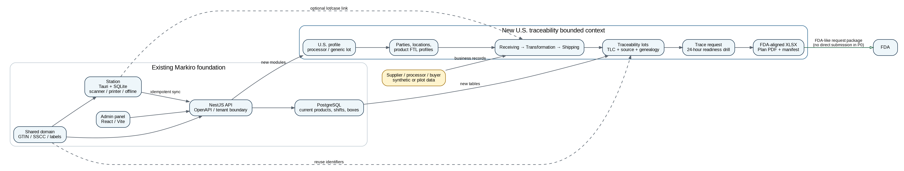

# Markiro U.S. Traceability: implementation plan

> Read the [shared MVP contract](mvp-contract.md) first. It resolves cross-slice scope and safety rules and supersedes conflicting draft recommendations below. Target design is not a completion claim; dated increment records below describe verified implementation scope.

- Source: MUS-001 v0.1 (2026-09-03), sections 11, 11.1, 11.2 and 15
- Status: US-00, US-01, US-02 and US-03 in progress as of 2026-09-08; no slice complete
- Owner: Vladislav Bogatyrev

Next scoped increment: [Receiving amendments, voids and current receiving basis](../superpowers/specs/2026-09-07-us-03-receiving-lifecycle-design.md).
The owner approved preserving lot identity/status/source locks on void and checking
current receipt basis separately and approved the written technical design on
2026-09-07. The [execution plan](../superpowers/plans/2026-09-07-us-03-receiving-lifecycle.md)
has completed its rules/contract foundation and additive storage (Tasks 1–3):
internal lot support-version, permanent roots, revision/void constraints and frozen-v3
relational validation. The original create/save/finalize bridge remains compatible.
Task 4 has internal revision detail/history/current-basis reads and QA-controlled
amend/void and amendment-save commands with durable replay, verified with concurrent
database changes. Amendment saving preserves exact predecessor bindings and lot
identity, requires current QA and leaves current support unchanged.
Internal readiness v4 now checks saved amendments against their predecessor,
current references and all affected lot support tokens in one read-only snapshot.
Internal explicit-v2 finalization now writes frozen v3 snapshots and atomically
replaces receipt support, preserving retained lot identity and historical content.
Internal live registry reads now select current/pending revisions or explicit all
history, with independent status filters and consistent summary pagination.
Original save/finalize now reject terminal or amendment targets with typed conflicts
after current authorization and exact historical replay. Saved results must match
the requested event, and real save/finalize-versus-void races preserve one winner.
Strict lifecycle error and command-specific result contracts are now available,
with original/revision input unions and real-store compatibility coverage.
Internal original-draft create/save commands now write versioned acknowledgements
and replay both historical formats without rewriting them. No-op saves leave the
draft, audit and lot basis unchanged; concurrent receipt collisions retry within
the same three-attempt limit.
Internal finalization now also accepts supported original input, rechecks v4
readiness and writes frozen v3 with a versioned acknowledgement. Its dual reader
replays old v1/v2 results exactly; original input cannot authorize an amendment.
Task 4/5 now have the coordinated original-workflow HTTP/OpenAPI and client switch:
new create/save/finalize acknowledgements, exact historical replay, live record/list
reads, readiness v4 and frozen v3. Every successful mutation is followed by a
current GET; if that read fails after a known acknowledgement, editing stays
blocked and the retry repeats only GET. Historical v1/v2 snapshots remain pinned.
The existing editor and frozen detail consume the live envelope and distinguish
void/amended state from frozen content. Explicit revision acknowledgement
validators now require captured pre-command context and check immutable identity,
versions, reasons and retained bindings.
The isolated server now exposes amend/void and history/basis endpoints and strict
explicit revision save/finalize inputs under the existing MFA/capability boundaries.
The browser client and exact proxy now support these commands and bounded reads,
requiring captured context for explicit mutation acknowledgements. Structured
conflicts retain strict bounded details; commands never silently retry or GET.
QA correction/void dialogs now capture the command and live context, lock duplicate
actions/navigation, recover unknown outcomes with the same command and retry only
GET after acknowledgement. Void previews identify lots losing their last basis;
unavailable previews block confirmation. The real local MFA/browser journey proved
amend replay, draft cancellation, receipt void, GET-only recovery, exact audits and
unchanged lot identities/status/source locks, with EN/ES light/dark dialog layouts
at 1440/1024/390. The amendment editor now verifies the frozen predecessor, allows
QA-only factual edits and explicit versioned save, retains line identity/bindings
through reorder/remove/add, and displays immutable comparison alongside the form
or in narrow-layout tabs. Real committed-but-lost save/replay preserves one draft
version advance and the unchanged original. EN/ES light/dark browser checks passed
twice; see [editor scope and evidence](receiving-browser.md#amendment-editor-and-frozen-comparison--2026-09-08).
Saved correction checks and explicit v2 QA finalization are now connected, including
fresh per-revision exemption review, retained/new/linked counts, captured-version
retry and GET-only acknowledged recovery. Full admin tests pass 1384/1384; real
Chromium proves exact replay, immutable lot/predecessor data, replaced basis and
exact audit in EN/ES light/dark at 1440/1024/390. See
[finalization scope and evidence](receiving-browser.md#amendment-check-and-finalization--2026-09-08).
Exact previous/current/pending navigation and paged revision history are connected,
with explicit current/all registry selection and all four status filters.
Failed navigation retains the displayed receipt and dirty input; retries read only
the selected record. See [history behavior](receiving-browser.md#revision-navigation-and-history--2026-09-08).
Independent current lot-basis cards are now connected through existing read-only
endpoints, with authoritative support counts, bounded pages, distinct loading/
error/missing states and exact revision links. Receipt and lot return contexts
survive successful and failed lookups; support never changes lot status or source
locks. See [basis behavior](lot-browser.md#current-receiving-basis--2026-09-08).
Ordinary TLC native input now preserves all 120 allowed Unicode points; a 121st
point remains visible with a save error and cannot alter the saved draft. The
shared contract is unchanged. Contextual EN/ES explanations now distinguish a
changed lifecycle, pending correction and locked retained-line fields. Existing
explicit reload/navigation preserves input until the user accepts replacement;
failed reads do not repeat commands. Real browser acceptance additionally proves
non-reused cancelled revision numbers, exact historical links and lost-response
void replay without a second audit or basis effect. A real two-receipt journey
also proves support counts 2 → 1 → 0, correct last-basis warnings, exact remaining
links, unchanged lot/frozen content and two exact void audits. Browser recovery
checks now also cover late detail reads after navigation, locked acknowledged
current-state reads and actual QA revoke/restore for correction and void. A
connected component test covers a late acknowledged read after QA loss while a
new dialog is open. Cross-task automated gates and acceptance reconciliation now
pass; the [dated verification checkpoint](../superpowers/plans/2026-09-07-us-03-receiving-lifecycle.md#cross-task-verification-checkpoint--2026-09-08)
separates that result from the remaining visual/language and external acceptance.
Tasks 4/5 and US-03 remain partial. See the dated storage, read and command checkpoints
in the execution plan for automated proof and remaining limits. Fixed-template Receiving
CSV follows separately, then US-04 Transformation with the P0 server case bridge.



Figure 1. Architecture scope of the U.S. adaptation as a bounded context inside the existing Markiro repository.

This plan breaks the U.S. adaptation into slices US-00..US-12 and defines an intentionally bounded MVP. Slice status is maintained here; per-requirement status is maintained in [requirements-traceability.md](requirements-traceability.md). Requirements themselves are in [requirements.md](requirements.md), acceptance gates and the MVP checklist in [acceptance.md](acceptance.md), the demo dataset in [demo-scenario.md](demo-scenario.md), the regulatory reasoning in [regulatory-basis.md](regulatory-basis.md), non-goals in [limitations.md](limitations.md), and the working protocol for coding agents in [agent-master-prompt.md](agent-master-prompt.md).

The original 115–156-hour estimate is unvalidated and does not include a proven deployment boundary. Re-estimate after US-00; eight weeks is not a commitment. Deliver the office workflow first. LOT-010/TRN-010 server-side links and synthetic cases are P0 under MUS-CR-001; all new Station behavior remains P1. US-11 owns required screenshots and video; US-12 owns optional landing and supplementary assets.

The requirement matrix owns per-requirement status and slice assignments. A boundary requirement assigned to US-00 is not evidenced until its implementing consumer passes the corresponding test.

## 1. Slices

| Slice | Result                                   | Requirements                        | Hours | Depends     | Status      |
| ----- | ---------------------------------------- | ----------------------------------- | ----- | ----------- | ----------- |
| US-00 | Deployment boundary + baseline + profile | REG-001..012, PRO-001..003, NFR-016 | 5–7   | -           | In progress |
| US-01 | Parties and locations                    | LOC-001..008                        | 8–10  | US-00       | In progress |
| US-02 | Product FTL profiles and TLC lots        | PRD-001..010, LOT-001..009          | 12–15 | US-01       | In progress |
| US-03 | Receiving CTE                            | REC-001..008, DOC-001..002          | 8–10  | US-02       | In progress |
| US-04 | Transformation and P0 server case bridge | TRN-001..014, LOT-010               | 14–18 | US-02/03    | In progress |
| US-05 | Shipping CTE                             | SHP-001..010                        | 8–11  | US-04       | In progress |
| US-06 | Trace graph, search, completeness        | TRC-001..010                        | 9–12  | US-03/04/05 | Not started |
| US-07 | FDA-aligned XLSX adapter                 | EXP-001..012                        | 12–16 | US-06       | In progress |
| US-08 | Traceability Plan                        | PLN-001..010                        | 7–10  | US-00/02    | In progress |
| US-09 | Trace request / mock recall              | RQ-001..008                         | 8–11  | US-06/07/08 | In progress |
| US-10 | Station/label lot link                   | STN-001..009                        | 8–12  | US-02/04    | Not started |
| US-11 | Demo seed, screenshots/video, release    | EVD-001..012                        | 10–14 | US-09       | Not started |
| US-12 | Optional landing and extra assets (P1)   | demo assets                         | 6–10  | US-11       | Not started |

Slice status values: Not started, In progress, Done. A slice is Done only when its Definition of Done from MUS-001 §10.2 is met and its verification report (see [acceptance.md](acceptance.md)) is filed.

The [current US-09 request/package design](../superpowers/specs/2026-10-04-us-09-trace-request-current-design.md) supersedes its historical draft. The owner approved the written design on 2026-10-04. Local implementation now includes additive request persistence/contracts, the transaction-aware source reader, complete scope selection, request lifecycle, validation/digest and atomic Prepare under the [selection/validation/freeze plan](../superpowers/plans/2026-10-04-us-09-selection-validation-freeze.md). These server steps have focused disposable-PostgreSQL evidence, independent task review and completed whole-stage integration review, including check-only CI ownership. The [local checkpoint](../superpowers/plans/2026-10-04-us-09-selection-validation-freeze.md#local-implementation-checkpoint--2026-10-04) separates this result from broad API and hosted acceptance. US-07 owns the frozen XLSX core, US-08 owns the immutable Plan PDF, and US-09 owns scoped freeze, distinct ready/incomplete outcomes, package publication and cabinet workflow. Worker and private publication subsequently progressed in the local increment below; request HTTP and cabinet integration remain pending.

The [frozen-payload foundation checkpoint](../superpowers/plans/2026-10-04-us-09-frozen-payload-foundation.md#local-implementer-checkpoint--2026-10-04) adds the shared saved-run verifier and the first two internal byte payloads, `validation.json` and `records.xlsx`. Local verification passes nine affected API suites (157/157, zero disposable-US-DB skips), API typecheck/lint/build, formatting/diff checks and 37/37 US development checks; both new suites run unconditionally in serial check-only CI. Both task reviews and final integration review are accepted; the controller independently verified evidence/Prepare (50/50), evidence/payloads (44/44), zero skips, and the isolation gates. This is an internal stage-3 subincrement, with no request package, HTTP, worker, storage, UI, publication or US-09 completion claim. The checkpoint retains the existing typed writer-failure taxonomy and separate broad API/external acceptance limits.

The [frozen-origin and pinned-Plan checkpoint](../superpowers/plans/2026-10-04-us-09-frozen-provenance-pinned-plan.md#accepted-local-implementation-checkpoint--2026-10-04) adds strict new-write v2 origin evidence with unchanged v1 replay/JSON/XLSX and a read-only reader for exact effective/superseded historical Plan PDF bytes. All three task reviews and final integration review are accepted. Final selected checks passed 179 request and 130 owner/Plan/export tests, zero skips; the controller reverified all 309 within the full API invocation. API typecheck/lint/build, formatting/diff and 37 isolation checks passed. The complete API is still non-green: eight unchanged primary-environment setup files failed, 3305 tests passed and 1411 skipped. The checkpoint retains inherited Vite/Turbo, standalone v1-plus-Plan-supersession and external acceptance limits. Positive origin attests demo tenant provisioning only; negative origin is not verified real operation. Report/ZIP/manifest/sums, worker, package publication, production build identity, HTTP/UI and hosted acceptance remain pending. US-09 stays In progress; no commit, push or release occurred.

The [accepted package-core checkpoint](../superpowers/plans/2026-10-04-us-09-package-core.md#accepted-local-implementation-checkpoint--2026-10-04) completes the internal report PDF, manifest, SHA256SUMS and deterministic ZIP component after five independent task reviews and approved final integration review, with no unresolved Critical/Important finding. Current selected gates pass 320 request/package tests across 14 files, plus 146 unaffected owner/Plan/export regressions, zero disposable-US-DB skips; amended integration is 14/14 after the test-only clean-checkout witness fix, superseding its original 13-case source/319 aggregate. API typecheck/lint/build, formatting/diff and 37 isolation tests pass. The five new suites have unconditional serial check-only CI ownership; locks/permissions and owned synthetic fixture boundaries remain unchanged. The refreshed complete API remains non-green: exit 1, 399 files (8 failed, 288 passed, 103 skipped), 3,445 tests passed and 1,411 skipped, with the same eight intentionally unavailable primary-environment setup files and no assertion failure. That broad run compiled the original 13-case test; the amended source is covered by fresh 14/14 integration and 320 selected tests, not a second broad run. Exact frozen visual acceptance covers 14 Task 2 pages only; four nonblocking coverage/evidence observations and the inherited Vite warning remain disclosed in the checkpoint. At that checkpoint worker and private package publication were pending; the subsequent increment below records their current local scope. Production build identity, HTTP/UI, remote CI and hosted/external acceptance remain pending; US-09 stays In progress. No commit, push or release occurred.

The [durable internal worker checkpoint](../superpowers/plans/2026-10-04-us-09-durable-package-worker.md#local-implementer-checkpoint--2026-10-05) now implements additive lease/attempt/checkpoint/object persistence, bounded one-run execution, immutable report/package reproduction, private synthetic storage, atomic publication and permanent cleanup fences. Tasks 1–7 are independently accepted, including actual transaction-outcome recovery and new service instance recovery; the 75-case integrated recovery/worker/package selection passed twice with zero skips. Task 8 adds exact serial check-only suite ownership: API 38 files / 809 tests and DB six files / 112 tests pass without skips; shared builds, selected domain/contracts, DB/API typecheck/lint/build, formatting/diff and 19 isolation tests pass. The full DB passes 780 tests with 141 opt-in skips. The sole refreshed full API remains non-green: 410 files (8 failed / 299 passed / 103 skipped), 3,716 passed / 1,411 skipped / zero failed assertions; nine primary-environment failed-suite groups include three secondary teardown diagnostics. These overlapping invocations are not summed. Independent Task 8 and final whole-increment reviews remain pending. Synthetic transport and deterministic test-only PostgreSQL clock projection do not establish live S3, hosted recovery, OS process restart, runtime/scheduler/shutdown, production build identity, HTTP/UI/downloads or remote CI/release acceptance. No package-core screenshot is worker proof. US-09 stays In progress; no commit, push or release occurred.

The subsequent [final-review fix checkpoint](../superpowers/plans/2026-10-04-us-09-durable-package-worker.md#final-review-fix-checkpoint--2026-10-05) supersedes the preceding worker review status: Task 8 was accepted, but final review required three Important fixes. One bounded corrupt queued-row disposition now preserves frozen facts/counters and records an exact system/original-initiator audit without inventing an attempt; final fresh DB-time guards roll back late checkpoint/intent/failure writes; renewal checks the old persisted expiry/deadline after both UPDATEs. Twenty-four new regressions cover real SHARE write barriers at expiry/deadline, corrupt-row progress with fresh healthy-actor authorization, and unsafe identity/reference rejection. Post-fix checks pass six affected suites / 146 tests and the selected 38 request/export/Plan suites / 833 tests, both zero skips, plus API typecheck/lint/build, formatting/diff and 19 isolation contracts. The earlier 809 selected tests and full DB 780 passed / 141 skipped and non-green full API 3,716 passed / 1,411 skipped with eight setup-failed files precede the three source-module and one test-file changes; full API/DB were not rerun or relabelled current. No primary environment was loaded. Independent scoped re-review remains pending, with no whole-increment acceptance claim. Schema, migrations, runtime, storage adapter, interfaces and release locks are unchanged; synthetic/local evidence and external limits remain distinct. US-09 stays In progress.

The [current US-06 design](../superpowers/specs/2026-09-27-us-06-current-trace-search-readiness-design.md) supersedes its earlier draft. Its P0 phases are server current trace, search/lot card, concrete readiness findings and U.S. office UI; TRC-007 and TRC-010 remain P1. This design checkpoint does not change the slice's implementation status.

Controller completion record, 2026-10-05: independent scoped re-review confirmed all three durable-worker findings addressed, with no new Critical/Important breakage, and accepted the local increment. This supersedes the pending worker review status in the historical checkpoints above. It does not establish a green full API gate, remote CI, runtime, hosted-storage/recovery, merge or release readiness. No source or test changed during this completion recording; US-09 remains In progress.

### US-09 separate local runtime checkpoint — 2026-10-05

The [worker runtime plan](../superpowers/plans/2026-10-05-us-09-worker-runtime.md)
implements the checked local build descriptor, serial loop, isolated resource
composition and explicit executable. Tasks 1–4 are independently accepted,
including actual SIGINT/SIGTERM drain, forced process exit, unchanged 120-second
lease recovery after SIGKILL, exact private bytes immediately after A exits and
before B starts, fresh authorization and forwarded-COMMIT/lost-reply recovery.
The corrected process matrix passed 11/11 twice (217.20/214.20 seconds), zero
skips. Those are local Node/PostgreSQL subprocess and provider-double results;
the clean fixture build identity is distinct from the dirty product checkout.

Task 5 adds unconditional check-only ownership for six build/loop/runtime/process
suites and compiled executable smoke, retaining explicit US DB isolation, shared
build order, serial DB/process selection and the 30-minute CI limit. Local checks
pass 93/93 in six new files (229.39 seconds) and 834/834 across 38 existing
worker/Requests/package/Plan/export files, both zero skips and without overlap.
API typecheck/lint/build and repository formatting/diff pass. The complete API
with both DB variables unset remains non-green: 416 files (8 setup-failed / 195
passed / 213 skipped), 1,986 tests passed / 3,259 skipped / zero failed assertions,
386.12 seconds. The same eight primary-environment setup files fail, with three
secondary teardown diagnostics; no primary env was loaded. Initial sandbox
EPERM probes are recorded separately and superseded by reviewed loopback runs.
Task and final review acceptance are tracked in the execution ledger and owner
handoff; these counts describe local checks. Publication from the
uncommitted checkout remains refused pending a separately authorized source
commit and rebuild. The API still starts independently with business readiness
closed; the subsequent Requests HTTP checkpoint below supersedes this earlier
HTTP/download/retry exclusion. EN/ES UI and hosted operation remain future work.
This checkpoint does not establish a green complete API, remote CI, real
S3, production identity, OS reboot, backup/restore or release acceptance. US-09
remains In progress; no stage/commit/push/PR or release occurred.

### US-09 Requests HTTP local checkpoint — 2026-10-05

The [Requests HTTP plan](../superpowers/plans/2026-10-05-us-09-requests-http.md)
implements strict public contracts, transaction-authorized bounded reads,
revision/digest-safe commands, operation-local checked build/private storage
resources, verified audited downloads and exactly 13 canonical US business routes.
Tasks 1–6 have independent acceptance, including actual loopback sessions/MFA
and binary response checks. This supersedes the earlier internal-only/pending
Requests HTTP boundary for the spec's exact routes; CORS `OPTIONS` remains a
protocol response. Task 7 and whole-increment review are recorded separately.

The HTTP process starts independently of the worker. Invalid/missing/dirty build
identity refuses Validate/Prepare locally while CRUD/reads remain available;
package storage remains private, optional and limited to the six existing fields.
Saved validation is not a fresh source check, ready incomplete is not export-ready,
and clean synthetic fixture identity does not attest the dirty product checkout.
Closing preserves accepted runs; download reauthorizes after verified I/O and
commits release audit before bytes. Exact unconditional serial CI ownership
preserves all old Request/worker/Plan/export gates and the 30-minute limit.

Local full contracts pass 1,020 tests and the original eight API suites pass
106, both zero skips. The separate 44-file regression recorded 937 passed /
2 old Plan-query ordinal failures; its accepted compatibility correction passes
the full focused 20-test file separately. The controller's one default API run
recorded 423 files (23 failed / 185 passed / 215 skipped) and 5,366 tests
(76 failed / 1,954 passed / 3,336 skipped), 408.75 seconds. Eleven EPERM files
subsequently pass 63/63 on bounded loopback; four new missing-URL test suites
received accepted mechanical gating, with 74 configured passes, zero skips,
74 unconfigured skips and invalid configured URL refusal before I/O. Eight prior
primary setup blockers remain untreated. No complete API repeat, green complete
API claim, fabricated 939-test green run or post-fix eight-only full result.

Exact elapsed, commands and proof limits are recorded in the linked plan and
Task 7 report. Static/format/diff/isolation and compiled smoke pass; dirty
product publication remains refused. Task 7 and whole-increment review are still
pending; these local checks do not prove remote CI. EN/ES cabinet transport/UI and an owned
synthetic browser journey remain the next product increment. No proxy/UI, real
MinIO/S3, hosted recovery, OS reboot, backup/restore, regulatory or release
acceptance is established. US-09 remains In progress and operational locks stay
closed; no stage/commit/push/PR, merge, release or deployment occurred.

### US-09 Requests HTTP final-fix checkpoint — 2026-10-05

Whole-increment review found that four owned HTTP lifecycle cases lacked a
configured CI owner. Two added unconditional serial commands now explicitly own
the lifecycle file and the new build-fixture unit file with the exact synthetic
US URL after existing dependency builds. Configured lifecycle checks pass 36/36;
fixture acquisition/disposal checks pass 2/2; all 42 tooling contracts pass,
zero skips. The earlier entry gate, exact eight HTTP suites and 30-minute budget
are retained. Acquisition failure removes only the new owned root and preserves
its original error; shared HTTP hooks now own both sibling suites at file scope.
Filtered first/second HTTP runs pass 9/4 cases (4/9 intentional filter skips),
and the complete file passes 13/13 with real sessions/MFA and verified exact
database/root removal and listener closure. A separate descriptor/resources
helper-consumer run passes 63/63. Counts belong to separate covering invocations.

Independent scoped re-review is pending. M1 universal historical attempt
chronology and M2 native-loader tooling remain explicitly deferred. The original
complete API remains non-green with eight primary setup blockers untreated;
there is no fresh complete API, old matrix repeat or fabricated green union.
No remote CI or release result is claimed. US-09 remains In progress; EN/ES
Requests cabinet/UI and an owned browser journey remain the next product slice.

### US-05 Shipping office UI checkpoint — 2026-09-27

The isolated U.S. Events workspace now opens Shipping drafts and saved records. Writers select
existing lots, an explicit quantity/UOM, ship-from and immediate subsequent recipient locations,
and reference documents; QA can check saved-version readiness, finalize, amend or void, including
cancellation of a pending amendment draft while its predecessor stays current. EN/ES readiness
blockers identify the affected field or line and give path-specific repair guidance. Frozen
ship-from, recipient and source Location Descriptions, Product Description, source reference and
document issuer are readable from saved snapshots without live master-data hydration or write
capability. Dates display MM/DD/YYYY in both languages, and audit instants use the tenant zone.
Shipping neither creates a TLC nor selects cases/SSCCs. The draft now reads a tenant-scoped,
event-derived current lot balance and origin UOM, with a contextual replacement preview for an
amendment. It shows an exact decimal projection and refresh control; finalization rechecks the
ledger under lock. Frozen Shipping detail keeps the recorded quantity and KDEs unchanged and
shows a separately labeled current recorded lot balance. That value is not a historical
before/after balance or warehouse stock; unknown and unavailable reads remain explicit.

The post-review local admin suite passed 1,575 tests across 137 files; the focused
Shipping/Events suites passed 26/26. Typecheck, lint and both
standard/US builds passed after that fix. The US-only CI workflow owns the new
admin tests; local isolation checks passed, but hosted CI has not run for this checkpoint. A
bounded Chromium smoke on a disposable database passed real MFA, a saved 100-case Receiving
origin, actionable EN/ES over-shipment blockers on a 200-case draft, correction and finalization
of a 60-case shipment, server readback, and EN/light plus ES/dark frozen-detail screenshots at
1024 px. This is local code/browser evidence, not a controlled 100-case US-11 demo,
FDA export, physical dispatch, screen-reader acceptance, or hosted deployment.

### US-04 server case bridge increment — 2026-09-26

The isolated U.S. API now has the [server case/SSCC bridge](../superpowers/specs/2026-09-26-us-04-server-case-bridge-design.md): tenant-scoped case lookup, output-lot active/history list, atomic manual link of 1–100 distinct valid SSCCs, and reasoned unlink by exact active link ID. The bridge stores link history, operation receipts and trusted synthetic provenance separately from shared boxes. A case may have only one active lot link; a new link requires a current finalized Transformation output origin. Voiding that origin retains old links with an explicit gap and still permits unlink. Active-link count is independent of immutable event quantity; cursor pages read live history and can reflect concurrent inserts. The US-only controller is allowlisted without mounting RU box or Station controllers.

At this server checkpoint, the controlled 100-case US-11 seed, unified Events UI and output-lot Cases panel remained pending. The later UI checkpoint below supersedes only the UI gap. The fixture's synthetic marker and automated checks do not establish physical closure, scanning, printing, a hosted U.S. deployment or regulatory acceptance.

### US-04 Events and Transformation office UI — 2026-09-27

The local office sidebar now opens a server-paginated mixed Events list with Receiving and
Transformation type/status/history/search filters. Typed Receiving editors, CSV and lot links
remain available. Transformation supports full draft replacement, saved-version readiness,
QA finalization/amendment/void, frozen detail and revision history, current/pinned genealogy,
and a separate Cases panel with audited links and synthetic/existing-record provenance.
EN/ES copy preserves identifier and quantity values. Cases counts are independent of event
quantity; void retains output lots and existing links with an explicit current-origin gap.

The 11 focused admin suites passed 70 tests locally; the full admin suite passed 1,535 tests
across 132 files without skips. Admin typecheck/lint and the standard and isolated US builds
passed (five existing RU hook warnings and the existing large-chunk advisory remain).
All 28 local Node isolation/proxy/ownership checks and the isolation checker passed;
repository formatting and diff checks passed. Hosted CI has not run for this local increment.
The disposable PostgreSQL browser
walkthrough `tools/us-development/test/transformation-flow.smoke.mjs` passed with real MFA:
mixed list, UI draft save, saved readiness, QA finalization, zero automatic case links,
Receiving filter/detail navigation and EN/ES at 1024 px with complete TLC/lot UUID access.
It uses `tools/us-development/browser-fixture.mjs`, creates only owned random child databases,
and captures only safe post-authentication states. The initial sandbox run was blocked by
loopback EPERM; the authorized local-runtime run passed. This is a local walkthrough, not
US-11 demo seeding or a hosted CI result.

The existing Receiving CSV companion and full Receiving browser regression also passed
after the Events entry migration, including exact retry/audit, lifecycle, revision/basis
navigation, multiple independent receiving bases and Unicode TLC boundaries. The mutation
observers recognize only the strictly validated read-only genealogy POST; other commands
remain checked exactly.

Briefs 03/04 now reflect the P0 lifecycle and exact `/cases` routes. The affected `.pen`
frames were not opened or revalidated and remain pending Pencil MCP acceptance. US-04 stays
In progress; US-05 Shipping and US-11 controlled 100-case seed remain open. Fluent Spanish,
screen-reader, hardware, scan/print, hosted CI and deployment acceptance remain separate.

### US-04 Transformation HTTP and Events API increment — 2026-09-27

The isolated U.S. API now exposes strict Transformation create/read/save/readiness/finalization/amendment/void/revision routes and a tenant-scoped, globally ordered Receiving/Transformation Events registry. The US controller allowlist and check-only workflow own the new contract and API suites. Local verification passed 8 focused contract tests and 86 tests across the five new API suites plus Receiving and Case HTTP regressions against disposable U.S. PostgreSQL child databases, without skips. The initial sandboxed database run was blocked by loopback `EPERM`; the authorized local-runtime rerun passed. This is local API evidence only. At this API checkpoint, Events/Transformation UI and browser walkthrough remained pending; the later office UI checkpoint above supersedes those two gaps. The 100-case seed, hosted CI and deployment remain pending; US-04 stays In progress.

### US-00 first increment — 2026-09-05

The [domain foundation plan](../superpowers/plans/2026-09-05-us-00-domain-foundation.md) implements explicit edition parsing, immutable profile allow-lists and feature policies, and edition-specific interface locale selection in `@markiro/domain`. Its 47 focused tests and the full 532-test domain suite pass, along with both domain typechecks and the build. The [design baseline](../design-briefs/us/08-design-baseline.md) contains 128 screens in 18 sections.

The separate US development API now consumes edition parsing and locale policy. Its validated entry rejects unsafe local configuration and production mode; the RU entry rejects explicit US configuration before auth/database setup. Metadata and liveness work, while business readiness deliberately remains unavailable. This is a metadata-only boundary, not an implemented office application. Persistent profiles, provisioning, authorization, frontend/build attestation and infrastructure verification remain open. No deployment or publication is included.

The [development isolation boundary](development-isolation.md) is now prepared locally on `codex/us-mvp`: inherited operational workflows are locked, check-only US CI is defined, and a separate synthetic dependency stack is configured. The [runtime entry plan](../superpowers/plans/2026-09-05-us-00-runtime-entry.md) records this runnable API increment and its limits. It does not complete end-to-end edition isolation or establish hosted infrastructure. US-00 remains In progress.

### US-00 profile persistence increment — 2026-09-05

The [profile persistence plan](../superpowers/plans/2026-09-05-us-00-profile-persistence.md) adds the profile table, a strict initial-provisioning contract and an internal transactional US settings store. It requires a current tenant-settings membership, an explicit US profile and an IANA timezone. The store serializes concurrent initial requests and writes profile, timezone and audit together. Identical retries do not create another audit event; different initial settings conflict. Profile switching and edits are not exposed by this provisioning operation.

Migration and store tests use randomly named disposable databases on the separate local US PostgreSQL. Existing RU defaults remain unchanged. At that increment the US HTTP composition had no profile endpoint or session adapter; the later increment below adds that integration. Requirement rows are not marked complete by storage-only proof.

### US-00 session and HTTP increment — 2026-09-05

The [session foundation](../superpowers/plans/2026-09-05-us-00-session-foundation.md) and [HTTP integration record](../superpowers/plans/2026-09-05-us-00-http-integration.md) add independent US cookies, mandatory per-session MFA, guarded organization selection and initial profile provisioning over the local US API. Real HTTP tests verify fresh membership/capability enforcement, exact profile audit, retry behavior, request boundaries, unavailable schema and safe database cancellation/shutdown.

The server never migrates or provisions users at startup. Overall business readiness stays unavailable; browser integration, recovery and remaining US-00 acceptance are still open. Explicit local synthetic-user provisioning is covered by the increment below. Release locks remain active. This is not completion of the slice or proof of hosted data-location requirements.

## 2. Dependency sequence

### Local owner increment — 2026-09-05

The [local synthetic-owner command](local-owner-provisioning.md) supplies explicit local identity bootstrap with atomic audit, collision/retry safeguards and no MFA bypass. It does not migrate or seed on startup, provision a profile or enable public signup. Tests use disposable US databases. The next US-00 integration surface is the edition-specific browser login/MFA/profile workflow; recovery, auth-event audit and hosted safeguards remain open.

### Browser client increment — 2026-09-05

The [US browser client foundation](browser-client-foundation.md) adds the isolated typed transport for login/MFA, organization selection and initial profile setup, with a shared strict response contract and real HTTP integration coverage. It is not imported by the RU entry. The subsequent browser increment below supplies the separate entry/build, proxy wiring and EN/ES screens; the current RU admin must not be pointed at the US API.

### Browser entry increment — 2026-09-05

The [local US browser flow](browser-entry.md) now supports password login, authenticator enrollment/challenge, backup-code login, organization selection and initial profile provisioning/readback. An independent Vite root outputs `dist-us`, imports no RU screens or translations, refuses non-US configuration, and attests the server before login. Real Chromium checks use the actual Vite proxy and disposable PostgreSQL, including cookie-safe logout during a held MFA request. English and Spanish, desktop/mobile and light/dark states were inspected. This is local access/profile functionality, not completion of US-00 or the operational MVP.

MUS-CR-001 confirms fixed-template Receiving CSV import/output (US-03), two response outcomes (US-07/09), and P0 server case links (US-04/06/11). Implement through the prerequisites below; do not build an isolated substitute pipeline. Retention calculation is implemented in the domain helper (36 tests); storage/hold enforcement and destructive-path checks remain tracked separately. Remaining US-00 acceptance includes recovery, auth-event audit and hosted safeguards. The explicit local owner command has not been applied to the base development database. Business work next follows US-01/02 without enabling deployment or declaring those remaining gates complete.

### US access increment — 2026-09-05

The [isolated US role matrix](access-foundation.md) now resolves the five traceability roles and the existing cabinet identities without extending RU capabilities. Current MFA principals reload role state, stored profile reads accept `traceability.read`, and initial provisioning remains owner/admin-only under a transactional membership lock. This is the first consumer of the policy; event/QA/export endpoints and role administration still need their own enforcement and denial tests. PRO-006 remains in progress.

### US-01 server increment — 2026-09-05

The [master-data foundation](master-data-foundation.md) adds separate US parties/locations, description snapshots, strict contracts, additive migration0115 and US-only CRUD/list/archive routes. Both profiles allow incomplete drafts; QA/manager/owner/admin can edit, other recognized US roles can read. Transactions reload permissions, validate the US profile, enforce tenant/parent boundaries and write full audit snapshots atomically. The remaining OpenAPI 400 union defect is corrected with full-schema regression coverage. The typed browser client, exact local proxy routes and connected EN/ES lists/forms are implemented. The office increment passes 1,071 admin tests and real Chromium CRUD/archive/read-only and held-request scenarios. Scoped final re-review is complete with no remaining Critical or Important findings; Minor picker-reselection residual US01-UI-01 is explicitly deferred in the foundation record. LOC-001/002/004/006 remain partial because finalized CTE consumers and historical exports are not delivered here. No deployment or publication is included.

The subsequent US01-UI-01 correction retains freshly resolved parent states across selection and search, closing the deferred picker defect. Full admin now passes 1,073 tests; focused master-data/app/client tests pass 66, and the existing real-browser flow passes. Independent scoped review has no remaining findings. No shared product schema was changed by this correction.

### US-02 catalog contract increment — 2026-09-05

Implemented `normalizeCatalogGtin` in the domain package and strict US product create/update/read schemas in platform-contracts. The package suites pass 627 domain tests and 166 contract tests, including 28 and 35 focused catalog tests respectively, with no skips. Typecheck, lint and builds pass for both packages. These are pure-rule/contract checks, not database or browser acceptance of a catalog workflow.

The owner approved a shared product model with optional GTIN for the two US profiles and required GTIN for RU, while keeping instances and databases separate. The [first catalog increment](../superpowers/plans/2026-09-05-us-02-catalog-contract-foundation.md) establishes the domain policy and strict US create/update/read contracts. It does not change nullable storage, expose catalog routes or implement FTL reviews/lots. PRD-007 runtime acceptance remains unimplemented until US writes, persistence and consumer denial tests are delivered together. The next increment must audit GTIN-dependent consumers and retain RU validation, operational payloads and barcode behavior before enabling null persistence. No deployment or publication is included.

### US-02 catalog persistence increment — 2026-09-05

The [catalog persistence plan](../superpowers/plans/2026-09-05-us-02-catalog-persistence.md) adds migration0116 and explicit guards for legacy GTIN-dependent consumers. The migration makes the shared product GTIN nullable without changing the active-GTIN unique index or tenant foreign keys. Existing rows receive an `updated_at` migration baseline, not a reconstructed modification history. RU DTOs, Station mirrors and label contracts remain non-null.

The US catalog API is implemented under `/traceability/catalog/products`. It supports bounded literal search, tenant-scoped reads, creation, partial edits and archive/restore. Each operation reloads current membership/profile in its transaction; real mutations write complete before/after audit snapshots atomically. Canonical no-op edits leave timestamps and audit untouched. Active non-null GTIN conflicts return `product_gtin_taken`; changes to GTIN with legacy shift, kiosk-assignment or inventory references return `product_gtin_locked`. Archive/restore preserves product UUIDs. RU readiness and request/response contracts are unchanged; there is no second catalog or exposed RU regulatory field.

Task reviews, the integrated review and one consolidated fix/rereview cycle are complete, with no open findings. The final corrections preserve the existing empty-box and inventory changed-GTIN errors, distinguish corrupt persisted data (sanitized 503) from invalid requests (400), verify every pre-existing product column across migration, and exercise a genuine canonical-GTIN mismatch separately from missing metadata.

Final local verification passes 169 US API tests in ten files without skips, including nine legacy operational-boundary cases, 21 catalog-store cases and nine real catalog HTTP cases, plus session/MFA and master-data regression. The six focused DB schema/migration cases pass on disposable US databases. Domain passes 627 tests; platform-contracts passes 178. The full DB suite passes 236 tests with 141 generic-infrastructure skips. Domain, contracts, DB and API typecheck, lint and build pass; isolation contracts pass 17 tests and compiled executable smoke passes four. No primary or base development database was migrated.

The broader API gate remains incomplete: 1505 tests pass and 1568 skip, while seven generic-DB suites fail setup because `DATABASE_URL` is deliberately unset. Skips and unavailable suites are not passing coverage. The real-pnpm invocation probe passes with Node 24's Corepack shim and the repository-declared pnpm; no toolchain files changed. The existing Vite configuration-loader warning remains visible. These checks establish no browser, hardware, provider or hosted acceptance.

This increment remains local and uncommitted. The catalog browser proxy remains closed; UI, FTL reviews and lots are still pending. US readiness remains 503, and no deployment, main merge or additional push is included.

### US-02 catalog browser increment — 2026-09-05

The [connected catalog workspace](catalog-browser.md) now supplies EN/ES product lists, bounded search, active/archived filters, pagination, current-record detail, creation, partial edits and archive/restore. Blank GTIN is supported, and canonical no-op edits do not send a mutation. Read-only users see no mutation controls. Shared Markiro components and tokens retain the existing light/dark and narrow-screen layouts; there are no RU screen or translation imports. Only exact catalog collection/UUID routes are added to the isolated local proxy.

Async list/detail fencing, mutation ownership through the post-write reload, dirty-close confirmation and translated safe errors protect the workflow. Scoped review identified two gaps, addressed by focused regression tests: successful mutations return keyboard focus to a stable catalog heading after the list settles, and a transient capability-refresh failure preserves the mounted draft while disabling writes. Permissions can be retried inside the form without losing its fields or automatically repeating the write. An explicit read denial still removes protected content, and session expiry exits the workspace. Spanish product status/filter wording uses product-specific forms.

The full admin suite passes 1,103 tests in 97 files without skips. Focused catalog client/component tests pass 30; the combined catalog/master-data regression passes 59. Typecheck, lint, US build and ordinary RU admin build pass. Lint retains five pre-existing RU hook warnings; the RU build retains its existing large-chunk warning. The 17 isolation contracts and local release-lock checker pass. Scoped independent re-review closes both Important findings with no remaining findings.

The real Chromium flow passes against an owned disposable US database with real MFA and HTTP mutations: GTIN-less creation, GTIN validation/canonical edit, conflict recovery, archive/restore with the same UUID, exact audit assertions, auditor read-only detail and keyboard focus/trapping. EN/ES, light/dark and 1440/1024/390px captures have no horizontal document overflow; the 390px auditor panel and its close control remain inside the viewport after its entrance animation. Screenshots were visually inspected. Permission-refresh outage/recovery is covered by component tests, not a fabricated business response in the real-browser scenario.

These checks do not rerun the full API/DB gates from the preceding persistence increment; their infrastructure limitations still apply. There is no hosted, native mobile, hardware or screen-reader acceptance, fluent Spanish review or pixel-level Pencil parity claim. US-02 and PRD-007 remain in progress: FTL review, extended Product Description and GTIN-less lot/CTE consumers are not implemented by this browser increment. No `.pen` edit, base/primary database migration, commit, push, main merge, release or deployment is included.

### US-02 product profile rules and contracts — 2026-09-05

The [product-profile foundation plan](../superpowers/plans/2026-09-05-us-02-product-profile-contracts.md) implements the five manual coverage statuses, profile-sensitive validation, Product Description components, a versioned ten-unit vocabulary and detached version-1 description snapshots. Positive coverage reviews require rationale, category and source URL/version; other non-unknown statuses require rationale. The assessment also requires server review provenance before reporting a reviewed classification. Unknown and exemption-review-required remain blocked prerequisites, and the generic profile never makes an FTR assessment. No rule infers a classification from a product name or RU CHZ group, fetches a source URL or claims package readiness.

Packaging values remain exact positive decimal strings within numeric(12,3), paired with an explicit unit; no coercion, rounding or conversion is performed. Snapshots carry separate copied components and canonical optional GTIN, with no live catalog references or embedded coverage verdict. The strict snapshot read schema preserves pinned text and decimal spelling rather than normalizing an existing artifact.

The full editable profile contract excludes client-selected tenant/profile and reviewer/time fields. Record contracts distinguish unsaved defaults from persisted reviews and reject incomplete provenance. This schema is not an authorization boundary: the next persistence/API increment must revalidate using trusted tenant context, reload capabilities, enforce field-group QA access, protect concurrent full-document writes, and stamp/audit changes transactionally. No profile route or table is added here; `/traceability/products/:productId` remains unavailable and the browser proxy remains closed to it.

Initial focused tests fail before implementation (62 domain and 60 contract cases), then pass. Full suites pass 689 domain and 238 contract tests without skips. Both package typechecks, lint and builds pass; API typecheck/build and 45 deployment/composition tests, the 71-test existing US browser-component/client regression, US browser build and 17 isolation contracts pass. Scoped independent review has no findings; full-worktree formatting and diff checks pass. The plan records the local-listener retry and remaining verification boundaries.

There is no new browser, HTTP, database, event/export, hardware or hosted acceptance in this rules-only increment. Prior browser/database evidence belongs to the dated preceding increments, not to FTL persistence. PRD requirements and US-02 remain partial. Changes stay local and uncommitted; no main edit, push, merge or release is included.

### US-02 product profile persistence and API — 2026-09-05

The [persistence plan](../superpowers/plans/2026-09-05-us-02-product-profile-persistence.md) adds migration0117 and tenant-composite 1:1 profile storage without modifying existing catalog data. The isolated US API exposes GET/PUT `/traceability/products/:productId`, with strict versioned input, server-resolved membership/profile and the existing session/MFA/Host/Origin/JSON boundaries. No RU controller or job is registered, and the browser proxy remains closed to this path.

Reads return revision 0 defaults without creating a row. Explicit saves start at revision 1; the product-row lock serializes concurrent first saves and later edits. Full PUT requires `expectedRevision`; divergent stale writes return 409 `product_profile_conflict`. Identical current saves and immediate retries preserve the entire response, timestamps and audit. Exact packaging values are string-padded to three decimals after strict validation, never rounded or converted. Saved descriptions are independent of later catalog renames.

Managers can edit descriptions but cannot change any coverage field; QA/owner/admin can review or reset coverage. The server stamps actual coverage changes and preserves those stamps for description-only edits. The generic profile rejects classification assertions. Historical reviewer IDs are retained without a live user FK, correcting the draft's deletion behavior so account removal does not erase review attribution. Every mutation and its full before/after audit events commit together; a forced audit failure rolls everything back.

Focused contract/schema tests and the initial HTTP route tests fail before their implementation. Fresh local checks pass 67 focused contract tests, 14 schema/migration tests, and 38 store/HTTP tests. Expanded US API/deployment checks pass 257 tests with no skips. Full contracts pass 245 tests; full DB passes 250 tests with 141 explicit non-US infrastructure skips because `DATABASE_URL` is intentionally unset. DB/contracts/API typechecks, lint and builds pass. Existing US browser-component/client regression passes 67 tests; the US browser build, 17 isolation contracts and four compiled executable checks pass. Review identified one malformed generic-profile provenance case; a failing real-DB regression reproduced it, the correction now rejects it without mutation, and re-review has no remaining findings.

The broad API package run is not green: 1,690 tests pass and 1,411 skip, while eight files fail setup/collection because primary auth/database variables are absent (with follow-on cleanup errors in three files). The final isolated 257-test set and API static/build gates were rerun after the review correction. Full-worktree formatting and diff checks are recorded in the plan; this is not full primary-infrastructure or release acceptance.

No FTL screen, lots, finalized CTE snapshot capture, export readiness, hosted/browser/hardware acceptance or release is included. Migrations were exercised only in owned disposable US databases, never the primary or base development database. Changes remain local and uncommitted.

### US-02 connected product-profile UI — 2026-09-06

The [profile browser increment](catalog-browser.md#product-profile-increment--2026-09-06) connects the existing versioned API to Products. Description, exact decimal packaging and manual coverage review are grouped in one isolated EN/ES form. The generic profile shows not-assessed applicability. QA-only coverage controls, server-owned reviewer/time, read-only inspection, conflict preservation and confirmed reload do not imply event/export readiness. Only the exact UUID item proxy is opened; collections, nested routes, RU routes and release jobs remain closed.

Focused tests were written before the client, proxy and UI implementation. The final full admin suite passes 1,121 tests across 99 files without skips; profile/app/catalog/master-data UI regression passes 75 tests across four files. API profile/store/HTTP regression passes 38 tests on disposable US databases. Admin typecheck and lint pass (zero errors, five existing RU hook warnings); US and RU builds pass with large-chunk advisories, and all 17 isolation contracts pass. JSDOM canvas/navigation warnings are not browser evidence. The broad API suite was not rerun for this frontend-only increment; its previously documented primary-environment failures are not resolved by these checks.

Real Chromium verifies initial GET without insertion, validation, exact decimal PUT, reviewer/time, current revision, saved no-op control, concurrent revision conflict, confirmed reload, exact audit actions and auditor restrictions. It also checks EN/ES and both themes at 1440, 1024 and 390 pixels, with no overflow, unexpected page errors, external requests or new persistent browser draft state. Screenshots were inspected. Only randomly owned fixture databases and loopback listeners were used; the base and primary databases were not provisioned or migrated. Local browser dependencies were reused read-only from the main checkout, and sandbox-local network restrictions required an explicit local verification permission retry.

A real-app regression exposed draft loss when language/theme rerenders changed the session callback identity. Stable callbacks now preserve the draft and avoid an unintended GET. Review found focus loss after access recovery and over-broad draft discard after QA revocation; both were reproduced by failing tests and fixed. Recovery restores the active heading, and a confirmed coverage-only discard retains permitted description/packaging edits without clearing a revision conflict. Re-review reports no remaining actionable findings.

US-02 remains partial: lots, CTE snapshot consumers, export gates, table-wide coverage summaries and history/source suggestions are unfinished. Fluent Spanish review, screen-reader/native-device checks and hosted operation are not covered by local Chromium. Shared frontend skills kept the form on existing components/tokens and made language/theme draft retention part of real-app verification. Changes remain local and uncommitted; no main edit, push, merge, deployment or release is included.

### US-02 lot domain foundation — 2026-09-06

The [lot foundation plan](../superpowers/plans/2026-09-06-us-02-lot-domain-foundation.md) adds pure domain rules and strict field/status contracts, not lot persistence or an interface. TLC entry trims only outer whitespace, rejects controls before trimming, preserves case, Unicode and formula-leading text, and counts the 120-character limit in Unicode code points. Persisted TLC validation does not silently repair a value. Demo suggestions use valid civil dates and make no uniqueness or assignment claim.

Assignment checks separate manual imported entry from receiving and transformation operations; reserved bases and unknown contexts fail closed. Manual status changes follow the complete six-status matrix; shipping recalculation cannot be selected in a client body. Tenant-filtered directed genealogy returns deterministic unique ancestors/descendants, detects a proposed cycle and terminates on existing cyclic input. A 15,000-edge chain is traversed without a depth cutoff. The caller still owns authorization, current/pinned revision selection, transaction isolation and completeness; none are inferred from traversal.

Focused RED/GREEN verification covers 107 domain and 51 contract tests. Full domain tests pass 796 tests across 44 files and full contracts pass 296 across 17 files, without skips. Both package typechecks, lint and builds pass; API/admin consumer typechecks and 17 isolation contracts pass. A test-only empty-array inference error was corrected without changing transition expectations. Independent read-only review found no actionable issues. The check-only US workflow includes the new contract tests; no remote CI run or release setting is claimed.

LOT-002/004/008/009 remain partial. Typed/resolved source identity, source-aware database uniqueness, finalization gaps, origin/snapshot capture, audit persistence, amendment-aware graph storage, routes/UI and case links are not implemented by this increment. The design explicitly removes the earlier nonblank-source shortcut and warns that locking only candidate endpoints cannot in general serialize concurrent graph mutations. No database, browser, hosted or hardware checks were run for this pure domain/contract change; previous dated acceptance remains separate. No local graph exists in this worktree, so Graphify's incremental update is inapplicable. Changes remain local and uncommitted; the main checkout, production data and release gates are untouched.

### US-02 lot persistence and API — 2026-09-06

The [lot persistence plan](../superpowers/plans/2026-09-06-us-02-lot-persistence.md) adds migration0118 and tenant-scoped imported-lot create/list/read plus QA status actions. The strict record contracts retain opaque TLCs and support a location, an exact typed web reference explicitly resolved to a tenant location, or a missing source on an incomplete record. No URL is fetched; scheme case is accepted without normalization. Source completeness is not inferred from a reference/ID. Same tenant/source/TLC is unique independently of product, including after archive; concurrent duplicates return one record/audit and a tenant-safe 409. GTIN-less products work in both US profiles.

QA status actions require current authorization, expected revision and a reason. Data and exact before/after audit commit in one transaction; concurrent divergent writes conflict, and only an identical immediate previous-revision retry by the same actor creates no additional audit. Historical lot actors and audit snapshots survive account deletion. Corrupt stored records, foreign references, archived master data and revoked memberships fail closed. The US controller exposes only four methods with generated OpenAPI; no RU controller or browser proxy path is opened, and readiness stays 503.

Focused RED/GREEN covered domain/source contracts, schema/migration, store and five new authenticated HTTP scenarios. Final lot store plus catalog/profile/lot HTTP regression passes 47 tests without skips; migration/schema checks pass 11 tests on owned disposable databases, including preservation of existing product/profile rows. Full domain tests pass 814 tests across 45 files; contracts pass 315 across 18 files, without skips. Full DB tests pass 261 tests with 141 primary-environment skips. Domain/contracts/DB/API typechecks, lint and builds pass; the admin consumer typecheck also passes. All 17 isolation contracts and three compiled-runtime smoke tests pass; the latter verify production refusal, closed readiness/RU routes and graceful shutdown. Repository formatting and diff checks pass.

The broad API run is not green: 1,724 tests pass and 1,411 skip, with eight failing files / nine failing suites. These are the existing billing, exchange, integrations and subscription-inventory suites that require absent primary DB/auth environment; three teardown errors follow their failed setup. The primary environment was not loaded, and these failures are not presented as US coverage or fixed by this increment. The separate final US API plus deployment/environment/health regression passes all 290 tests across 16 files, without skips.

Independent read-only review found two actionable issues: a current-revision self-transition was treated as a retry, and uppercase HTTP schemes were rejected. Both were reproduced by failing tests and fixed; re-review reports no remaining actionable findings. This increment does not implement lot UI, source/identity corrections, event origin/snapshots, genealogy storage, completeness/finalization, event-derived balances or case links. No new browser, hosted, hardware or external-service acceptance is claimed. Migrations touched only owned disposable US databases, not the base or primary database. No local Graphify graph exists, so no incremental update applies. Changes stay uncommitted in `codex/us-mvp`; the primary checkout and release locks are preserved, with no push, merge or deployment.

### US branch checkpoint — 2026-09-06

Commit `bbe7c1e917cbb89996d9bcecf945eb2388367e46` (`feat(us): checkpoint catalog profiles and lot persistence`) was pushed to `codex/us-mvp` and verified against the remote branch. It contains the preceding catalog/profile/lot increments; their earlier local/uncommitted notes above remain historical. The check-only [US development isolation run](https://github.com/thevladbog/markiro/actions/runs/33996348724) succeeded for this exact commit. No PR, main merge, deployment, release or operational workflow dispatch was performed.

### US-02 lot source corrections — 2026-09-06

The owner approved source-only correction while preserving lot UUID, TLC and product. PATCH `/traceability/lots/:id/source` requires the current revision, a trimmed reason and current `traceability.master_data.write` permission (the same capability as lot creation). It can add, replace or withdraw a source, without claiming completeness. Target locations/references must belong to the active tenant and remain non-archived. All identity, actor, tenant, assignment and lock fields are rejected in the strict body.

Actual changes lock the lot row, increment revision and atomically write exact `traceability.lot.source_changed` before/after audit with reason and server request ID. Unchanged current-revision sources are no-ops; identical same-actor immediate previous-revision retries require the same reason. Status and source changes invalidate each other's retry metadata. Divergent concurrent writes return 409; a conflicting source/TLC correction rolls back through a savepoint and returns only the same-tenant duplicate ID. Audit failure rolls back the source, revision and metadata together.

Additive migration0119 preserves existing rows, adds nullable internal `last_source_reason` and server-owned `source_locked_at`, and guards frozen identity with a hand-maintained trigger. Responses explicitly include `sourceLockedAt`; no API can set, clear or replace it. A nonnull lock blocks every source command, including no-ops/retries, without blocking valid QA status changes. The first latch cannot also replace identity. Future finalizers must use consistent row-lock ordering and latch the unchanged lot in the same transaction as immutable event snapshots; void/amendment must never unlock it. Concurrency tests simulate the lock transaction committing or rolling back, not an implemented event finalizer.

Focused RED/GREEN reproduced the absent source contract/store/HTTP route and missing database lock enforcement. Independent read-only review then found that a combined first-latch/source replacement bypassed the trigger. A failing database test reproduced it; the fix now blocks identity changes whenever either the old or new lock is set. Regression covers source, TLC, assignment basis, product, UUID and tenant replacement, unchanged first latching and later irreversible locking. Re-review found no actionable issues.

Full contracts pass 317 tests without skips. Final DB tests pass 267 with 141 primary-environment skips; the new migration has five passing real-PostgreSQL cases. Contracts/DB/API typechecks, lint and builds pass, as does the admin consumer typecheck. All 17 isolation contracts and four compiled-runtime smoke checks pass. Snapshot comparison confirms that migration0119 changes only the lot table and preserves the snapshot chain. The final isolated US API plus deployment/environment/health regression passes 310 tests across 16 files, without skips. The broad API run has 1,744 passing tests and 1,411 skips, with eight failing files / nine suites requiring absent primary DB/auth configuration and three cascading teardown errors. That environment was intentionally not loaded; this broad gate is not green.

This increment changes contracts, DB schema/migration, the isolated lot store/controller, tests, check-only CI test selection and US documentation. No new browser/UI, finalized-event, hosted or hardware validation is claimed. Only owned disposable US databases were migrated; the base US database and primary checkout/data were untouched. There is no local Graphify graph to update. Source-correction changes remain local and uncommitted after the checkpoint above; release locks stay in place. Lot UI, event integration/completeness, genealogy storage, balances and P0 server case links remain pending.

### US-02 connected lot UI — 2026-09-06

The [lot browser increment](lot-browser.md) connects the registry, imported creation, current detail, approved source correction and QA-only manual status changes. Strict client commands, exact proxy routes, EN/ES shared components, current reference labels and domain transitions remain within the isolated workspace. Historical actor IDs are not invented names; reference labels are explicitly not event snapshots. Source identity and revision rules remain server-owned.

Failing tests preceded client/proxy/UI implementation and review fixes. Review reproduced accidental save on Enter in reference search, cancellation bypassing the known-conflict reload requirement, and a later authentication denial hidden by a faster reference-data failure. Regressions cover each fix, duplicate navigation, held writes, permissions and translated drafts. The real local browser exercises imported creation, source correction, status change and exact audit against its own disposable database, plus responsive EN/ES/light/dark screenshots. Business responses are not mocked in the browser scenario. Final scoped re-review reports no remaining blockers.

Final local verification passes 1,146 admin tests across 101 files without skips, including 25 focused lot client/UI tests. Admin typecheck, lint and both RU/US builds pass; five existing RU hook warnings and chunk-size advisories remain. All 17 isolation contracts, the release-lock checker, root formatting and scoped whitespace checks pass. The final real Chromium scenario and actual Vite/API proxy smoke both pass on owned disposable US databases; desktop EN and narrow dark ES screenshots were visually inspected. JSDOM canvas/navigation warnings are not browser evidence. Full primary API/infrastructure, hosted operation, hardware, native-device/screen-reader and fluent Spanish acceptance were not rerun or claimed.

US-02 remains partial: event consumers/finalization, genealogy storage, balances, case links and export are not implemented. This increment changes only isolated frontend/client/proxy, tests, check-only CI selection and US documentation. Shared frontend design guidance kept the UI on existing components/tokens and the approved grouped layout. Main-checkout state is unchanged; no `.pen` writes, commit, push, merge, release, publication or deployment are included.

### US-03 receiving input foundation — 2026-09-06

The [input-foundation plan](../superpowers/plans/2026-09-06-us-03-receiving-input-foundation.md) adds pure domain rules for exact positive decimal quantities and Gregorian civil dates, plus strict shared contracts for reference-document metadata, lossless snapshot reads and explicitly incomplete receiving drafts. Quantities remain strings within the designed `numeric(18,3)` range; no rounding, timezone conversion, unit conversion or default identity is introduced. Drafts preserve ordered lines, nullable missing values and existing typed TLC/source rules. Unique document links and line/document limits reject malformed requests without dropping entries. Document type and opaque number are first-class data; all nine types are supported without a binary attachment.

RED/GREEN tests preceded scalar and contract implementation. A further regression reproduced UUID case normalization during snapshot reads; the snapshot validator now preserves stored spelling while entry UUID validation remains canonical. Independent read-only review reports no remaining scoped findings. Full domain verification passes 865 tests across 46 files, and full contracts pass 381 across 19 files, with no skips; both packages pass typecheck, lint and build. Existing US browser-client regression passes 68 tests, and isolated API entry/environment/health regression passes 59; both consumer typechecks pass. The new contract suite is included in the existing check-only US workflow.

All 17 isolation contracts, the local release-lock checker, repository formatting and diff checks pass. US-03 remains in progress: this increment adds no API routes, database persistence, live tenant/reference validation, completeness decision, event finalization, frozen snapshot publication, revision lifecycle, UI or CSV workflow. Browser, database, hosted, hardware and external-service acceptance were not exercised by these input tests. Before persistence work, reconcile the old draft's routes/auth composition, nullable draft columns, event timezone, exempt-supplier TLC assignment and downstream revision/void rules against the shared MVP contract and current isolated code. No primary environment was loaded and no database was changed. Work remains local in `codex/us-mvp`, with no commit, push, merge, release or deployment.

### US-03 reference document persistence and API — 2026-09-06

The [document persistence plan](../superpowers/plans/2026-09-06-us-03-reference-document-persistence.md) adds strict record/query/list contracts, the additive `reference_documents` table in migration0120, a transactional store and isolated create/list/detail API. All nine types retain separate type/number data, optional issuer/date/notes and historical attribution. Number identity is tenant/type/issuer-scoped, case-sensitive and retained across archival, with separate null-issuer uniqueness. Duplicate creation returns 409 without overwriting data or adding audit.

Current membership/profile locks protect reads and writes; creation permits receiving, transformation or shipping writers. A supplied issuer must be active and tenant-owned, with a lock through creation and exact before/after audit commit. Audit failure rolls the document back. Filters are bounded, search metacharacters escaped and stored output validated without repair. Actual MFA HTTP tests cover trusted Host/Origin, strict body/query, foreign data, live role changes, server request IDs, safe errors, OpenAPI and still-unmounted event/edit/archive/attachment/RU paths.

Failing tests preceded contracts, schema, store and HTTP implementation. Independent review found PostgreSQL-unsafe search text could return 503 or be rewritten by the driver. Contract/store/HTTP tests reproduced it; the document-local query now rejects NUL/lone surrogates with 400, preserving valid Unicode, trim and length bounds. Re-review reports no remaining actionable findings.

Final contracts pass 400 tests across 20 files without skips. DB tests pass 278 with 141 primary-environment skips; the new schema/migration tests pass all 11 cases on disposable PostgreSQL. Contracts/DB/API typecheck, lint and builds pass, as does the admin consumer typecheck. The isolated US API plus entry/environment/health regression passes 335 tests across 17 files without skips, including 18 document-store and seven new document HTTP tests. All 17 isolation contracts and four compiled-runtime smoke checks pass; release readiness remains closed. Migration snapshot comparison confirms only the new document table/enum and an intact chain.

The broad API run passes 1,769 tests and skips 1,411, but is not green: eight primary-product files fail in setup. A diagnostic rerun confirms nine failed suites caused by absent primary DB/auth configuration and three cascading teardown errors. The primary environment was intentionally not loaded. No new browser/UI, hosted, hardware, attachment or finalized-event acceptance is claimed. Only owned disposable synthetic US databases were migrated; neither the base US nor primary database was migrated. Work remains local and uncommitted in `codex/us-mvp`, with no push, PR, release, merge, deployment or change to operational workflow locks.

Repository-wide formatting and diff checks pass, and the post-format document store/catalog HTTP rerun passes all 46 tests without skips. Receiving persistence, event links, completeness/finalization, frozen snapshots, revision lifecycle, document UI and CSV remain pending. DOC-001/002 and INT-001 stay in progress. The next step is revisioned receiving draft storage using the existing input contracts and tenant-owned reference documents; it must preserve incomplete input and the shared MVP revision/source rules.

### US-03 receiving draft persistence and API — 2026-09-07

The [receiving draft plan](../superpowers/plans/2026-09-06-us-03-receiving-draft-persistence.md) implements the approved incomplete-draft boundary: create, read and full replacement in the isolated US API. Migration0121 adds a draft-only event header, ordered rows/document links, tenant/year number counters and durable operation receipts. `draftVersion` advances only for changed saves; confirmed-event `revision` stays 1. Exact quantity spelling, calendar dates, captured timezone and stable event identity are retained.

Current membership/profile locks precede every request and replay. Changed saves validate tenant-owned active references without enforcing finalization completeness. Same-key retries return their original response even after subsequent changes or a different current writer; different input with that key conflicts. Stale new-key saves conflict before no-op detection. Header, children, operation receipt and exact before/after audit share one commit. Tests cover concurrent requests and audit rollback. No lot/source lock/balance is written, and no confirmed snapshots are fabricated.

POST `/traceability/receiving` and GET/PUT `/traceability/receiving/:id` require actual US session/MFA and current capabilities. Only receiving POST/PUT receives a 256 KiB body limit; other paths stay at 16 KiB. Strict contracts and OpenAPI preserve server-owned identity/actors and safe errors. List/search, UI/proxy, CSV, finalization, amendment, void, export and hosted acceptance remain pending. REC-001/002/003, DOC-001 and INT-001 remain in progress, not evidenced as complete. See the plan's verification section for final checks and limitations.

### US-03 connected receiving drafts — 2026-09-07

The [receiving browser record](receiving-browser.md) adds a saved-draft registry and a grouped editor: receiving details, selected product/lot line and reference documents. The new tenant-scoped GET collection has literal event-number search and bounded summary pagination. Existing create/read/save persistence now has an EN/ES interface with explicit saves, version conflicts and same-command recovery after an unknown result. Metadata creation supports all nine reference-document types; links are saved with the receipt, not silently persisted on selection.

Client validation rejects mismatched acknowledgements without clearing input or retry identity. A populated TLC source cannot be cleared by changing its type without confirmation. Session loss continues to clear protected transient state; there is no cross-session draft persistence. No finalization, CSV, lot assignment, stock mutation, confirmed-event snapshots or lifecycle command is added. REC-001/002/003, DOC-001/002 and INT-001 remain in progress. Existing Markiro components/tokens and grouped layout were retained through the frontend guidance; no `.pen` modification is included.

Final local verification passes 1,192 admin tests across 104 files, including 43 focused receiving client/UI/reference tests; 379 isolated API tests across 19 files; and 407 shared-contract tests across 21 files, all without skips. Admin/API/contracts typecheck, lint and build pass, including both primary and isolated US browser builds. Five unchanged RU hook warnings and large-chunk advisories remain. The primary API/infrastructure suite was not rerun; its earlier environment gaps are not resolved by these US results.

The final real Chromium flow passes save-after-lost-response recovery, reload/reopen, exact audit verification and concurrent-version conflict with retained input. It exercises both locales/themes at 1440/1024/390 pixels; desktop EN and narrow dark ES screenshots were visually inspected. The actual Vite/API proxy smoke, all 17 isolation contracts, local release-lock checker, repository formatting and whitespace checks pass. Independent review reports no remaining blocking findings after response-validation and source-confirmation fixes. Hosted operation, native devices, screen readers and fluent Spanish acceptance remain unverified. Work stays local in the isolated `codex/us-mvp` worktree, with no commit, push, merge or deployment.

### US-03 saved-draft data check — 2026-09-07

The [saved-data check](receiving-browser.md#saved-draft-data-check--2026-09-07) adds a pure domain assessment, strict query/result contracts, tenant-scoped read-only API and an EN/ES panel in the existing receiving editor. One repeatable-read transaction checks the requested saved version with current references and returns a rule version, check time and input digest. Header, numbered line and document findings include missing descriptions, inactive references, unresolved product coverage, mismatched linked lots and duplicate create identities. The generic profile explicitly leaves applicability unassessed; an exempt-supplier flag cannot substitute for the future QA-reviewed basis or TLC assignment.

The interface checks only on request, never saves automatically, and invalidates results after edits (including edit-and-revert), save attempts or reloads. Late replies cannot restore old results. A complete result is limited to the saved data at check time; it is not finalized/export-ready/compliant status. No audit, receipt, draft, lot or source lock is written by checking. Finalization, frozen snapshots, reviewed exempt receiving and cross-event completeness remain pending; US-03 and REC-001/002 remain in progress.

Focused failing tests preceded implementation. Final local gates pass: 877 domain tests (47 files), 411 contract tests (22 files), 1,206 admin tests (106 files), and 395 isolated API/entry/environment/health tests (20 files), without skips. The final receiving client/UI subset passes 57 tests. Domain/contracts/admin/API typecheck, lint and builds pass, including both primary and isolated US browser builds; five existing primary UI hook warnings and large-chunk advisories remain. All 17 isolation contracts, release-lock checker, repository formatting and whitespace checks pass. Independent source/test review reports no remaining actionable findings; it did not independently rerun tests.

The real Chromium journey verifies explicit saved-data checks, blocked findings, edit-and-revert invalidation, stable digest on unchanged input, changed digest after saved-version advancement, and exact unchanged receiving audit counts alongside the existing save-recovery/conflict flows. Both locales/themes at 1440/1024/390 pixels have no page overflow, and every finding and scope note can be scrolled above the sticky save bar. A diagnostic showed that viewport intersection alone could ignore that bar in the test; explicit scroll positioning fixed the assertion without changing product layout. Final desktop EN and narrow dark ES captures were visually inspected. Actual proxy smoke confirms the narrow readiness allowlist and refusal of extra/nested commands. No hosted environment, physical devices, screen reader or fluent Spanish acceptance was exercised.

No migration, commit, push, merge, deployment or release-setting change is included in this readiness increment. The full primary API/infrastructure suite is not rerun because its required primary environment is intentionally outside this isolated increment. Existing primary-checkout changes are unchanged. The frontend guidance retained Markiro components/tokens and the existing grouped layout rather than introducing a separate visual system.

1. US-00: edition, provisioning, authorization, data-location inventory and deployment design.
2. US-01/02: parties, locations, product profiles and lots.
3. US-03/04/05: receiving, standalone transformation and shipping.
4. US-06: trace and completeness; US-08 plan can proceed after master data.
5. US-07/09: workbook mapping, immutable request snapshot and package.
6. US-11: reproducible seed, screenshots/video, deployed smoke checks and release evidence.
7. P1: US-10 Station/hardware integration and US-12 landing/extra assets.

Slice hour ranges below are historical planning inputs, not delivery promises. Infrastructure purchase and publication require separate approval.

## 3. Critical path

```text
Profile → locations/products → lots → receiving → transformation → shipping →
trace → export + plan → mock request → release/evidence.
```

Station integration must not block the main critical path. US-10 remains P1: the administrative end-to-end workflow, generated artifacts and repeatable demo already form the MVP.

## 4. MVP boundary

### 4.1 P0: required for the MVP

- this approved specification and the regulatory source register;
- working code for Receiving, Transformation, Shipping, TLC/source, genealogy, plan, request and XLSX;
- reproducible synthetic fresh-cut apple demo;
- tagged public release with commit SHA and hashes;
- CI/test report and limitations;
- architecture/data dictionary/requirement traceability;
- generated XLSX, plan PDF, validation report, request report, manifest;
- 12–18 screenshots and a 5–8 minute English video;
- a dedicated U.S. deployment whose persisted production surfaces are not hosted in the Russian Federation.

### 4.2 P1: product hardening that does not block the MVP

- review by a U.S. food-safety/traceability professional;
- structured feedback from industry practitioners;
- design-partner or limited pilot evaluation;
- Station offline case-to-lot demonstration;
- deeper imports, partner mappings and operational controls.

### 4.3 Future product scope

The MVP does not include all CTEs and exemptions, direct FDA integration, EPCIS, RFID, full EDI, commercial billing, self-service onboarding, multi-region operations or enterprise certification. [limitations.md](limitations.md) records the complete boundary.

### 4.4 Why this remains an MVP

The MVP implements one synthetic processor scenario with three CTEs, one trace path and one export package. It deliberately omits broad integrations, additional supply-chain roles, commercial operations and enterprise hardening. Detailed requirements preserve correctness inside that narrow workflow; they do not turn the MVP into a complete production platform.

## 5. Risks and scope control

P/I = probability / impact.

| ID   | Risk                               | P/I           | Mitigation                                                                            |
| ---- | ---------------------------------- | ------------- | ------------------------------------------------------------------------------------- |
| R-01 | Regulatory baseline changes        | Medium/High   | Source refresh per release; versioned adapters; specialist review.                    |
| R-02 | Scope creep into full U.S. ERP     | High/High     | Only CTE/lot/request/export; no accounting/inventory rebuild.                         |
| R-03 | Automatic legal classification     | Medium/High   | Manual reviewed coverage status; disclaimer; no exemptions engine.                    |
| R-04 | Overengineering item serialization | High/Medium   | Lot-level core; SSCC/case optional; no item requirement.                              |
| R-05 | Limited U.S. product feedback      | Medium/Medium | Structured reviews with food-industry practitioners after the MVP works.              |
| R-06 | Export diverges from FDA template  | Medium/High   | Versioned field registry + golden fixtures + source mapping review.                   |
| R-07 | Russian workflow regression        | Low/High      | Feature profiles, additive migrations, full repo gates.                               |
| R-08 | Synthetic demo looks artificial    | Medium/Medium | Coherent quantities/docs; external reviewer; show real Markiro foundation separately. |
| R-09 | Evidence claims exceed tests       | Medium/High   | Verification report separates automated/browser/hardware/external.                    |
| R-10 | Personal/confidential data leak    | Low/High      | U.S.-hosted data plane, synthetic demo, privacy scan, redaction and access audit.     |
| R-11 | Estimate does not cover scope      | Medium/Medium | Station/EPCIS/EDI are P1/P2; protect critical path.                                   |
| R-12 | Product presented as legal advice  | Medium/High   | Claim language matrix and clear product limitations.                                  |

### US-03 ordinary receiving finalization — 2026-09-07

The [approved ordinary-finalization design](../superpowers/specs/2026-09-07-us-03-ordinary-receiving-finalization-design.md) is connected through shared strict contracts, additive migration0122, atomic US-only command/read APIs and the [Receiving browser](receiving-browser.md#ordinary-finalization--2026-09-07). Current QA explicitly confirms a saved complete check; exact identifiers, decimal quantities and captured civil date/timezone are preserved. Mixed create/link lots, permanent source latches, immutable history and exact audit commit together. Replay requires current authorization and cannot repeat effects. Older draft/readiness-only exclusions above remain the historical record of those increments and are superseded only for ordinary finalization.

Client/UI proof covers acknowledgement correlation (event/version/digest), typed 409 findings, dialog cancellation, exact BigInt totals, QA loss/restoration, dirty documents, late checks, double submission, unknown same-command retries, historical save recovery and failed current-record reload. Post-integration disposable DB checks passed 22/22; ten affected API suites passed 284/284. The real local browser journey passed in 25.78 seconds, including stale references, genuinely committed response loss, frozen labels after live edits, exact lot/back navigation even after failed GET, and operator denial. Confirmation/history were exercised in EN/ES light/dark at 1440/1024/390, with keyboard and overflow assertions; representative safe screenshots were inspected. Actual proxy smoke and 17 isolation/release-lock contracts passed.

After the final source freeze, all 1,225 admin tests passed across 108 files in 179.59 seconds, with no skips. Admin typecheck, lint, primary build and US build passed; five existing primary-app hook warnings, build chunk-size notices and expected jsdom canvas/navigation warnings remain. The full legacy API suite was not repeated: its eight primary-environment setup failures remain an explicit pre-existing limit. No primary environment/base migration, hosted/hardware/native-device/screen-reader check, fluent Spanish acceptance, commit, publication or release occurred.

A separate controller run after the last UI recovery guard passed the complete local Chromium journey again: 1/1, no skips, 24.75 seconds (26.56 seconds including process setup/cleanup). This closes the timing gap between the earlier browser run and final source freeze. The final run's narrow dark ES confirmation and tablet light ES history were also visually inspected; no clipping or branding regression was observed. This remains synthetic local evidence, not hosted acceptance.

Independent task reviews and the final cross-layer integration review are complete with no remaining actionable Critical, Important or Minor findings. The final review was read-only and assessed the recorded tests/browser evidence without rerunning broad suites. Its approval covers this isolated ordinary-finalization increment only; it provides no merge or release authorization.

US-03 and the MVP remain In progress. Exempt-supplier receiving is the next P0 increment; amendment/void, Transformation, Shipping, genealogy, balances, CSV and export remain unfinished. Ordinary finalization does not establish export eligibility or a regulatory conclusion.

### US-03 exempt-supplier Receiving — design decision, 2026-09-07

The owner approved receipt-specific, per-line QA review at finalization, with
mandatory rationale and supporting source URL. Existing TLC/source identity is
preserved; only absence of an assigned TLC allows a separate own-code proposal
at the receiving site. No supplier-wide exemption registry or automatic legal
classification is included. The [technical specification](../superpowers/specs/2026-09-07-us-03-exempt-supplier-receiving-design.md)
was approved 2026-09-07. The [implementation plan](../superpowers/plans/2026-09-07-us-03-exempt-supplier-receiving.md)
separates pure input rules, additive storage/frozen contracts, atomic API activation
and the connected review interface. Task 1 (pure rules and strict primitives)
passed its independent review on 2026-09-07. Task 2 additive storage and frozen-v2
contracts also passed review after a timestamp-identity correction. Task 3 active
API/readiness/finalization and legacy compatibility passed independent review;
the connected per-line QA interface and real-browser acceptance remain pending.
Design brief03 and its mirrored open question reflect this decision; earlier unconditional source
replacement wording is superseded.

This entry records a design, not delivery. Current exempt-supplier finalization
remains blocked; REC-004 and the corresponding assignment path remain unfinished.
No API, database, browser behavior, migration or release setting changed in this
documentation step. Previous verification results are not proof of this new path.

Documentation checks passed: whole-worktree formatting, scoped formatting after
the final wording edits, diff checks and all 17 isolation contracts (no skips).
The specification was self-reviewed for identity, review timing, retries and
legacy-history compatibility. Application/database/browser tests for the new
path were not run because no implementation changed. Hosted and hardware checks
remain outside this documentation step. No staging, commit, push or release.

### US-03 exempt-supplier Receiving — connected implementation, 2026-09-07

The approved receipt-specific design is now connected through strict optional draft metadata, readiness v3, exact per-line QA review and frozen snapshot v2. The editor preserves received TLC/source/lot data, keeps the own proposal separate and requires explicit correction of a conflicting source. Confirmation resolves readable labels once per unique reference, begins unchecked for every saved receipt, blocks incomplete/mismatched/stale metadata and freezes one exact retry command after uncertain delivery. V1 history and missing-versus-null legacy receipt data remain compatible; v2 history reads only frozen review and identity data.

After review, the editor binds each resolved physical-source label to its selected location ID, preventing a previous site's name from appearing while the new lookup is delayed or failed. Connected success/failure/obsolete-response cases went RED before the fix; shared receiving/previous location lookup counts are also asserted. The broader Receiving regression passes 99/99, and amended editor tests pass 17/17 after the final test typing correction. Admin typecheck/lint and the US build with both edition variables pass. The final real Chromium source passed 1/1 in 33.83 seconds (35.71 seconds including setup/cleanup) using the existing owned FSMA fixture. It proved mixed preserved/own paths, independent same-supplier receipts, real commit then delivery abort with exact retry, exact persisted/audit/lot identities, frozen history after master-data changes and real operator 403. EN/ES light/dark 1440/1024/390 checks found no horizontal overflow; original-resolution mobile preserve, own, bottom/footer confirmation, top-of-dialog confirmation and frozen screenshots under `/var/folders/1t/vr4lx9_x5zj65f1bhlk6q5b40000gn/T/markiro-us-browser-Z4wywV` were personally inspected. The owned disposable database and loopback servers were confirmed closed; production source did not change after the browser run.

Before this bounded UI follow-up, scoped package gates passed: domain 904/904, contracts 469/469, exact API list 337/337 and admin 1,245/1,245 across 110 files, plus typecheck/lint/build for domain/contracts/DB/API and admin typecheck/lint/primary+US builds. The final-source full admin rerun passed 1,248/1,248 across 110 files, with no skips and the three new race tests included. DB reported 406 passes and 141 explicit skips across 27 files; isolated US database cases ran and tests requiring other package database variables remained skipped. Isolation contracts passed 17/17 and actual proxy smoke passed 1/1. Unaffected backend/domain/DB suites were not repeated for the source-label fix. Existing CommonJS/module-type, five RU hook, jsdom canvas/navigation and chunk-size warnings remain unsuppressed.

This closes the scoped exempt receipt UI/finalization path, not US-03 or the MVP. Amendment/void, Transformation, Shipping, genealogy, balances, CSV/export, hosted operation, hardware/native-device/screen-reader and fluent Spanish acceptance remain open. The broad legacy API suite is still outside this isolated gate because of its previously recorded primary-environment setup failures. No profile mutation, external evidence fetch, browser approval/key storage, primary environment/base database change, workflow release enablement, staging, commit, push, publication or deployment occurred.

The final three-finding UI correction wave is also complete. Proposed TLC entry now permits every contract-valid 120-code-point value even when supplementary characters occupy 240 UTF-16 units, while the unchanged contract still rejects 121. Saved QA confirmation distinguishes physical and reference sources and shows the exact reference URL and resolved location separately from exemption evidence. The saved-data readiness card shows the exact current pending-QA lines to every role in EN/ES, with the existing edit/generation invalidation preventing stale notices. Correction tests passed 35/35; the covering Receiving set passed 106/106; the fresh full admin run passed 1,255/1,255 across 110 files. Admin typecheck/lint, the primary build and the separate US build with both edition variables passed. Unaffected backend/domain/DB suites were not repeated.

The final local Chromium source passed 1/1 in 34.36 seconds (35.91 seconds total) after all production formatting edits. Its genuine keyboard path reproduced the old UTF-16 cap under mutation, then proved exact native entry and persistence of 120 supplementary points plus rejection of 121 on final source. It also asserted the exact reference-source database and frozen tuples, null physical-source column, separate evidence, pending line list `1, 2`, existing retry/audit/lot/role safeguards and EN/ES light/dark 1440/1024/390 coverage. Four new source-reference and pending-notice originals under `/var/folders/1t/vr4lx9_x5zj65f1bhlk6q5b40000gn/T/markiro-us-browser-AuCcFK` were inspected. Production source hashes were unchanged across the run; the owned database and loopback servers were clean afterward. This remains isolated synthetic browser evidence and does not broaden the existing US-03/MVP or external-acceptance limits.

### US branch checkpoint and Receiving command compatibility — 2026-09-08

The owner-requested checkpoint `0cd1999d42891d6502f14c23478c6ec74f16ded0`
saved the preceding internal Receiving lifecycle development to `codex/us-mvp`.
Its remote check exposed one environment-dependent frozen-v2 URL assertion:
Node 24.20.0 accepted the empty ACE host label `xn--`, while local 24.18.0 rejected
it. The separately approved correction `a88398162900bb6cac24f99fe64b904f2a8d7f93`
explicitly rejects that empty parsed label, including case/percent-encoded forms,
without changing valid international URL values or fetching a reference.
Both commits were pushed and their exact remote SHAs verified. The direct runtime
regression failed before the correction on Node 24.20.0 Linux, then passed there
and on local 24.18.0. The [second check-only run](https://github.com/thevladbog/markiro/actions/runs/34171451552)
passed that gate but exposed eight related failures: the coverage validator still
relied on native IDNA, and an invalid non-empty Punycode label remained accepted.

The complete correction `08e813f46eb923d04cf585c559c00bb95f49e331` uses a shared
host validator with the already-resolved `tr46` 6.0.0 package declared directly
in domain. Only its importer was added to the pnpm-generated lockfile; no resolved
version changed. The non-transitional IDNA options preserve valid international
names, contextual joiners and IPv6, without adding DNS length limits, rewriting
stored URLs or fetching anything. Coverage and TLC/evidence references retain
their separate existing length, protocol and character rules. A direct Node test
proved the invalid non-empty Punycode case before the shared fix, then passed on
Node 24.20.0 Linux and local Node. The full 609-case API regression also passed
on a checksum-verified temporary Node 24.20.0 runtime; the system Node was unchanged.
This third commit was pushed and its exact remote SHA verified. Its
[check-only run](https://github.com/thevladbog/markiro/actions/runs/34172657766)
succeeded for this exact commit in 8 minutes 39 seconds, including dependency
installation, entry/build/browser contracts, release isolation and all selected
US persistence regressions. The existing action-runtime deprecation notice remains;
no action pin or release capability was changed to suppress it.

Local continued development adds original save/finalize terminal-state protection,
exact stored-result target correlation and real command-versus-void races.
Historical successful retries remain unchanged after amendment finalization and
void. This server slice and its CI test selection remain uncommitted after the
three pushed checkpoints; see the execution plan's original-command checkpoint.
Final verification passed 609/609 scoped API, 1009/1009 domain, 622/622 contracts,
35/35 affected browser-client tests and 19/19 check-only tool tests, without skips.
Affected API/domain typecheck, lint and builds, tool lint, full formatting and
diff gates passed. Domain/contracts/tool tests also passed on Node 24.20.0;
118 URL/snapshot API cases passed again on 24.18.0. Both primary and US browser
builds passed with the existing chunk-size notices. No new browser journey, full primary API or hosted acceptance
was performed. The US fixture created/removed only owned disposable databases;
read-only inspection confirmed zero temporary API test databases afterward.
No main merge, PR, tag, deployment or operational workflow dispatch was performed;
release isolation remains locked. Task 4 and US-03 remain partial.

### US-07 export core local checkpoint — 2026-10-02

The internal US-only adapter composes strict frozen input parsing, the pinned English registry, canonical input digest, exact CTE rows, a library-independent workbook model, deterministic XLSX rendering and semantic/ZIP verification. It accepts explicit captured event revisions; no current catalog lookup or bounded trace graph feeds export cells. The result carries lowercase `metadata`, `definitions`, `receiving`, `transformation`, `shipping` and `validation` row-count keys. An out-of-scope CTE has zero rows; when model construction fails, all six counts are zero, while a writer-only failure retains the model row counts. KDE findings remain separate from typed artifact failures, which retain the exact source record and field key. A candidate workbook is not a request-ready or regulatory conclusion.

Focused local checks cover strict contract (`packages/platform-contracts/test/us-export-core.test.ts`), pinned source reader on an owned disposable U.S. database (`apps/api/test/us-export-source-reader.e2e.test.ts`), registry/dictionary/canonical digest (`packages/domain/test/us-export-registry.test.ts`), row identity and Transformation 2→2 (`packages/domain/test/us-export-rows.test.ts`), workbook validation and safe cell modeling (`packages/domain/test/us-export-workbook.test.ts`), XLSX ZIP/semantic safety (`apps/api/test/us-export-xlsx-writer.test.ts`) and composed adapter (`apps/api/test/us-export-adapter.test.ts`). The latter checks stable bytes and digest after event reordering, a later captured revision without rewriting the earlier revision, a readable historical record with visible findings, a model-level unsafe cell, an XLSX-only render refusal, and a controlled 100-line three-CTE synthetic fixture with an automated `<60 s` bound. On local Node v24.18.0 arm64, the verbose adapter run measured 131 ms for that synthetic fixture on 2026-10-02; this is a development-machine baseline, not hosted throughput evidence. These are local code and synthetic-data checks; hosted CI has not been observed for this uncommitted checkpoint.

US-07 remains in progress. Task 6 opened and re-saved a synthetic writer-model workbook in headless LibreOffice; opening the composed three-CTE P0 fixture there and in Microsoft Excel, real hosted performance, independent FDA/legal mapping review, complete request scope, manifest/SHA256SUMS/package, persistence, audit, download and publication are separate future gates. EXP-008 depends on US-09 package orchestration; EXP-009 is P1. No public route, UI export action, storage write, request-ready verdict, release, push or deployment is added here. The US development release locks remain in force.

### US-08 rules and contracts local checkpoint — 2026-10-02

The [approved current design](../superpowers/specs/2026-10-02-us-08-traceability-plan-current-design.md) now has a [first rules/contracts increment](../superpowers/plans/2026-10-02-us-08-plan-rules-contracts.md): deterministic approval issues for required sections, non-farm scope, real-operator confirmations and bounded prohibited wording; a detached, digestible configuration snapshot with code-owned manual FTL-review characteristics and precise changed-section detection; and strict draft-save/approve body schemas that reject client-supplied tenant, actor and demo provenance. Two integration-review gaps—separator variants/negative disclaimers and the missing FTL workflow descriptor—were corrected with separate failing tests and independent reviews. Per-fact snapshot provenance, including server actor/time and verified synthetic identity, is required in the next server/persistence increment; the current top-level provenance is not sufficient to approve a persisted plan.

On the final local source, domain tests passed 1,309/1,309 across 62 files and platform-contracts tests passed 943/943 across 52 files. Both packages passed typecheck, lint and build; full-worktree formatting and diff checks passed. The broad Turbo wrapper stopped before tests because its child selected pnpm 11.18.0 instead of the repository's 11.22.0; direct Corepack package commands ran all named gates without changing configuration. These are local code checks only. No plan table, version service, US route, PDF, private US artifact store, cabinet screen, browser journey, operational backup or hosted non-RF storage check was added or exercised. US-08 and PLN acceptance remain open. No commit, push, merge, release or deployment occurred.

### US-09 Requests cabinet local checkpoint — 2026-10-06

The US cabinet now connects the thirteen existing Requests HTTP operations: bounded summary
list, selected card, requester/timing and scope edits, close, fresh validation, warning
acknowledgement, explicit Export-ready/incomplete preparation, frozen run/attempt history,
bounded visible polling, retry and six descriptor-verified artifact kinds. Lists contain no
requester PII or per-row enrichment. Saved validation is not automatically fresh; accepted
preparation freezes the request revision and complete scope, and later live edits or Plan
approval do not change an earlier run. Closed requests retain authorized history/downloads.

The new API Vitest browser fixture composes an owned random US database, copied checked build,
real Better Auth MFA, loopback API/Vite and separate child worker. Its test-only private object
transport shares the child's bucket-qualified bytes; no hosted provider is used. Lifecycle
fault tests cover each acquisition and idempotent cleanup. The real browser journey covers
missing Plan, queued before worker, incomplete Ready ZIP verification, later actual Plan
approval, fresh Export-ready preparation, immutable earlier runs, live edit and closed download.
EN/ES light/dark desktop and narrow Spanish checks exercise bundled branding/fonts, overflow
and keyboard focus. Recorded pass/failure counts and safe screenshot paths live in the
[cabinet execution plan](../superpowers/plans/2026-10-05-us-09-requests-cabinet.md).

The check-only US workflow owns the exact serial fixture/browser commands after dependency,
checked worker and UI checks; only disposable CI bootstraps the separate pinned browser tool.
Local source remains uncommitted. These checks do not establish external response delivery,
provider policy/health, real residency, backup/restore, hosted OS recovery, hosted performance,
remote CI timing, fluent Spanish/assistive-device review or customer/regulatory acceptance.
The older US-07 future-scope paragraphs describe their earlier checkpoint; this increment
implements the local request/package/UI seams without closing those external gates. All release
locks remain in force, and no production, primary database or old fixture cleanup is included.

## 6. Final rule

> When the P0 checklist is closed, the MVP release is frozen. New ideas enter P1 or P2 unless they fix a defect or close a regulatory gap in the defined end-to-end workflow.

### US-11 demo descriptor and guarded journal foundation — 2026-10-06

The first foundation increment defines Scenario A's fictional processor facts and
100 synthetic SSCCs in an API-local immutable descriptor. Exact quantities remain
two inputs of `500 lb` each and one output/shipment of `100 case`; no packaging
conversion is inferred. Strict intent/receipt codecs bound compact input/result
JSON to 256 KiB and depth 16, reject secret-bearing keys and verify canonical
digests. Migration0141 adds tenant-keyed journal headers and stage records without
repurposing organization metadata or the original owner audit.

The internal `UsDemoJournalStore` verifies actual database/user, the original
reserved owner and intact provisioning provenance, current owner membership, the
processor profile and `America/Los_Angeles` on every call. Mutations serialize and
lock journal headers, validate stored evidence, and replay an exact committed
intent/receipt before stale-revision comparison. Changed bodies cannot reuse a
stage or operation identity. Reads perform no writes; receipts record bookkeeping
and confer no completed business status.

The serial check-only US workflow owns the pure descriptor/codec, DB schema/
migration and API journal/owner/profile/origin checks. Local tests use genuine
service-provisioned reserved owners inside helper-owned random databases, including
real concurrency, discarded committed returns, wrong-target denial and corrupt
stored/provenance boundaries. Release locks and Requests browser ownership remain
in place. Independent task and whole-foundation acceptance are separate review
gates; remote CI has not been dispatched for this checkpoint.

US-11 remains partial. This increment provides no business dataset seeding,
orchestration, CLI/HTTP registration, viewer, Plan/package generation or browser
demo. It does not initialize the base database or establish hosted, backup/restore,
physical, customer or regulatory acceptance.

### US-11 Scenario A reference stage — 2026-10-06

The subsequent internal reference increment creates only three fictional parties,
three complete locations, two catalog products with null GTIN, their two synthetic
covered profiles and six metadata-only reference documents. Existing services own
UUIDs, audit facts and review timestamps. The accepted descriptor, version and
civil event dates remain unchanged; packaging describes the products and performs
no quantity conversion. No CTE, lot, genealogy, case, Plan, request or export run
is created.

A separate complete recipe digest is captured in the immutable references intent.
Native service transaction entry points compose business rows, 18 exact audit
facts, canonical response verification and receipt persistence in one guarded
transaction. The 14 receipt IDs exclude profile IDs, which reuse the two product
IDs. First apply refuses any pre-existing tenant reference data, including
identical names or numbers. Repetition reads the exact bound UUIDs and checks
complete current service responses against the frozen receipt; missing, archived,
edited, foreign or divergent evidence fails without adoption or repair. Verification
does not create a header, intent or business records.

The check-only workflow adds an unconditional nine-file serial reference/journal/
service regression selection after shared builds, with the explicit isolated US
test URL. Existing foundation, Requests, worker and browser selections, read-only
permissions, 30-minute budget and operational release locks are preserved. Local
owned-database checks cover concurrent initialization, discarded committed returns,
canonical replay, collisions and failures after creates and during receipt write.
Independent task and whole-increment reviews remain separate acceptance gates.

This is a partial dataset foundation. CLI/storage/build/worker orchestration,
remaining event/case/Plan/request data, viewer, complete demo screenshots/video,
remote CI timing, browser/hosting/provider/storage, backup/restore and release
acceptance remain outside this reference stage. The shared base is not seeded.

### US-11 large dataset progress foundation — 2026-10-06

The separate `us-processor-six-month-v1` foundation adds bounded immutable
definition/intent contracts and additive migration0142. Its internal journal
checks actual database/user, original reserved owner/provenance, current
owner/QA capability and processor timezone. Initial installation refuses existing
references, event roots/history, lots, boxes/case links, Plan, Requests and compact
journals. Installed replay preserves the exact definition and tolerates later
independent references. The compact Scenario A recipe remains unchanged.

Unit stages capture revision 1 intents and a single revision 2 receipt, with exact
replay preceding stale CAS, distinct operation identities and required predecessor
receipts. Progress uses bounded lexicographic pages. Serial check-only CI owns
exact codec, schema/migration and guarded dataset test paths on disposable
databases. Independent review and final package gates are separate.

This is partial bookkeeping foundation: no six-month business dataset is generated,
no recipe orchestration/CLI/runtime registration or viewer is added, and no demo
is deployed. Receipts do not certify current business validity or completion.

### US-11 six-month recipe — 2026-10-06

The pure `us-processor-six-month-v1` recipe now defines the complete fictional
catalogue and one-chain expansion, with a parsed immutable 267-unit manifest
that includes every algorithm parameter and exact compact Scenario A identity.
Correction and orphan recipes preserve stable lot identity; three ordered
Request selections pin Scenario A, twelve April chains and twelve September
chains excluding Scenario A. Independent recipe expansion verifies 964 event
roots, 963 current finalized events, 785 lots and 15,700 unique synthetic SSCCs.
No revision count is represented as an event-root count.

The serial check-only workflow owns the three exact pure recipe test files after
shared/API builds. Tests exercise bounded JSON, canonical identity, immutable
ownership and compiled/source agreement across three machine timezones and a
fake wall clock. Local verification and independent review remain separate from
remote CI acceptance; existing progress/reference foundation history is retained.

US-11 remains partial. Business dataset generation, native service orchestration,
actual correction/void history, Plan/Request artifacts and measured Request
bounds are not implemented here. Viewer/browser, full-volume generation,
CLI/runtime registration, hosting, deployment and physical/regulatory acceptance
remain separate gates. Recipe totals do not claim generated business records.

### US-11 dataset atomic stage seam — 2026-10-06

The internal dataset journal now provides `runAtomicStage` for trusted transaction
callbacks. A durably captured bounded intent precedes apply; business writes,
audits, mandatory canonical verification and the revision 2 receipt commit
together. Completed replay reauthorizes the original synthetic owner and current
US target/profile, then verifies callback-owned current facts without reapplying.
Failure rolls back new business/audit/receipt writes and retains the captured
intent. Validated predecessor receipts establish within-unit ordering; future
service orchestrators still own cross-unit canonical prerequisite checks.

The existing check-only dataset-progress command now executes the journal and
atomic-stage database suites exactly once with `--maxWorkers=1` and explicit
`US_TEST_DATABASE_URL`, after shared/API builds. Parsed workflow tests protect
ownership, ordering and failure propagation. Owned disposable fixtures establish
local transaction evidence; no base seed, new runtime registration, CLI, token,
environment, job or remote CI execution is introduced.

This completes the database-local transaction seam, not the six-month generator.
Reference expansion and native catalogue/Receiving composition, Transformation,
Cases, Shipping, actual correction/void history and Plan/Request artifact
orchestration require subsequent reviewed increments. Artifact storage/publication
retains its separate recovery protocol. No full-volume, Request-limit,
viewer/browser, hosting, backup, physical or regulatory acceptance is established.
The preceding full API package gate remains nongreen (eight failed files and
3,528 skipped/pending tests); focused seam success does not replace that gate.

### US-11 six-month shared catalogue stage — 2026-10-06

The shared reference portion of the approved six-month recipe is implemented
through existing supplied-transaction services: 23 parties, 23 locations, 16
products and 16 synthetic reviewed profiles, with no reference documents. The
recipe identity, pinned April–September business period, Los Angeles timezone,
compact Scenario A and 256 KiB intent/result bounds remain unchanged. Service
creation, audit and profile review clocks reflect actual installation.

The scoped exact journal reader supports persisted reference-stage identity.
One durable canonical intent retains the winning operation key across concurrent
initializers and lost replies. All catalogue writes, 94 native audit facts,
canonical current verification and receipt persistence are atomic. Failed
write/audit/verifier/receipt attempts preserve the pending intent and roll back
business facts. Completed replay returns the same IDs without new audit, checks
owned records under shared row locks and rejects drift without repair. Strict
result validation checks catalogue order, 62 unique IDs, evidence/binding/profile
alignment and raw/parsed canonical identity. Current owner/provenance/target
guards, fresh-target conflict and populated-compact rejection remain enforced;
later independent references do not invalidate intact owned evidence.

The check-only workflow adds the pure contract file once to its existing codec
owner and the configured seed file once to its existing reference-service owner.
The dataset journal/atomic-stage owner remains exactly two files. Both owners
run unconditionally and serially after shared/API builds; configured fixtures use
only `US_TEST_DATABASE_URL`. Parsed workflow tests reject omission, duplication,
guarded/ignored failures, wrong database variables and execution before builds.
Local isolation tests pass 35/35. New-suite evidence is 64 passing tests (12 pure,
52 configured); four configured dataset/compact regressions pass 149 tests with
zero skips and fixture-owned database disposal. The controller owns the separate
full API run and independent review. The preceding full API gate remains nongreen;
only billing's missing auth/origin variables have an established cause here.

US-11 remains partial. This catalogue stage creates no chain documents, events,
lots, cases, corrections, Plan or Requests and supplies no runtime/CLI/HTTP
orchestrator. Full-volume generation, actual correction history, measured
Request bounds/artifacts, browser/viewer, remote CI, hosting, backup, deployment
and physical/regulatory acceptance remain separate gates. The shared base has
not been seeded.

### US-11 Receiving native transaction foundation — 2026-10-06

Six internal store entry points now accept the caller's native transaction:
Receiving draft creation, current command finalization, revision readiness,
live-record read, lot Receiving basis and exact lot read. Existing document
methods can compose bounded chain references with Receiving writes, lots,
snapshots, source locks, operation receipts and native audits in that transaction.
Actual document/draft/lot/audit/operation failures and caller abort roll back the
complete composition. The supplied-transaction commands do not retry internally;
the caller owns commit, rollback and retry of the whole transaction. Public
capabilities, tenant isolation, parser precedence, legacy/versioned replay,
save/amend/void behavior, repeatable-read readers and three-attempt command retry
policy are preserved. Native multi-statement readers require caller-owned
repeatable read or sufficient explicit locks, rather than promising a consistent
snapshot for every read-committed caller.

The existing check-only persistence owner extends only its revision-finalization
command: both prior files remain in order, followed once by the new configured
transaction suite and `--maxWorkers=1`. No other existing command is rewritten.
The owner and shared/API build remain unconditional, fixture-only and failure
propagating. Parsed executable-command tests pin prior persistence paths/order,
retain separate reference/dataset owners and reject unsafe ownership mutations.
Local isolation checks pass 37/37 without skips; operational locks, read-only
permissions and the 30-minute budget remain unchanged.

Accepted Task 1 evidence covers 24 configured disposable-PostgreSQL scenarios,
including fresh composition, rollback failpoints, actual constraint/audit/receipt
failures, authorization/tenant denial, stale readiness, historical replay after
amendment/void and legacy compatibility. Existing public regressions pass
249/249 without configured skips; API build/typecheck/lint pass. These focused
local runs are separate from the controller's final combined checks and the full
API package gate, which was nongreen at the preceding checkpoint. No unconfigured
skip is represented as database evidence, and no remote CI run is claimed.

The shared catalogue implementation remains accepted; this increment adds native
Receiving composition only. A later reviewed dataset orchestrator must bind each
unchanged chain descriptor and shared-reference dependency identity to its durable
intent, verify cross-unit prerequisites and canonical current origin inside the
stage transaction, and persist its bounded Receiving receipt. Historical command
acknowledgements alone do not certify current finalized origin. Cross-unit reads
and owned-root/lot lock ordering remain to be designed. Dataset Receiving
orchestration, a new receipt codec, special correction/void seed stages,
full-volume generation, Plan/Request artifacts and measured bounds, viewer/browser,
runtime/CLI registration, remote CI, hosting, backup, deployment and
physical/regulatory acceptance remain separate work. The shared base is unseeded.

### US-11 regular dataset Receiving stage — 2026-10-06

The approved internal orchestrator now applies one regular Receiving chain using
the unchanged recipe/descriptor and exact installed shared-reference dependency.
A durable bounded intent retains the winning operation key across concurrent
capture and restart. Native services create two documents, an original current
finalized Receiving root/revision and two source-locked inbound lots. Business
writes, native audit/operation evidence, canonical verification and the bounded
dataset receipt commit atomically; failure retains the pending intent, while a
lost commit acknowledgement recovers the exact completed stage without writes.

Completed replay verifies current origin rather than historical command replay
alone. Explicit root/event/lot and catalogue/document locks protect native
multi-statement reads through commit. Forgery, dependency drift, amendment/void,
archive and extra/changed origin stop without adoption or repair; legitimate
downstream stock consumption and technical-token changes remain allowed.
Representative tests cover April, a varied middle-period chain and Scenario A
at index259, strict codecs and cross-unit reads, rollback/recovery and capture
races, real public-writer waits and actual Transformation consumption. These
establish one regular Receiving stage's contract, not a populated complete demo.

The existing pure codec command adds the new Receiving contract suite once.
A new check-only configured owner selects exactly the stage-read, Receiving
verifier, locks and seed suites once with explicit fixture-only
`US_TEST_DATABASE_URL` and `--maxWorkers=1`, after shared/API builds. Parsed
executable ownership checks reject unsafe mutations and pin all prior workflow
steps, command matrices and order. Operational locks, read-only permissions and
the 30-minute budget remain unchanged. Final API build/typecheck/lint, combined
configured regressions, the full unconfigured package gate and independent
whole-increment review belong to the controller; this handoff claims no remote
CI result.

US-11 remains partial: the shared base is unseeded and the demo is not populated.
Transformation/Cases/Shipping orchestration, stage-aware correction/void,
Plan/Requests orchestration, explicit initializer/CLI/runtime entry, complete
260-chain generation, measured resources/Request bounds, artifacts,
viewer/browser, cloud/hosting, backup, deployment and physical/regulatory
acceptance remain separate gates. The preceding full API gate remains nongreen;
only billing's missing auth/origin variables have an established cause. Three
earlier overlapping five-second timeout failures remain unexplained. The existing
Vite module-loader warning and generic profile/covered-product mismatch returning
503 remain separate limitations. Focused local evidence does not establish
merge/deploy readiness.

### US-11 Transformation native transaction foundation — 2026-10-07

The internal product foundation now exposes supplied-transaction draft creation,
readiness, finalization and record reads through `UsTransformationStore`.
Existing native document methods can compose chain documents with Transformation
rows, frozen quantities, output lots, genealogy, source locks, operation receipts
and exact service audits in the caller's transaction. Actual write/audit/receipt
failures and caller abort roll back that composition. Native commands propagate
driver failures without inner retry; the caller owns commit, rollback and a fresh
whole-transaction retry. Public authorization and parser precedence,
commandVersion 1 digests/replay bytes, repeatable-read isolation, three-attempt
retry behavior and the three named lot-conflict mappings are retained.

Caller-owned repeatable read or sufficient explicit locks are required for
multi-query consistency. Existing root/header and sorted affected-lot lock order
is retained; arbitrary read-committed callers are not certified. The subsequent
dataset Transformation increment must separately review cross-stage prerequisite
verification and the Receiving/reference/Transformation lock protocol. A saved
command acknowledgement alone does not prove current finalized origin.

One new check-only owner runs exactly the two native suites in one serial
fixture-backed command after successful shared/API builds. Parsed ownership
contracts and 34 fresh executable mutations reject missing/duplicate ownership,
conditional execution, ignored/suppressed failures, absent/reordered builds,
parallel workers, wrong/missing fixture URLs and `DATABASE_URL` fallback. All
prior workflow steps, commands, suite selections and order remain pinned.
Permissions stay read-only, the budget stays 30 minutes and inherited operational
locks remain. The local isolation run passes 41/41 with no skips; it does not
measure the remote job's duration or establish remote CI execution.

At this tooling handoff the controller reports one configured run of the two new
suites passing 33 tests without skips after the cleanup repair. Earlier public
regression selections are separate evidence, not a combined total. Final API
build/typecheck/lint, frozen 19-file configured regressions, the unconfigured
full API gate and independent whole-increment review remain controller-owned.
The preceding full API gate remains nongreen, with existing setup failures/skips
and the Vite module-loader warning unresolved by this increment.

US-11 remains partial and the shared base remains unseeded. Dataset
Transformation codec/orchestration/current verifier, Cases/Shipping,
correction/void stages, Plan/Requests artifacts, initializer/CLI/runtime entry,
complete demo population, measured resource/Request limits, viewer/browser,
remote CI, cloud/hosting, backup, deployment and physical/regulatory acceptance
require separate reviewed work. Recipe identity, April–September 2026,
`America/Los_Angeles`, Scenario A, migrations 0141/0142 and 256 KiB journal bounds
remain unchanged.

### US-11 regular dataset Transformation stage — 2026-10-07

The subsequent [approved per-chain increment](../superpowers/specs/2026-10-07-us-11-dataset-transformation-design.md)
implements strict Transformation intent/result codecs, native atomic application
and canonical current-state verification for one regular chain at a time. It
requires installed shared references and the same chain's completed Receiving;
it creates two metadata documents, one original finalized Transformation, one
output lot and two exact input-to-output genealogy edges. Business writes,
native operations/audits, verification and the bounded receipt commit together.
The separately captured intent survives rollback; capture races and lost commit
acknowledgement reuse the winning key and receipt. April–September 2026,
`America/Los_Angeles`, the 256 KiB bounds and Scenario A's 500 lb + 500 lb →
100 case remain unchanged, without inferred conversion or edge allocation.

Replay validates both prerequisite identities, locks the owned Receiving and
Transformation roots/revisions before the sorted inbound/output lot union, then
verifies reference/document facts. It returns identical receipt bytes without
writes. Real PID-observed public lifecycle, lot and reference writer schedules
exercise both directions and the root-before-lot inversion-sensitive case.
Legitimate later consumption is accepted without pinning stock or mutable
technical versions. Amendment/pending draft/void, archive, forged evidence and
extra or altered origin/genealogy fail without adoption or repair. Tests cover
actual transactional failure boundaries, concurrent capture/application,
ambiguous acknowledgement, and runner cancellation before readiness and while
blocked. Cleanup releases gates before draining workers, attempts independent
resource cleanup and verifies each owned child's disposal.

One unconditional check-only owner runs all four
`us-dataset-transformation-{contract,verify,locks,seed}` suites exactly once in
one command after shared/API builds, with `--maxWorkers=1` and only the exact
synthetic fixture `US_TEST_DATABASE_URL`. Parsed executable ownership/mutation
tests reject missing/duplicate selections, conditions, suppressed/ignored
failures, missing/reordered builds, parallel workers, wrong fixture targets and
`DATABASE_URL` fallback. Whole-step and whole-workflow hashes retain all prior
commands, order and settings; historical hashes exclude only this new owner.
Read-only permissions, 30 minutes and inherited operational locks remain.
Local isolation passes 43/43, zero skips; remote CI and its elapsed budget are
unmeasured.

At this tooling handoff, independently approved Task 1 reports 58 pure passes.
Task 2's final five-file configured run reports 123 total (121 ordinary passes
and two expected runner timeouts), no skips. Task 3's final eight-file configured
run reports 370 total (368 ordinary passes and two expected runner timeouts),
no skips, with temporary diagnostic telemetry. After telemetry removal the seed
suite passed 55/55; the later test-only Los Angeles event-year correction passed
three focused repetitions. These are separate runs, not an invented final union.
The two earlier Task 3 five-second timeouts have no established cause; deadlines
were unchanged and a passing retry does not prove a causal fix. A read-only
catalogue observation found 29 unidentified test databases and zero backends;
their provenance is unknown. Exact owned disposals were verified; no deletion or
global-clean claim follows.

Fresh final API build/typecheck/lint, the controller's configured 34-file
regression selection, the separate unconfigured full API and whole-increment
review remain controller-owned and pending at this handoff. Historically the
preceding full API gate was nongreen with eight setup-failed files; only billing's
missing auth/origin configuration had an established cause. The existing Vite
module-loader warning is retained. Focused results do not clear those gates or
establish a warning-free full package.

US-11 remains partial. The shared base is unseeded and the demo is not populated.
Full 260-chain execution, Cases/Shipping and correction/orphan stages,
Plan/Requests artifacts, initializer/CLI/runtime registration, measured resource
and Request limits, viewer/browser, providers/cloud/hosting, backup, deployment
and physical/regulatory acceptance remain subsequent unrun gates.

## US-11 Case native transaction foundation — 2026-10-07

The [approved native Case foundation](../superpowers/specs/2026-10-07-us-11-case-transaction-foundation-design.md)
now composes the existing manual link command in a supplied transaction through
`linkCasesInTransaction` and `UsCaseStore.linkInTransaction`. It authorizes before
parsing or historical replay, uses only the supplied transaction and propagates
original driver errors without an internal retry. The caller owns rollback and
fresh whole-transaction retry; sufficient isolation or a separately verified lock
protocol remains required. Public commandVersion 1 digests, saved receipt bytes,
repeatable-read retries, audit fields and link ordering remain unchanged.

Minimal synthetic support rows are visible to the native command before commit.
Box provenance remains distinct from `linkSource: manual`; this increment
implements no `demo_seed` mode or dataset Cases executor/verifier. Support rows
contain no fabricated closure, print or scan facts. Tests establish caller abort
and injected dependency/link/audit/operation rollback, exact raw error identity
and one native attempt, current authorization on replay and tenant denial.
PID-observed public/native link, unlink, void and amendment-finalization schedules
cover both winner orders. The original persisted link row and exact active link
IDs survive amendment finalization. Actual runner cancellation, worker drainage,
owned child disposal and preservation of the primary error across cleanup failure
are separately exercised.

At this handoff, Task 2's combined 11-file run passed 84 ordinary assertions plus
two expected runner timeout cases, with zero skips. Its later 15-line original-row
assertion repair passed the full lock suite: 14 ordinary assertions plus two
expected runner timeout cases, zero skips. These are separate runs; the combined
run is not relabeled after the repair. Controller fresh API typecheck, lint and
build exited 0. The pre-repair configured 14-file selection passed 151 assertions
with zero skips; the post-repair final configured selection remains pending.
The separate full API run with both database variables unset is in progress and
has no final result here. Earlier full API preparation failures, historical
timeouts and unidentified database provenance remain unresolved; only the earlier
billing configuration cause was established. The Vite warning is retained.

One unconditional check-only CI owner, `Check US Case native transaction foundation`,
runs the two native suites exactly once across workflows in a single exact
`corepack pnpm` command after successful shared/domain/API builds, serially with
`--maxWorkers=1` and only the exact synthetic `US_TEST_DATABASE_URL`.
Local parsed isolation tests pass 45/45 with zero skips and reject 35 fresh
workflow mutations at their intended assertions. Removing only this owner
reconstructs the exact previous steps and whole workflow hashes; historical hash
pins are unchanged. Read-only permissions, the 30-minute budget and inherited
release locks remain. Remote CI and its elapsed budget are unmeasured.

US-11 remains partial and the shared base is unseeded. Dataset Cases/provenance,
Shipping, correction/orphan stages, Plan/Requests artifacts, full 260-chain
generation, initializer/CLI/runtime registration and measured resource limits
remain later acceptance. No manual browser, hardware, scanner, printer, Windows,
provider/private-storage, hosting, backup, deployment, physical-production or
regulatory validation is claimed. Final controller regressions, formatting,
source-byte inventory and independent whole-increment review remain separate
gates.

### Case foundation: final local verification checkpoint

After the original-link preservation assertion repair, the controller's serial
PostgreSQL selection passed **151 tests in 14 files, zero skips**, including the
two intentionally expected runner-cancellation cases. API typecheck, lint and
build passed; the repair also passed a subsequent API typecheck. US tooling
passed 66/66 (including 45 isolation tests and 35 workflow mutations); the local
isolation checker, repository formatting and diff whitespace checks passed.

The separate full API run with both database variables unset was **not green**:
454 files, 2,312 passed assertions, zero failed assertions, 3,965 pending/skipped
tests and 16 failed suites across eight files. Billing accounts reported six
missing auth/origin/pepper settings. The other seven failing files supplied empty
failure messages; their causes are not established. A matching older failure set
does not prove harmlessness. The Vite config-loader warning remains. No environment
or unrelated product fixes were made. Whole-increment review is still pending at
this checkpoint; remote CI and all external acceptance above remain unverified.

### US-11 regular dataset Cases stage — 2026-10-08

The [approved Cases design](../superpowers/specs/2026-10-08-us-11-dataset-cases-design.md)
and [execution plan](../superpowers/plans/2026-10-08-us-11-dataset-cases.md)
now implement strict bounded contracts, a separate guarded native demo entry,
minimal support persistence, current-state verification and durable per-chain
application/recovery. Completed references, Receiving and Transformation are
required; they are never implicitly installed. Captured operation key, actual UTC
time and support identities survive retry, capture races and acknowledgement loss.
The journal's supplied transaction owns atomic application and mandatory verification.
Native methods start no transaction, independent pool read, commit or inner retry.

Synthetic markers describe boxes. Public/native manual commands preserve
`linkSource: manual`, commandVersion 1 digests, saved bytes and existing signatures.
Only the separate internal demo entry creates `linkSource: demo_seed`; there is no
public source selector. Minimal persistence creates one planned aggregation shift,
exact boxes and dataset/version markers. Links, dependencies, native audit and
operation receipt stay service-owned. No items, scans, pallet contents, print jobs
or physical counters are generated. Actual technical clocks are not recipe dates.

Operation arbitration precedes prerequisite roots/revisions, the sorted lot union,
references and ordered support locks. Exact verification binds current upstream
facts, captured intent, support/defaults, all owned-box history, the complete output
active-link set, native operation/audit and result/digest/record identities. Fresh
mode runs only after private atomic application; completed replay writes nothing
and refuses drift without repair. Rollback covers support through dataset receipt,
retains the durable intent and propagates original failures. Explicit retry reuses
captured values; postcommit lost acknowledgement reconciles the completed receipt.

Independent spec and quality reviews approved all four implementation tasks.
Their final local runs remain separate evidence:

| Task                                               | Ordinary passes | Expected runner cancellation cases | Files | Skips |
| -------------------------------------------------- | --------------- | ---------------------------------- | ----- | ----- |
| 1: contracts                                       | 109             | 0                                  | 1     | 0     |
| 2: demo command/preparation and manual regressions | 94              | 2                                  | 8     | 0     |
| 3: support/locks/verifier and command/preparation  | 126             | 2                                  | 4     | 0     |
| 4: durable executor and broader regressions        | 494             | 6                                  | 15    | 0     |

Vitest labels expected-fail cancellation cases as passed; they are not ordinary
assertion passes. Following ordinary tests prove actual signal reasons, barrier
release before worker drainage and owned backend absence. The controller's later
fresh seed suite passed 58 ordinary assertions plus 2 expected cancellation cases
(60 total, zero skips), and fresh API typecheck passed. Four ordinary 5-second
timeouts in Task 4's earlier expanded run still have no established cause; neither
successful diagnostic rerun nor final green run establishes a causal repair.

One new check-only CI owner,
`Verify regular US dataset Cases on disposable databases`, owns exactly the six
Cases suites globally once in one exact serial `corepack pnpm` command after the
successful existing shared/domain/API builds. Its environment contains only the
synthetic `US_TEST_DATABASE_URL`; `DATABASE_URL` fallback is rejected. Parsed YAML
tests pass 47/47 with zero skips and reject 68 fresh mutations at their intended
assertions, including duplicate quoted/`./test/...` aliases across workflows.
Historical command selections/order/settings/hash pins, services, read-only
permissions, operational locks and 30-minute budget remain. Removing only the new
owner restores steps SHA256
`f3b34bfe35b442908b8696fce4b424f96d5ce02859124094ce3ac7f8cd579f1b`
and whole-workflow SHA256
`c221c71b470554b13d1d5010affb6ed33a74664c843ab3bba969dbb44b40787c`.
Remote CI and elapsed budget have not been observed.
The complete safe Node tooling set passed 68/68 without skips, including the 47
isolation checks; the local isolation checker passed separately.

US-11 remains partial. April–September 2026, Los Angeles, 260 regular chains and
15,640 boxes describe the pinned recipe, not stored demo records. Scenario A at
index 259 remains 100 boxes. The corrected chain's additional 60 boxes toward
15,700 are subsequent work. Only owned disposable child databases were populated;
the shared base remains unseeded. Physical scan-row mutation is unexercised because
the fixture lacks a scan partition; the production predicate and exercised
physical-item/default checks remain. The Vite config-loader warning and historical
full API nongreen result above remain, with seven empty-message causes unestablished.

Final controller API lint/build, configured 24-file regression, separate full API,
repository formatting/source inventory and independent whole-increment review are
pending at this checkpoint. Shipping orchestration, correction/orphan stages,
Plan/Requests artifacts, full-volume population, initializer/CLI/runtime/HTTP
registration, viewer/browser and measured resource limits remain subsequent gates.
No remote CI, hosted storage outside RF, hosting, backup, deployment, hardware,
scanner/printer/Windows, physical-production or regulatory acceptance is claimed.

## US-11 Shipping native transaction foundation — 2026-10-08

Four internal `UsShippingStore` entries now accept the caller's transaction:
`createDraftInTransaction`, `checkReadinessInTransaction`,
`getRecordInTransaction` and `finalizeInTransaction`. The existing finalization
module also exports `finalizeShippingInTransaction`. Native document creation,
Shipping draft/readiness/finalization/history, balances, automatic status effects,
dependencies, receipts and audit can compose atomically in that transaction.
Authorization precedes input parsing and replay. Native calls start no independent
pool read, nested transaction, commit or inner retry; original driver/cause errors
propagate. Public signatures, repeatable-read wrappers, three-attempt retry policy,
commandVersion 1 digests, saved replay bytes, capabilities and HTTP remain intact.

General multi-statement reads require caller-owned repeatable read or a separately
proved locking schedule. Read-committed coverage establishes visibility of the
caller's fresh uncommitted composition only; it does not establish general
multi-read safety. Existing root → Shipping-header, sorted-lot →
references/status locking order remains. Caller abort and injected failures roll
back composed business rows, stock/status effects, dependencies, audit and receipts.
Replay preserves original finalized bytes after public void and does not certify
current lot stock. Minimal synthetic support belongs to disposable tests; this
foundation adds no dataset Shipping executor, verifier or cross-stage protocol.

Reviewed local evidence remains separate:

| Run                                                       | Files | Ordinary passes | Expected runner cancellation cases | Total | Skips |
| --------------------------------------------------------- | ----- | --------------- | ---------------------------------- | ----- | ----- |
| Task 1 fresh seams and Shipping regressions               | 11    | 75              | 0                                  | 75    | 0     |
| Task 2 configured seams/locks plus ten old Shipping files | 12    | 90              | 2                                  | 92    | 0     |
| Controller fresh frozen native suites                     | 2     | 44              | 2                                  | 46    | 0     |

Vitest counts deliberately expected runner-cancellation cases as passed; these are
not ordinary assertion passes. Following ordinary assertions prove the actual
signal phase/reason, rollback, barrier release before worker drainage and exact
owned backend disposal. PID-observed native/public finalization, amendment, void,
readiness/current-balance and recall schedules cover the tested winner orders.
Historical reads remain on one repeatable-read snapshot. Independent spec and
quality reviews approved Tasks 1 and 2; controller fresh API typecheck exited 0.

One new unconditional check-only owner,
`Verify Shipping native transaction foundation on disposable databases`, runs
exactly the seams and lock suites once globally in one exact `corepack pnpm`
command after the existing successful shared/domain/API builds. It uses
`--maxWorkers=1` and only the synthetic `US_TEST_DATABASE_URL`; primary
`DATABASE_URL` fallback is forbidden. Parsed YAML checks pass 49/49, zero skips,
and reject 88 fresh Shipping mutations at their intended AssertionError/messages.
They cover missing/duplicate owners and suites, split commands, quoted/`./test`
aliases locally and across workflows, conditional or suppressed execution,
inherited shell overrides, fixture/worker drift, prerequisite builds and prior
commands/order/settings/services/permissions/budget. The complete safe Node
`*.test.mjs` set passes 70/70 without skips; the local isolation checker and scoped
lint pass.

Removing only the new Shipping owner reconstructs preincrement steps SHA256
`d3144c04106e7bd4e176ec210aee5351c30aab869b625c8969c0f29251a3e8b3`
and whole-workflow SHA256
`849380f0b1b156fa2c7294ab8b7eadaabac2fc36582b2b1329f22836e56feebe`.
Historical hash pins and Cases alias semantics remain. Existing owners, read-only
permissions, services, operational release locks and the 30-minute budget remain.
Remote CI and elapsed budget have not been observed.

US-11 remains partial and the shared base is unseeded. The unchanged
`us-processor-six-month-v1` recipe spans April–September 2026 in
`America/Los_Angeles`: 260 regular chains, 440 Shipping events and unchanged
Scenario A are recipe definitions, not stored demo population. Journal bounds
remain 256 KiB. Shipping dataset orchestration, correction/orphan stages,
Plan/Requests artifacts, full-volume execution, initializer/CLI/runtime/HTTP
registration, viewer/browser and measured resource limits remain later gates.
Controller final configured/full API checks, final source inventory/formatting
and independent whole-increment review remain separate pending gates here.

The prior full API run remains nongreen: eight failed files and sixteen failed
suites, including seven empty-message failure causes that remain unestablished.
Earlier ordinary Cases timeouts also have no established cause. The Vite
config-loader warning and fixture scan-partition gap remain. These focused local
checks do not establish remote CI, hosted storage outside RF, hosting, backup,
deployment, hardware/scanner/printer/Windows, physical-production or regulatory
acceptance. No such external validation was performed by this increment.

## US-11 regular dataset Shipping execution — 2026-10-08

The internal `UsDatasetShippingSeedStore` now applies and verifies one regular
chain's Shipping stage using the existing journal and native Shipping stores.
References, Receiving, Transformation and Cases must already be complete. Current
target/owner authorization precedes caller evidence. The captured intent owns one
atomic document/draft/readiness/finalization/verification/receipt transaction;
each later shipment reads preceding writes. Original failures roll back business
rows, counters/effects, audit and receipt together, retaining captured intent for
explicit caller retry. No prerequisite recursion, nested transaction or inner
retry is introduced.

Frozen bounded evidence retains actual native responses, the original output lot
and actual lot after Shipping. Completed initialize/replay/verify write nothing
and reject current lifecycle, identity, command/digest, document, audit, case-link,
status or extra-consumer drift. Missing/pending verify fails. Existing pending
native writes are rejected rather than adopted; fresh mode checks this
transaction's ownership before publication. Historical readiness is not
recalculated from mutable stock.

Verified per-chain outcomes are chain 0: supply 55, shipments 22/23, remaining 10,
active revision 1; chain 1: supply 65, shipments 26/39, remaining 0, shipped revision
2; chain 258: supply/shipment 60, remaining 0, shipped revision 2; unchanged
Scenario A chain 259: supply/shipment 100, remaining 0, shipped revision 2.
Upstream replay allows only the proven native active/1 → shipped/2 transition,
with unchanged original identity, canonical intent/operations/events, exact
zero-balance last-shipment effect and native audit. Pending status proof alone
cannot detect a well-formed finalize-digest substitution without the historical
input and never certifies completion. The Shipping verifier binds the exact
fresh/frozen finalize command digest before publishing or accepting a receipt.

Read-committed operation/root/revision/lot/reference/support locking was exercised
with actual independent-pool PID barriers. Amendment's item FK `KEY SHARE`,
pending-root-only void and current-finalized void's explicit lot locks remain
distinct writer paths. Whole 198-table hashes prove rollback and no-write replay;
actual workers drain before exact disposable-child cleanup. This establishes the
tested per-chain schedules, not a general repeatable-read or production-abort API.

Tasks 1–3 passed independent spec and quality review. Controller fresh evidence:
236 pure contract/recipe tests, 50 status tests and final 52 seed/verify/lock tests,
all without skips; the final three-suite run took 195.95 s. A separate implementer
bounded status/native gate passed 94 ordinary assertions and two expected
cancellation cases, 96 total without skips. The earlier controller concurrency
timeout is retained in the report; its prerequisite setup and actual-worker drain
were corrected without changing the 5 s assertion timer or product behavior.

Mandatory check-only CI ownership now runs exactly the six regular Shipping suites
once globally after successful shared/domain/API builds in one serial `corepack
pnpm` command, using only synthetic `US_TEST_DATABASE_URL`. Parsed YAML checks pass
51/51, rejecting 110 fresh omission/alias/split/condition/suppression/environment/
build/preservation mutations at their intended assertions. Safe Node tooling passes
72/72 with no skips; the isolation checker and scoped lint/format checks pass.
Removing only the new owner restores actual predecessor steps SHA256
`a36a03e4a4cd5026aeb24f6b6ab8152d5071c76c5dd56caa9fd34f900751b3fc`
and whole-workflow SHA256
`5f20d278eb331aeddad69b12b467a022a860ed6241430cdcaa7e97988f82fe1d`.
All historical pins, prior owners/settings/services, operational locks, read-only
permissions and the 30-minute budget remain; remote CI timing is unobserved.

US-11 is partial. This is verified per-chain execution in owned disposable child
databases, not full population of 260 chains and 440 Shipping events; the shared
base is unseeded.
The April–September 2026 Los Angeles recipe and Scenario A are unchanged.
Full-volume execution, correction/orphan stages, initializer/CLI/runtime/HTTP,
Plan/Requests artifacts, viewer/browser, screenshots/video, resource measurements
and final controller configured/full API/whole-increment review remain later or
pending gates. Earlier broad API failures and ordinary Cases timeouts, the Vite
warning and scan-partition gap remain separate unresolved evidence. No remote CI,
hosting/backup/deployment, outside-RF hosted storage, hardware/scanner/printer/
Windows, physical-production or regulatory acceptance was performed here.

## US-11 sequential regular-chain range — 2026-10-08

The internal `UsDatasetRegularSeedStore` now accepts an explicit
`{ startIndex, count }`: integer start 0–259, count 1–260 and end at most 260.
There is no default full-volume run. Actual database/tenant/owner authorization
precedes descriptor-safe range validation; invalid caller evidence writes nothing.
References runs once, followed by awaited Receiving → Transformation → Cases →
Shipping for each ascending selected index. Every native store rechecks current
business state and retains its own bounded transaction and journal ownership.

The first failure stops the sequence and propagates the original error/cause.
Prior committed stages remain; no later chain starts and no internal retry runs.
Explicit caller initialization verifies/reuses completed stages and resumes pending
work. Explicit verification installs or repairs nothing and rejects missing,
pending or drifted state. Repeated initialization and verification were checked
against all 198 public-table hashes without writes.

The owned frozen summary contains the dataset identity and recipe digest, copied
range and ordered compact rows with the actual Shipping shipment count/result
digest. It is bounded by the existing 256 KiB guard and always reports
`state: selected_regular_shipping_verified`, `datasetComplete: false`.
These are separate transaction-boundary checks, not one simultaneous snapshot or
an atomic range. Later writes can invalidate earlier checked state. Even a range
of 260 covers selected regular Shipping only and does not certify demo completion.

Task 1 passed independent spec and quality review. Its final local two-suite gate
passed 46 tests with zero skips in 73.40 s; the controller's separate fresh exact
two-suite gate passed 46 with zero skips in 72.32 s. Actual disposable databases
covered adjacent chains 0/1, unchanged Scenario A 259, no-write replay, absent and
pending verification, target-guard precedence, chain 1 Shipping failure with
chain 0 preservation and explicit resume, canonical drift, original SQL cause and
drained equal concurrent calls. The earlier timeout and sandbox connection failure
remain recorded in the task report; the inherited Vite config-loader warning remains.

One unconditional check-only CI step,
`Verify regular dataset range orchestration on disposable databases`, runs exactly
`test/us-dataset-regular-contract.test.ts` and
`test/us-dataset-regular-seed.e2e.test.ts` through one dedicated owner after the
actual successful shared/domain/API builds. These two explicit suite path
selections are globally unique in workflow run commands; aggregate API collection
can execute the pure suite too. The existing generic CI command
`pnpm turbo test --filter=@markiro/db --filter=@markiro/api --concurrency=1 --force`
uses the API's `vitest run` script and `test/**/*.test.ts` include. It collects both
suites; the native suite skips without `US_TEST_DATABASE_URL`. This guarantee
does not imply exclusive total execution. A source-derived regression permits
that actual aggregate command, checks glob collection and executes the actual
native skip predicate without importing native tests or acquiring a database.
The dedicated owner's direct `corepack pnpm` command uses only the synthetic
`US_TEST_DATABASE_URL` and `--maxWorkers=1`. Parsed YAML tests reject 121 fresh
ownership, alias, nonexecution, split, duplicate, condition, failure suppression,
environment, build-order and preservation mutations at their intended assertions.
Removing only this owner restores the complete 76 predecessor steps, SHA256
`b46d97f8525f7fc94c447b1a5ef488cd8df28d5f53e47dd3f4d224e4928b2e66`,
and workflow SHA256
`501009445906334f0ad0e7750ba9983184b67f4f92eb860627c57d5cc2a66354`.
Old SHA pins, all prior steps/settings/services, read-only permissions, operational
release locks and the 30-minute budget remain. Remote CI timing is unobserved.
All safe Node `*.test.mjs` checks passed 75/75 without skips; the local isolation
checker, scoped ESLint, five-file Prettier check and diff whitespace check passed.

US-11 remains partial and the shared base remains unseeded. The unchanged
April–September 2026 Los Angeles recipe defines 260 chains and 440 Shipping events;
full 260-chain stored population and resource measurements have not run.
Correction/orphan examples, `trace_readiness`, Plan/Requests/package artifacts,
visitor/browser/screenshots/video, CLI/runtime/HTTP registration and hosting remain
open. Controller full API/static/build checks and final whole-increment review are
separate gates; these focused results do not clear inherited broad API failures,
ordinary Cases timeouts or the fixture scan-partition gap. No remote CI, hosting,
backup/deployment, external storage, hardware/print/Windows, physical production
or regulatory acceptance was exercised by this range increment.

## US-11 native Receiving amendment/save/void composition — 2026-10-08

Receiving now exposes internal amendment, amendment-save and void methods that
use the caller's supplied transaction. Each extracted native body is identical
to the former public transaction callback; the public wrappers retain their
repeatable-read policy and at most three attempts. Current QA/tenant checks,
parser precedence, operation arbitration, root/revision/lot locks, downstream
denial, digest, receipt and audit rules remain unchanged. There is no new route,
runtime registration, schema or environment setting. The caller owns isolation,
commit/rollback and fresh whole-transaction retry; native commands make one
attempt and propagate the original SQL cause.

The accepted Task 1 suite composes real finalized original → native amendment →
native save → readiness → native re-finalization, retaining both lot identities,
TLC/product/source facts and exact audits while changing only the first quantity
to 300. Genuine void retains the lots and removes current origin basis.
Caller aborts and native audit/operation SQL failures preserve all 198 public
table hashes. Native retryable errors make one nontransactional sequence attempt;
the unchanged public wrapper makes three. No-write replay, unchanged save,
current QA/foreign-tenant denial before hostile input/replay, stale versions,
retained-line identity rejection, downstream blockers and ordered concurrent
public/native commands are covered with actual disposable PostgreSQL children.
Historical receipt replay remains the saved acknowledgement after later
amendment/void; separate live/basis reads establish current state. A historical
receipt alone never proves current origin.

After a review found that an afterEach timeout could allow next beforeEach setup,
the suite added a synchronous prior-work guard and a shipped actual-runner
regression. Deliberate nested body/hook timeouts diagnose the guard, one provision,
unchanged context, actual work drainage and owned-child absence; expected nested
exit1 is distinct from the normal configured parent result. The final worker
suite passed 38/38 with zero configured skips in 26.89 s; the controller's fresh
exact CI command passed 38/38 with zero skips in 33.48 s. With both database
variables unset, the controller collected all 38 and explicitly skipped all 38
in 2.46 s without acquiring a fixture. The earlier unchanged nine public
regression suites passed 165 tests; they were not rerun after this test-only fix
and no combined 203-test gate is claimed. Task 1 passed independent spec and
quality review; whole-increment review is still pending.

One unconditional fixture-only serial CI owner,
`Verify Receiving lifecycle transaction foundation on disposable databases`,
selects `test/us-receiving-lifecycle-transaction.e2e.test.ts` exactly once
explicitly across workflows after the existing successful domain/API builds.
Its direct `corepack pnpm` command uses only synthetic `US_TEST_DATABASE_URL`
and `--maxWorkers=1`. Aggregate API collection remains permitted and the actual
native skip predicate is checked without importing native tests or acquiring a
database. Removing only this owner restores complete predecessor bytes, all 77
predecessor steps (SHA256
`73c46135006754776854fcd884c6e7f02dcdfc082db4658cb1561483dbf06ada`)
and complete workflow AST (SHA256
`70567b2a59615eb965fa3cb136f7dcf7094de9e9a4db8f1a7cfb2883caec23d3`).
Existing hash pins, commands/settings/services, read-only permissions,
operational release locks and the 30-minute budget remain. Remote CI execution
and elapsed budget are unobserved.

The new Node contract rejects 108 fresh parsed-YAML ownership, alias, duplicate,
nonexecution, split, condition, failure-suppression, shell, environment, build
and preservation mutations at intended AssertionError/messages. Three additional
AST-neutral byte mutations fail complete-predecessor byte preservation.
The local safe Node `*.test.mjs` gate passed 79/79 with zero skips in 2.20 s;
the isolation checker and scoped Node lint/format/diff checks passed.

Controller whole API typecheck/lint passed after database drainage; API build
passed on the same unchanged production bytes. The full API run remains
nongreen on the earlier 37-case test snapshot: 471 files, 8 failed, 212 passed,
251 skipped; 7041 tests, 2687 passed, 0 assertion failures, 4354 skipped, exit1
in 477.60 s. The bounded eight-file diagnostic confirmed loadEnv failures from
missing auth/origin/pepper settings (seven also lacked DATABASE_URL), plus three
secondary exchange cleanup failures on undefined db.delete. It passed 3 tests
and skipped 96, exit1 in 19.14 s. This is not a full API pass on the final
38-case test source and says nothing about uninitialized/skipped services.

US-11 remains partial and the shared base remains unseeded. Next scope is genuine
special-example seed execution: the existing correction recipe's finalized
Receiving first quantity 250 → amended 300, plus genuine orphan void, each with
atomic business/journal receipt publication and current-origin verification.
No special seed/receipt/verifier or corrected downstream data is installed here.
Full 260-chain/440-Shipping population, trace_readiness, Plan/Requests/package
artifacts, initializer/CLI/runtime/HTTP, viewer/browser/screenshots/video,
resource measurements and hosting remain open. Inherited Vite loader warning,
ordinary Cases timeout cause and fixture scan-partition coverage gap remain.
No remote CI, hosting/backup/deployment, outside-RF storage, hardware/print/Windows,
physical production or regulatory acceptance was exercised by this increment.

## 2026-10-09 special Receiving execution and check-only handoff

This entry supersedes the preceding “next special seed” statement without
rewriting that evidence chronology. The prior native Receiving lifecycle
whole-increment review subsequently finished Approved. The special codecs and
executor now have independent spec/quality acceptance, including the orphan
support correction; final whole-increment review of this special increment is
still pending.

Only the Receiving portions of the immutable six-month special recipe are
executed: `us-processor-six-month-v1`, April–September 2026,
`America/Los_Angeles`, with its existing definition digest. `correction_0001` finalizes 250/400 lb on 2026-06-10, then changes only
the first saved quantity to 300 lb and finalizes revision 2. Its original frozen
250/400 content and two lot identities remain; the root has two revisions,
current revision 2 and lifecycle version 4. `orphan_0001` finalizes 200/200 lb
on 2026-08-10 and voids its original; both active source-locked lots remain
without current Receiving basis, with current/pending null. Original and
lifecycle stages use separately captured UUIDs, exact existing reasons,
references and TLCs. No recipe version/digest/date/timezone, public command,
journal policy, regular codec, dependency, schema or runtime setting is changed.

The store exposes original `initializeReceiving/verifyReceiving` and complete
Receiving-example `initialize/verify` for correction/orphan after target/owner
authorization. Native document/Receiving business, exact operation/audit evidence
and each bounded receipt commit together. A later-stage failure retains its
original receipt and pending lifecycle intent; an explicit rerun resumes that
exact key. Completed replay verifies actual joint current/history state and
returns unchanged historical receipt bytes without new business/journal writes.
The candidate lifecycle receipt is verified explicitly before its journal row
becomes completed. Actual root, ordered revision and sorted affected-lot locks
remain through commit and block genuine public mutation.

Correction replay tolerates genuine downstream consumption's technical token
changes while rejecting business/history drift. The fixed orphan example rejects
Transformation input/output, Shipping items, case-link history and genealogy
edges in either direction, including draft/historical support, under the same
lot locks at candidate completion and replay. That strict synthetic invariant
does not change public void rules. Negative actual orphan downstream consumption
rolls back the demonstration draft; the seed itself creates no downstream events,
cases or case links.

The corrected configured three-suite gate passed **132/132** with zero skips
(codec 20, seed 104, locks 8). The worker's stable-byte run took 219.00 s; the
controller's separate fresh run of the literal CI command took 241.28 s. SQL
business/audit/operation/receipt failures, lost acknowledgement, no-write replay,
drift denial and actual PostgreSQL writer blocking are exercised on invocation-
owned random fixture children. Failure/replay comparisons cover all 198 persisted
table hashes; acquired children/workers/failpoints are drained and independently
disposed. The earlier eight-suite 297/297 in 148.48 s remains pre-fix unchanged-code
evidence. The earlier unconfigured 19 passed/98 DB-skipped of 117 describes the
pre-fix 117-case source, not current 132 runtime coverage.

One unconditional direct serial fixture-only CI owner,
`Verify special dataset Receiving examples on disposable databases`, selects
`test/us-dataset-special-contract.test.ts`,
`test/us-dataset-special-seed.e2e.test.ts`, and
`test/us-dataset-special-locks.e2e.test.ts` once explicitly across workflows,
after the existing successful domain/API build steps. Its exact `corepack pnpm`
command uses only synthetic `US_TEST_DATABASE_URL` and `--maxWorkers=1`.
Aggregate API collection remains allowed; all three actual DB skip predicates
are checked without importing native suites or acquiring a DB.

Removing only the new owner restores complete actual predecessor bytes
(SHA256 `8979a73cb508749c575524c95da1f69fc63818ec88736a2719fd7e9e8a4be7f2`),
all 78 predecessor steps
(`d549fb32a14d1b00deb55fab0c4bdccd97a7c9650700e1e9e4aec4bddad46795`)
and the complete workflow AST
(`ce467895d986b54e617fa564b124e775568c728169cfa3b1d5b0c1b008b781c8`),
including comments/newlines. Every older literal pin, command/setting/service,
release lock, read-only permission and the 30-minute budget stays unchanged.
The new Node contract rejects 146 fresh parsed-YAML mutations at intended
AssertionError/messages plus 3 AST-neutral byte mutations. Local safe Node passed
83/83, zero skips, in 2.14 s; isolation checker and scoped Node lint/format/diff
checks passed. Remote CI execution and job elapsed budget remain unobserved.
Domain/shared source and compiled dependencies are unchanged; a fresh domain
build is not claimed.

Controller whole API typecheck, lint and build all exited 0 after database work
drained. The fresh full API run used unfiltered collection with both
`DATABASE_URL` and `US_TEST_DATABASE_URL` explicitly unset: exit 1 in 450.28 s,
474 files (8 failed, 213 passed, 253 skipped), 7174 tests (2706 passed,
0 assertion failures, 4468 skipped). The eight failed files are the unchanged
legacy `billing-accounts.e2e`, `exchange-credentials.e2e`,
`exchange-import.e2e`, `exchange-orders.e2e`, `exchange-protocol.e2e`,
`integrations-delete.e2e`, `integrations.e2e`, and
`subscription-route-inventory`. Each failed setup at `loadEnv`
(`src/env.ts:334`) for missing auth/origin/pepper settings; seven also lacked
`DATABASE_URL`. Exchange import/orders/protocol additionally reported secondary
cleanup failures on undefined `db.delete`; these do not add a ninth failed file.
The fresh failure cause matches the prior baseline; no broader green is claimed.

Within that same full run, the three current special suites contributed codec 19
passed/1 DB-skipped, locks 8 DB-skipped and seed 104 DB-skipped: 19 passed and 113
explicit DB skips. This is a current aggregate-collection subset, not an
additional standalone three-suite gate or configured DB coverage. The actual
7174-test JSON agrees with the CLI totals; its describe-container count is not
a file count. Skipped database/service surfaces and legacy setup failures remain
unverified. Inherited Vite ESM/CommonJS warning and expected legacy negative-test
Nest warnings were retained, not suppressed.

US-11 remains partial; no special unit or dataset completion is asserted, and the
shared base remains unseeded. Next scope is the corrected special chain's real
Transformation/Cases/Shipping stages. Full 260-chain/440-Shipping population,
trace_readiness, Plan/Requests/package artifacts, initializer/CLI/runtime/HTTP,
viewer/browser/screenshots/video, resource measurements and hosting remain open.
The inherited Vite loader warning, ordinary Cases timeout cause and fixture
scan-partition coverage gap remain. No remote CI, external hosting/backup/
deployment, outside-RF storage, cloud-cost measurement, hardware/print/Windows,
physical production or regulatory acceptance was exercised by this increment.

## 2026-10-09 corrected Transformation execution checkpoint

This development-only increment executes `correction_0001/transformation`
through the native document/Transformation services and dataset journal after
completed references, original Receiving and its amendment. The unchanged
`us-processor-six-month-v1` recipe uses 2026-06-11, Los Angeles timezone,
retained inbound lots at 300/400 lb and output 60 case. Historical Receiving
250/400 content and the original/amended identities remain intact. The stage
creates two documents, one original finalized Transformation, one output lot
and two genealogy edges. It creates no Cases or Shipping dataset stage.

The corrected result codec shares mechanically extracted Transformation
business evidence with the regular wrapper while preserving the regular input
contract. It returns a frozen owned copy and rejects aliases to upstream
Receiving identities. Corrected initialization authorizes the actual target and
owner before reading evidence, uses the persisted amendment, captures a durable
intent separately, then commits native business, exact operations/audits,
mandatory current-history proof and receipt in one transaction. Failed stage
writes roll back while the intent survives; lost acknowledgement replays the
exact committed receipt. Completed initialize/verify writes nothing and cannot
adopt, repair or execute preexisting unreceipted business rows.

Operation keys precede Receiving root/ordered revisions, then known
Transformation root/ordered revisions, then the sorted input/output lot union.
Actual PostgreSQL blocker observations exercise public lifecycle writers in both
winner orders and the root-before-lot schedule. Corrected output replay permits
legitimate technical-token changes while rejecting changed business identity.
Only invocation-owned random disposable children were populated; the shared
administrative base remains unseeded.

The following are separate temporal evidence snapshots, not one combined gate.
Task 1's final three-file configured contract selection passed 134/134 with zero
skips in 9.25 s before Task 2: corrected result 49 (48 pure plus one native
witness), regular Transformation 58, special/corrected input 27. Task 2's
ten-file configured regression selection passed 475 ordinary tests plus two
expected inherited `it.fails` cancellation controls (477 collected), zero skips,
in 821.27 s. Six other deliberate cancellation controls passed as ordinary
tests; the expected controls retained their signal reasons and drained their
workers. After the narrow lint callback correction, a separate covering seed
selection passed 3 tests with 68 explicit name-selection skips (71 collected)
in 14.38 s. Its skips are not unconfigured native coverage or a repeated full
ten-file pass. Owned workers/children were drained and disposal verified in
those runs.

The existing special CI owner is expanded from three to six ordered suites and
renamed `Verify special dataset event examples on disposable databases`.
One direct `corepack pnpm --filter @markiro/api exec vitest run` command selects
the original special contract/seed/locks followed by corrected Transformation
contract/seed/locks, with the same fixture environment and `--maxWorkers=1`.
No workflow step is added: 79 remain. Existing successful domain/API build
predecessors, operational locks, read-only permission and 30-minute budget remain.
Explicit paths are globally unique; unfiltered aggregate API collection remains
allowed. All six actual module-level `US_TEST_DATABASE_URL` / `!base` native
gates are inspected and their predicates executed without acquiring a DB.

Replacing exactly the expanded owner with the captured original block restores
this increment's entire 79-step predecessor bytes (SHA256
`aaf3c3138eb67afd09e9d08a89c269a5bbafdba6feeedc803027b44e12ae3419`),
steps (`229fad0677f2dbaa4fa8ec60bb31d3dc1d5bc02223f46e70b8241cbde7588a61`)
and complete YAML AST
(`b44871d1f0cea3e2a4bb1846fc4561ea5f27210a23728fbb1987ccf84a944768`).
Removing the expanded owner still restores the older 78-step predecessor and
all unchanged historical literal pins recorded above. Parsed ownership checks
reject 203 fresh YAML mutations at their intended assertions; both predecessor
proofs reject three AST-neutral comment/newline mutations each. Task 3's local
safe Node run passed 84/84, zero skips, in 2.60 s; the release-isolation checker
and diff whitespace check passed. After scoped formatting, a separate repeat
passed 84/84, zero skips, in 2.92 s; scoped ESLint and seven-file Prettier check
passed.

At this checkpoint, the controller reports API typecheck exit 0 before the
final mechanical callback correction and API lint/build exit 0 after it. The
fresh unfiltered API package run with both DB variables unset, exact expanded
six-suite configured command, final root static/format checks and whole-increment
review remain pending; their results must be appended after completion.
The prior full-package nongreen snapshot and its named legacy setup/secondary
cleanup failures above remain historical evidence, not a current green result.
The inherited Vite configLoader warning, wider shared JSON-walker audit,
ordinary Cases timeout cause and fixture scan-partition limits remain open.

US-11 remains partial. Corrected Cases/Shipping dataset execution, full
260-chain/440-Shipping population, trace readiness, Plan/Requests/package
artifacts, initializer/CLI/runtime/HTTP, viewer/browser/screenshots/video,
resource measurements and hosting remain next. No remote CI/job-budget,
hosting/storage/residency/backup/deployment, hardware/print/Windows, physical
production or regulatory acceptance is claimed. Work stays local; Git
publication and cleanup were not authorized.

### Controller final gate snapshot: corrected Transformation

This later snapshot closes the pending controller test gates above, without
rewriting their chronology. The exact expanded six-suite workflow command ran
serially with only the isolated `US_TEST_DATABASE_URL`: six files and 271/271
tests passed, zero skips, in 477.12 s. Native work drained before other gates;
the fixture close paths verify their own child databases are absent. A read-only
observer during this run saw a test-DB session with no long lock wait at that instant;
it neither altered data nor established a performance guarantee. The shared
base remains unseeded. No remote workflow execution or 30-minute full-job budget
is inferred from this local selection.

Controller API typecheck, lint and build exited 0 on the final production/test
bytes after the two mechanical lint corrections. Safe Node tooling passed
84/84 with zero skips in 2.55 s; isolation and whitespace checks passed. The
203 special, 121 regular-range and 108 Receiving-lifecycle mutation families
are distinct evidence, not additional native tests. Whole-format verification
and final independent review remain separate gates for this prose snapshot.

The fresh unfiltered API run explicitly unset both database variables. Its first
sandbox run was nongreen: 477 files (19 failed, 203 passed, 255 skipped),
7313 tests (2704 passed, two `listen EPERM` assertion failures, 4607 skipped),
507.15 s to the JSON artifact write. After reviewed loopback permission, the
same test selection was rerun without changing source or supplying DB/service
configuration: exit 1, 477 files (eight failed, 214 passed, 255 skipped),
7313 tests (2761 passed, zero assertion failures, 4552 skipped), 496.46 s to
artifact write. JSON describe-container counts are not file counts; test-clock
mocked per-file end times are not used to calculate elapsed runtime.

The eight unchanged failures are `billing-accounts.e2e`,
`exchange-credentials.e2e`, `exchange-import.e2e`, `exchange-orders.e2e`,
`exchange-protocol.e2e`, `integrations-delete.e2e`, `integrations.e2e`, and
`subscription-route-inventory`. A separate bounded eight-file diagnostic
confirmed `loadEnv` at `src/env.ts:334` rejects missing auth/origin/pepper
settings; seven also lack `DATABASE_URL`. Exchange import/orders/protocol
additionally fail cleanup on undefined `db.delete`, not a ninth failed file.
That diagnostic exited 1 with three passed and 96 skipped in 15.93 s. Full API
is not green and skipped service/DB surfaces are not accepted. In the same full
run, the corrected suites contributed 48 pure passes and 84 explicit DB skips
(contract one, seed 71, locks 12), not a second configured native gate.

Inherited Vite loader and expected legacy negative-test Nest warnings were not
suppressed. No browser, artifact viewer, complete dataset population, hosting,
residency, backup, deployment, hardware or regulatory validation is claimed.
Task reviews passed after the codec ownership and append-only documentation
fixes; final whole-increment review is recorded separately in retained local
controller evidence. No Git publication or cleanup occurred.

## 2026-10-09 corrected Cases input boundary

This increment adds only the internal corrected Cases input codec and factory.
They bind saved reference/amendment evidence and completed corrected Transformation
intent/receipt to the same output lot and product, carrying journal revision 2
separately from native event revision 1/lifecycle version 2. The immutable recipe
and regular-chain codecs remain unchanged; no regular index or Receiving alias
is fabricated. No Cases executor, support rows, links, receipt or runtime route
is added yet.

Captured support requires exactly 60 ordered reserved recipe SSCCs, technical
shift sequence 261, the UTC month of actual capture, canonical disjoint shift/box
UUIDs and unique trimmed device IDs. Guarded parsing rejects hostile descriptors,
normalization and contradictory prerequisites before caller code is evaluated,
and returns a deeply frozen owned copy. Stored coherence is not current database
ownership, authorization or locking; the future executor must establish those.

Meaningful stub RED preceded implementation. The configured disposable-US
three-contract selection passed 260/260 with zero skips in 17.24 s. A subsequent
test-only UUID inference correction passed its focused native rerun (one passed,
123 filtered/skipped, 6.41 s). The actual saved Transformation journal stage came
from the existing executor, not a fabricated native receipt. Snapshot equality
and zero Cases support/link counts demonstrate that the codec does not write
business data. Only unique owned child databases were provisioned and disposed;
the shared base was not migrated, truncated or otherwise changed.

API typecheck, lint, build, scoped formatting and isolation checker passed.
Safe CI/isolation tooling passed 63/63 with zero skips in 2.47 s. The existing
Vite loader warning remains; it was not suppressed. Full API package results and
independent review acceptance are recorded separately after those gates finish.
Next: native corrected Cases support/link execution and current-state verification,
then Shipping 50 of the 60 cases. Complete population, browser and hosting remain
unverified. No push, deployment, dependency/schema/environment change or cleanup
was performed.

## 2026-10-09 corrected Cases native execution checkpoint

The internal corrected Cases executor now captures and atomically applies the
fixed `correction_0001/cases` unit after actual completed special Receiving and
corrected Transformation. It creates a planned synthetic aggregation shift,
60 synthetic boxes/markers and 60 native links, using reserved SSCC serials
15641–15700 and support sequence 261. Journal revision 2 and native event
revision 1/lifecycle version 2 remain separate. Regular Cases keeps its strict
codec and command behavior; shared structural helpers do not select or authorize
another recipe. No runtime route, CLI, schema, dependency or environment was added.

The configured disposable-database evidence recorded for the executor is 44/44
native tests passed, zero skips, followed after the declaration/holder refactor
by all five covering contention tests passed with 39 explicitly filtered skips.
Real support/link rows, amended 300/400 lb origin/history, exact native audit,
rollback after business writes, unchanged replay snapshots and PID-observed
operation/origin lock ordering are exercised. These fixtures create, migrate,
drain and dispose only owned child databases; the shared base stays unseeded.
The lost-acknowledgement scenario simulates post-commit delivery loss.

The configured corrected contract selection passed 200/200 with zero skips.
Focused regular Cases regressions passed 11 tests with 134 explicitly filtered
skips. The earlier wider 164-test regular selection remains nongreen: 159 passed,
four expected negative tests and the existing chain-259 timeout (5000 ms limit,
5163 ms observed). Its focused retry passed, but the wider timeout's cause is
unresolved; no old assertion or timeout was changed.

Check-only CI now has one unconditional `Verify corrected dataset Cases on
disposable databases` owner after successful shared/domain/API builds. It uses
the exact two-suite serial command and step-only synthetic loopback fixture.
The pure contract has no native gate; the native seed has one module-level gate.
Removing only this exact owner restores all 34,241 predecessor bytes, 79 steps
and their complete parsed workflow. Historical predecessor projections omit
only the new owner; their hash constants and mutation families are retained.
Local ownership/isolation checks passed 67/67, zero skips: 132 new corrected
Cases mutations plus the preserved 203 special, 121 regular-range and 108
Receiving-lifecycle families, together with existing isolation mutation families.
The isolation checker passed; release jobs remain locked and permissions read-only.
Local workflow proof does not establish a remote CI run or the full 30-minute budget.

Controller API typecheck, lint, build, whole-format and isolation gates passed
before this CI/documentation increment. Fresh full API package results and final
independent review remain separate pending gates at this checkpoint. Existing
Vite warnings remain visible. This is bounded fixture evidence, not complete
six-month population or physical, scanner, printer, browser, hosting, residency,
backup, production or regulatory acceptance. Next: corrected Shipping of lot
quantity 50 case from the 60-case output; this does not allocate 50 specific SSCC
boxes. No push, deployment or cleanup was performed.

### Corrected Shipping input checkpoint (2026-10-09)

The distinct `us-dataset-corrected-shipping-input-v1` parser/factory binds the
validated corrected Cases input and completed Cases journal identity, including
the exact input/result digests, operation key, request ID and 121 ordered owned
record IDs. It validates the bounded combined prerequisite envelope before caller
property reads, reuses the accepted upstream validators and factory, and rejects
contradictory evidence before classifying coherent pending stages as incomplete.
Returned inputs and plans are owned deeply frozen copies. Regular Shipping and the
recipe descriptor remain unchanged.

The plan contains one lot shipment: 50 case on 2026-06-12 from processor to
recipient_02, with BOL then invoice and a recipe forecast of 60 available/10
remaining. These figures are not current stock evidence or allocation to 50
specific SSCC boxes. No Shipping events or stock effects are written here.

Local pure new Shipping/regular Shipping/corrected Cases contracts passed 180/180
with both DB variables unset, zero skips. The configured touched native Cases
suite passed 45/45, zero skips, including one actual completed-journal Shipping
witness. The subsequent review fix's focused witness passed one with 44 filtered
skips, covering three coherent pending variants and 27 contradictory mutations,
including pending support shift/box aliases to completed Transformation records.
All factory calls preserve complete unchanged database snapshots. The existing one gate,
assertions, timers and child-fixture cleanup remain in place. The native run used
only the synthetic loopback fixture and its owned disposable child database.
The initial sandbox socket EPERM was retried with the authorized identical command.
Scoped ESLint and diff whitespace checks passed; the inherited Vite warning remains.

The unchanged aggregate API test glob owns the new pure file, while the existing
corrected Cases native CI owner selects the extended suite. Controller API
typecheck, lint and build passed after the native DB worker ended. Fresh full API
package results, whole-format/ownership checks, independent final review and remote
CI remain separate gates at this checkpoint. The unresolved regular
chain-259 wider-run timing limitation remains recorded above. Next: guarded atomic
native corrected Shipping with current ownership, lock ordering and actual stock
verification. No full population, browser/hardware, hosting/residency/backup,
production or regulatory validation, push, deployment or cleanup occurred.

### Corrected Shipping native execution checkpoint (2026-10-09)

The dedicated corrected Shipping executor now consumes completed actual amended
Receiving, corrected Transformation and 60 Cases evidence, authorizes the installed
database/owner/tenant/profile and current Shipping capability before capture, and
writes two recipe documents plus one native finalized shipment atomically. It
ships 50 case on 2026-06-12 to recipient_02. Actual current balance is verified as
known case supply 60, used 50 and remaining 10; the output lot remains active and
unchanged. This does not allocate the shipment to 50 specific SSCCs.

Initialize resumes only its own pending intent and accepts a compatible race
winner. Initialize replay and read-only verify recheck exact persisted evidence,
current origins, native rows, documents, audits, consumer and status effects.
Neither entry point installs prerequisites. Native operation arbitration and all
owned roots/revisions precede sorted lot locks, then reference/profile/document
shares precede Cases support locks. Fresh proof checks this transaction's private
native rows before receipt publication. Native failure or post-finalization proof
failure rolls back business writes while leaving the captured intent resumable.
The regular Shipping adapter delegates one extracted native content proof with
its existing input, result and lifecycle semantics retained.

Task 2 recorded an actual completed-Cases semantic RED assertion, then a positive
atomic/replay/verify GREEN. Its first broader selection passed 25 tests and failed
two new fixture tests: the profile SQL named a nonexistent table, and deliberate
post-finalization item drift hit the native immutable-child guard before proof.
The fixes use current org_profiles and a same-transaction negative failpoint in
the owned child with USER guards restored before statement completion. The
focused repair/fresh/lock run passed 9 tests with 69 filtered tests. No production
guard or old test timer/assertion was changed.

The final serial native touched suite plus unchanged regular Shipping seed,
verify and locks regressions passed 131/131 across four files, zero skips,
561.85 seconds. The touched single-gate suite contains its old 45 tests plus 34
new tests. It covers current drift, actual lifecycle/extra consumption, rollback,
pending/concurrent execution and six bounded PID-observed lifecycle lock probes.
Audited fixtures created/migrated/drained/disposed only randomized owned loopback
child databases; the shared base was not migrated, seeded or reset. Default
socket EPERM was retried with the identical authorized local-child command.

After the native DB worker ended, pure corrected/regular Shipping input/result
and corrected Cases contracts passed 489/489 across five files with both DB
variables unset, zero skips. Diff whitespace passed. Controller full API,
typecheck/lint/build/format/isolation/ownership gates and independent review remain
separate pending gates at this checkpoint. The earlier wider regular chain-259
timing failure remains unresolved despite the current serial regressions passing.
CLI/full-dataset wiring and trace_readiness remain subsequent increments. No
remote CI, browser/hardware, hosted/residency/backup/recovery, physical/customer,
production or regulatory acceptance, publication, deployment or cleanup occurred.

### Special native chains orchestration checkpoint (2026-10-09)

The internal special-chain orchestrator now validates the actual target/owner,
executes References, correction Receiving/amendment, corrected Transformation,
corrected Cases, corrected Shipping, then orphan Receiving/void through existing
native stores. Native stages retain their separate transactions and receipts.
No whole-run atomic transaction or globally atomic snapshot is asserted.

Its owned frozen summary uses actual returned native result digests, exact dataset
identity/version/digest and shipment count, with
`state: special_chains_shipping_verified` and `datasetComplete: false`. Verify is
read-only and never installs prerequisites or consumes pending intents. Initialize
resumes amended Receiving or completed Cases. Native Shipping drift halts before
orphan work; original errors and exact native annotations survive propagation.

Task 1 recorded real PostgreSQL assertion RED with 0/0/0 against literal
5 lots/60 boxes/one current Shipping, then 18/18 focused GREEN with 79 filtered.
The full serial touched suite passed 97/97, zero skips, 470.92 seconds. It includes
the byte-identical original 79 tests and unchanged hooks/timers plus fresh native
assembly, amended/void lifecycle, current balance 60 supply/50 used/10 remaining,
active output, exact frozen summary, replay/verify table-hash immutability,
incomplete/pending refusal, resume, target/owner denial, native drift and error
identity. Owned-child work-drain and verified-disposal assertions passed. Only
randomized synthetic loopback child databases were migrated or modified; the
shared base was not migrated, seeded or reset. Initial socket EPERM was retried
in the authorized fixture scope; the inherited Vite config-loader warning remains.

Controller API package/static/build/format/isolation/ownership gates are separate
pending evidence at this checkpoint. Next increments retain CLI/full-dataset and
trace_readiness ownership. No remote CI, browser/hardware, hosted/residency/backup/
recovery, physical/customer, production or regulatory acceptance, publication,
deployment or cleanup occurred.

#### Special orchestration controller evidence (2026-10-09)

The native 97/97 checkpoint above is complemented by an independent controller
fresh-assembly witness: one passed, 96 name-filtered, exit 0. API typecheck, lint,
build, isolation and 67/67 named ownership checks passed. Task and final source
reviews accepted this increment without Critical/Important implementation findings.
The initial format failure named only the new plan; mechanical formatting and
the subsequent whole-repository check passed. Final source/checkpoint formatting
is separately retained with the controller evidence.

The unfiltered API package is not green: 481 files, 7738 tests, 3081 passed,
7 failed and 4650 skipped/pending, exit 1. Eight legacy suite setups require
missing auth/origin/pairing configuration (and database configuration); the focused
eight-file diagnostic reproduced the setup failures with 3 passed and 96 skipped.
Additionally, seven unchanged `us-request-http-resources.test.ts` cases failed
around 5000 ms in the broad run. Its JSON reporter retained `STACK_TRACE_ERROR`,
not a useful root-cause message. A focused no-change retry passed 13/13 in 2.43s;
this does not establish or fix the wider-run cause. No timer or assertion was
weakened and no environment/shared database was modified to force a green result.

This accepts only special native orchestration, not overall package, full demo or
publication readiness. Wider-run request-resource behavior remains to investigate
alongside subsequent full-dataset/trace_readiness integration. The earlier regular
chain-259 wider-run limitation remains unresolved. No browser or hosted checks ran.

#### Request resource test lifetime checkpoint (2026-10-09)

A bounded test-only phase scope now registers each full request-resource body
before it starts and drains through its asynchronous `finally`. Mock restoration
follows drain; an idle guard refuses subsequent setup while prior work remains,
with a final fallback drain. The existing eight asynchronous body implementations,
their 13 cases, resource cleanup and default test/hook budgets are preserved.
No production implementation, API contract, environment or dependency changed.

Behavioral TDD recorded six assertion failures against the unimplemented ownership
boundary, then eight helper passes. A deterministic external-cancellation witness
holds real body and cleanup promises, verifies setup refusal and restoration
absence before release, then verifies cleanup precedes restoration. Other cases
cover exact table arguments, original rejection identity without an unhandled
owned rejection, multiple bodies/new work during drain, failing cleanup and
independent instances. The scoped five-file helper/resources/build-descriptor/
build-fixture/package-artifacts command passed 105/105, zero skips, in 8.27 seconds
with both database variables unset. The inherited Vite config-loader warning
remains. Controller package/static/build/format gates and independent review are
separate from this focused result.

This confirms repair of the secondary test-lifecycle defect only. The original
seven broader-run resource timeouts remain unexplained; no full API/demo, database,
native, browser/hardware, hosted, remote CI or release acceptance is claimed.
No publication, deployment or cleanup occurred; release remains locked.

Controller lint's `no-unsafe-finally` finding in the new witness was corrected by
awaiting a real rejecting cleanup operation from `finally`, preserving the exact
cleanup error and drain-order assertions. The five-file focused rerun passed
105/105, zero skips, in 12.41 seconds; scoped ESLint passed for all three test
files with both database variables unset. The original timeout cause remains open.

Final controller API typecheck/lint/build, whole-format, isolation 51/51 and
whitespace checks passed; independent review accepted the bounded repair. Fresh
uninstrumented full API: 482 files (218 passed, eight failed legacy environment
setups, 256 skipped), 7746 tests (3096 passed, 4650 skipped), exit 1. Resources
13/13 and helper 8/8 passed; no original resource timeout reproduced. Three
undefined-database cleanup errors follow failed legacy setup. This is not a
full-package pass or proof of the original timeout cause. Both database variables
remained unset. No shared data, browser/hosted verification, push or deployment
changed. Full-dataset wiring and trace_readiness remain subsequent product work.

#### Full native assembly input checkpoint (2026-10-12)

The pure full-native input boundary now accepts only exact regular/special
summaries sharing canonical identity and the pinned six-month definition digest.
It requires the full ordered 0–259 range, recipe-exact 440 regular shipments,
distinct shipping digests and one corrected shipment. Combined JSON bounds and
descriptor checks precede parsing; custom array prototypes cannot invoke inherited
caller methods. Accepted output owns recursively frozen copies, retaining
`native_assembly_input_validated` and `datasetComplete: false` without a receipt.

Task TDD recorded 138 behavioral assertion RED failures and 138 focused GREEN
passes. The final nine-file pure contract/recipe selection passed 503 tests,
three existing native-witness skips, exit 0, 19.66 seconds, with `DATABASE_URL` and
`US_TEST_DATABASE_URL` explicitly unset. Scoped diff whitespace passed; the
inherited Vite CommonJS/native warning remains. Controller package/static/build/
format/isolation gates and independent review remain separate pending evidence.

Synthetic summary validation does not establish persisted native business facts.
No coordinator, CLI, runtime/HTTP/UI registration, full population, database/schema,
dependency/environment/configuration, CI, publication or external acceptance is
included. Trace_readiness, Plan, Requests and volume measurements remain separate.

Final controller typecheck/lint/build, whole format, isolation 51/51 and diff
whitespace passed; both source reviews accepted this pure increment. Full API
completed with exit 1: 483 files, 219 passed/eight legacy setup failures/256 skipped;
7884 tests, 3234 passed/4650 skipped, 978.55 seconds. The new suite passed 138/138.
Missing auth/database environment and three subsequent undefined-database cleanup
errors remain explicit; no assertion failed. Native/browser/hosted acceptance was
not exercised. The early unset-alias error is disclosed in the implementation
report; the final correctly isolated run, not those commands, is authoritative.

Deferred Minor findings: size rejection also has strict-shape rejection paths;
the inherited Vite warning remains. Generic PR CI collects the pure test, while
US branch push CI selection remains to wire with the subsequent coordinator.
No release/push is authorized by these results. Next product work is sequential
full-native coordinator execution, retaining false completion until trace_readiness,
Plan, Requests, full-volume and viewer acceptance are independently verified.

### US-11 pure native assembly contract CI ownership — 2026-10-12

Added one dedicated pure input-contract selection to the US push workflow,
immediately after the existing API build. The owner has only its name and exact
serial command. New parsed-YAML ownership evidence covers missing/duplicate
owners, guarded or printed commands, failure suppression, extra explicit suite
selection, inherited environments/defaults, build order, permissions and budget.
Current predecessor bytes and AST are pinned independently; the four earlier
ownership suites retain their hashes through exact additive-owner normalization.
Existing aggregate API collection remains allowed.

This check-only increment closes the explicit pure-suite selection gap locally.
It does not claim remote CI execution, full-native coordinator execution,
six-month population or installed demo data. Trace/readiness, Plan, Requests,
full-volume and viewer acceptance remain separate subsequent gates. The existing
overlapping combined-size rejection witness remains a limitation. Release locks
remain active; no commit, push, PR, publication or deployment follows this work.

### US-11 full native coordinator: implementation, acceptance failed — 2026-10-12

Added the internal sequential `UsDatasetNativeSeedStore`: pinned target journal
read, all 260 regular chains, special chains in the same mode, then the existing
pure assembly codec. It returns an owned frozen native Shipping summary while
keeping `datasetComplete: false`. Existing stores retain their transaction and
proof boundaries; the coordinator does not catch, annotate or retry their errors.

Actual test-first assertion RED failed all ten original native cases against the
typed absent-behavior skeleton. Implementation passed nine cheap cases, but the
full native phase timed out at its unchanged 900,000 ms deadline. After the process
and clients settled, 140 regular Shipping receipts were committed; the next
Shipping receipt was missing and special execution had not begun. The late
special failure, explicit resume, complete totals, successful no-write replay,
full drift rejection and full resource measurements were therefore not reached.
The exact owned failpoint/sequence/child were disposed with verified absence;
pre-existing children and the fixture base were preserved.

A separate actual RED exposed PostgreSQL `name[]` arriving as a driver string in
the preservation census. Casting column names to text and asserting the shape
before generation fixed this test infrastructure issue. The resulting cheap
native selection passed ten tests with the full case explicitly filtered out.
Full native acceptance remains open; the timeout was not raised and the expensive
run was not repeated without a performance diagnosis. Pure contracts, API static
and isolation checks are distinct gates. The bare API suite and independent
reviews remain separately reported in the task evidence. No CI ownership change,
commit, push, PR, publication or deployment is included.

### US-11 native reference collection batches — 2026-10-12

Native reference verification now reads parties, locations, catalog products and
product profiles through four bounded native batch getters. Each invocation
reloads authorization, tenant-scopes requested IDs and reuses existing response
mapping. Requested order and repeated IDs are retained; arrays are capped at 256.
Empty collections still authorize. Profile reads retain sorted product share locks,
stored-profile validation and catalog-derived defaults. Writer behavior and every
reference proof comparison remain unchanged.

The actual-driver direct reference proof budget failed before implementation at
333 queries / 325.304 ms and passed afterward at 22 queries / 39.020 ms, including
transaction control at the same boundary. Exact persisted table hashes stayed
equal. The bounded native batch and ordinary master/catalog/profile suites passed
75 tests across four files; the existing reference suite passed all 55 tests.
Real reused-client/error characterization, authority reload, own-transaction
freshness, foreign/malformed/oversized ID rejection and profile/default concurrent
55P03 share-lock assertions passed. Fixtures used only guarded randomized children;
the batch children were drained and verified absent after disposal.

After batching, an actual chain0 initialize measured 3947 queries / 3383.784 ms and
verify measured 1615 queries / 1523.081 ms with unchanged verified table hashes.
This bounded measurement does not prove the untouched complete coordinator phase
fits its 900,000 ms deadline: it includes generation, failed verification, explicit
resume, full verification and replay. That complete phase was not rerun during
this increment because the measured costs predict another over-budget run. A
separate attributable optimization stage is being reviewed; complete native
acceptance remains open. No deadline, proof traversal, recipe, schema, fixture,
runtime or CI ownership was changed, and dataset completion remains false.

The subsequent serial existing native regression command completed with 282 of
308 tests passing and 26 failing across three of six files. Special seed,
special locks and corrected cases passed. Regular fresh two-chain execution
exceeded its unchanged 30-second body and 10-second drain-hook bounds; corrected
transformation seed reported 24 failures with retained 5-second timeout stacks;
one corrected transformation lock case failed at 5347 ms under its default
5-second bound (its final stack was truncated). All owned work subsequently
drained and the retained exact children were verified absent. These failed gates
remain explicit; no deadlines were raised or proof assertions removed. Final
package/static and complete coordinator gates are held by the controller until
the separately reviewed optimization stage settles.

### US-11 canonical CPU optimization checkpoint — 2026-10-12

Task 3 extracts the unchanged browser-pure canonical JSON serializer, keeps Noble
for existing browser hashing and opts only listed US demo modules into Node SHA-256
over identical validated bytes. Fresh bounded JSON traversal reuses object
descriptors and preserves exact UTF-8 limits, error precedence and secret-key
checks. Private frozen catalogue expectations and per-journal expected manifest
digests avoid rebuilding immutable facts; current headers, authority and nested
proofs remain fresh on every invocation. Catalogue factory ownership is unchanged.

Behavioral RED observed seven missing serializer expectations and one missing
native adapter expectation. GREEN evidence includes domain 1368/1368 plus its
typecheck/lint/build, focused API 624/624, final adjusted codec 45/45, API typecheck,
scoped lint, existing native batch 39/39 and native header-own-write witness 1/1.
Supplemental verbose budgets passed 3/3 (36 name-filtered cases): 22 reference SQL,
11 owner-target SQL and 14 dependency-batch SQL. The US admin build and 18/18
browser-entry checks passed; Node hashing does not enter the shared domain source
or browser imports. No manual browser or external validation is claimed. Existing
Vite config and bundle-size warnings remain.

The unchanged warm5 diagnostic passed all actual result and no-write comparisons:
initialize 12838 queries / 21529.356 ms, verify 5852 / 10321.481 ms and replay 5853 /
10217.621 ms. Prior same-boundary values were 22652 / 11081 / 11120 ms at identical
query counts. Native work drained before static/build checks, and owned fixtures
verified disposal. These measurements show modest improvement, not sufficiency
for the complete phase. Task 4 still owns authorization-read consolidation, all
26 earlier adjacent failures, the untouched full 260-chain/900000 ms acceptance
gate and final bare API checks. Dataset completion, hosted and release acceptance
remain false; no deadlines, assertions, recipes, shared data or release locks changed.

### US-11 ordered native authorization checkpoint — 2026-10-12

Task 4 adds the internal detailed authorization result and preserves the old
code-only interface. Membership and JavaScript capability checks remain first.
One parameterized statement reads a share-locked materialized profile, followed
by an explicitly dependent lateral organization-profile read. The target uses
that invocation's validated timezone. Native scalar validation and existing
Zod/baseline validation remain; no authority cache or writer change is introduced.

Before implementation, actual query assertions failed at 5 > 4 for authorization
and 11 > 9 for target. Final bounded native regression command passed 309/309 in
11 whole files; recorded counts are 4 authorization, 9 target, 18 reference-proof
and 12 journal-dependency queries. Tests include actual role alternatives/empty
denial, an existing foreign tenant, same-transaction edits, profile-to-organization
lock order, missing-profile early denial, shares until exit and exact native
driver cause forwarding. SQL integrity rejects retention 1; valid native minimum
and maximum values are exercised without weakening that constraint.

The three unchanged whole files that contained all prior 26 failures passed
99/99: regular seed, corrected-transformation seed and corrected-transformation
locks. All original assertions and 5000/30000ms deadlines remain. The five-chain
diagnostic passed with init 11303 SQL / 14203.551 ms, verify 5040 / 6808.284 ms
and replay 5041 / 6723.728 ms, preserving table hashes in both read modes. Earlier
Task 3 counts/times were 12838 / 21529.356 ms, 5852 / 10321.481 ms and 5853 /
10217.621 ms. This is bounded improvement, not complete native acceptance.

Same-rate extrapolation still exceeds the full 900000ms budget before every
required proof/replay pass; further heavy execution is held for scope review.
The three remaining adjacent whole files, affected shipping/special regressions,
untouched 11-case full coordinator and final bare API/package gates remain open.
Full acceptance is not waived and dataset completion remains false. Native work
drained and child disposal was verified; no production/shared state, release or
external acceptance changed. Existing Vite configuration and bundle-size warnings
remain; no suppression or runtime/browser modification is part of this checkpoint.

### Private Receiving expectations checkpoint — 2026-10-12

Task 5 retains a single private deeply frozen catalogue and its expected reference
input digest in the Receiving codec. Every incoming stage/input/result still gets
fresh bounded JSON traversal, strict schema and digest/record-ID comparisons;
result objects keep fresh ownership. The unchanged public catalogue factory still
constructs fresh owned data. No native proof, authority or persisted-row cache was
added, and the rejected owner CTE proposal was not implemented.

The real codec regression was RED before production edits: two identity calls
constructed two catalogues; two result parses constructed four, independently for
chains 0, 131 and 259. Transparent factory spies forward original behavior and
restore in finally. The final eight codec/factory files passed 484/484, including
six new expectation/ownership/fresh-input checks. API typecheck, scoped ESLint,
code formatting and diff/scope checks passed.

The unchanged warm5 passed under its original 60000ms bound, including equal
results and exact no-write table hashes for verify/replay. A controller-approved
verbose recapture retained the metrics omitted by the first passing reporter:
initialize 11303 SQL / 19750.144 ms, verify 5040 / 9488.938 ms, replay 5041 /
9471.902 ms. Query counts are unchanged from Task 4, and these wall times are
slower than its 14203.551 / 6808.284 / 6723.728 ms sample; this checkpoint makes
no end-to-end speedup claim. The first passing run remains recorded at 42.74s
total. Initial sandbox connection EPERM occurred before native execution; the
approved guarded loopback run succeeded. Native work drained and the owned
disposable child was verified absent. Existing Vite configuration warnings remain.

This is a bounded source checkpoint. Full 260-chain acceptance, remaining native
regressions and final package gates remain mandatory and unrun here; dataset
completion remains false. No existing tests, fixtures, deadlines, schema, recipes,
CI, env files, shared data, release locks or deployment changed. No browser,
hardware, hosted or other external acceptance was performed.

### Completed regular-chain terminal proof checkpoint — 2026-10-12

Task 6 selects the existing live Shipping -> Cases -> Transformation -> Receiving
-> References proof once for a structurally completed regular chain, including
completed initialize/replay. A guarded repeatable-read projection reads only stage
identity, revision and native receipt presence. This metadata is eligibility,
never business proof. Nested verifiers, native predicates and the global References
proof remain unchanged; terminal denial never initializes or repairs a chain.
Missing/pending chains keep their original ordered stage execution and commits.

Actual driver-budget RED was 1018 queries for completed chain0 verify against the
650-query ceiling. Final source uses 479 queries / 410.852ms for verify and 480 /
402.206ms for replay, with equal summaries and unchanged hashes of all 198 tables.
The first full-row eligibility prototype passed 59 tests but failed an additional
native combined-partial regression: malformed Transformation intent incorrectly
preceded Receiving audit drift. The final metadata projection fixes that observed
failure; exact Receiving-first assertions pass in both modes. No test or deadline
was weakened. Three earlier new-test setup errors were corrected to reach native
proofs without violating unrelated uniqueness/nullability constraints.

Final native matrix: 60/60. Unchanged whole regular, journal, journal-batch,
reference-batch and reference-seed suites: 151/151. Exact unchanged warm5: 1/1,
with fresh initialize 11363 SQL / 9670.254ms, verify 2177 / 2057.320ms and replay
2178 / 2021.377ms; both read modes preserve results and complete table hashes.
The comparable Task 5 clean-host sample was 11303 / 10099.414ms, 5040 / 4646.404ms
and 5041 / 5123.235ms. Fresh eligibility adds 60 queries across five chains;
completed verification/replay remove 2863 queries each. The earlier explicitly
approved termination of 24 unrelated CPU-heavy processes is a separate host change,
not a source optimization or a repeatable throughput guarantee.

API typecheck, scoped ESLint, code formatting and diff checks passed after native
work drained. Each owned disposable database was verified absent; no shared data
or env file was used. The existing References proof does not assert reference
creation audits/operations; Task 6 preserves its actual predicate set and all
Receiving/Transformation/Cases/Shipping audit and operation proofs.

This is bounded evidence only. The byte-identical 11-case full coordinator with
its 900000ms bound, actual 260-chain acceptance, remaining native regressions and
final whole-package gates remain mandatory controller work. Dataset completion
remains false. No browser, hardware, hosted acceptance, schema, recipe, dependency,
CI, release, commit, push, PR, deployment or cleanup is part of this checkpoint.

### Bounded complete dataset snapshot checkpoint — 2026-10-12

Task 7 replaces only the dataset test fixture's aggregate snapshot. One owned
pool client enumerates all public tables inside a read-only repeatable-read
transaction, then reads each complete table through one sorted cursor in batches
of 64 rows. Incremental SHA256 preserves the exact legacy JSON array bytes,
including empty tables, duplicate rows, Unicode, nulls and parsed numeric values.
There is no row cap, tenant filter, sampling, column omission or proof change.
Rollback and release preserve the original driver error even when cleanup fails;
a connection with uncertain rollback state is discarded from the pool.

Actual native RED: the original fixture failed the aggregate/batch witness and
the new transaction/cleanup checks (10 failures, 2 legacy/drift passes). Final
native combined verification passed 163/163 across six files in 148.97s. The
12 focused cases include a 132-row multi-batch table,
all-table legacy differential, ordinary and prototype-named tables, full-row/table
drift, concurrent commits between batches, and real driver errors at each boundary.
The five unchanged whole journal, journal-batch, reference-batch, reference-seed
and regular-seed files passed 151/151 under their existing deadlines. That combined
run exposed a new-test beforeAll wrapper incompatible with Vitest fixture parsing;
only the new wrapper was corrected. Scoped lint then required moving error
propagation after cleanup, retaining an explicit error-presence flag. The final
163/163 combined run exercised both corrections. API typecheck, scoped ESLint,
code/doc-append formatting, diff checks and frozen-source guards passed.

The prior full11 log remains a failure: all 260 regular receipts preceded an OOM
in the old aggregate snapshot, followed by database recovery and failed cleanup.
That retained owned child is reserved for the controller's bounded snapshot check;
it was not reused or deleted by this task. Full11 acceptance and final whole-package
gates remain open, and dataset completion remains false. No production behavior,
existing assertion, deadline, schema, dependency, resource limit, env file, release
lock or external surface changed. Browser, hardware and hosted checks were not run.

### US-11 Task 8 — bounded native drift namespace checkpoint, 2026-10-12

Implemented only the full native coordinator error boundary and a new bounded
native regression file. Exact known semantic mismatches are surfaced as
`us_dataset_native_drift`, retaining the original Error as cause and its existing
stage/unit annotations without mutation. Ordinary stores retain their diagnostics;
driver/network codes on any cause, frozen errors and uncertain classifications
retain original identity. There is no retry, repair or query change.

TDD: actual document/reference drift failed the unchanged `/drift|invalid/`
expectation before implementation. Final native checks passed 5/5 new tests plus
16/16 unchanged regular tests (21/21 in 57.66 s), and 10/10 unchanged bounded
coordinator cases (9.75 s; full phase explicitly skipped). Both modes reject actual
row drift with all 198 table hashes preserved. Forwarding instrumentation proves
original cause identity and unchanged descriptors. Actual early native SQL40001
retains its exact Error, `special_sql_fault` cause message, code and annotations;
its sequence records one attempt. Every owned fixture drained and was disposed.

API typecheck, scoped ESLint and 168/168 unchanged native-assembly/regular contract
tests passed. Prior source hashes and document prefixes are preserved; review is
against the dirty Task 8 baseline. The existing full11 file and 900,000 ms deadline
remain unchanged. This is bounded evidence only: full260, independent task review,
remaining whole-package/build gates and final acceptance remain open. No browser,
hardware, hosted, publication, commit or push claim is made.

### US-11 Task 9: bounded ASCII specialization evidence

The approved scalar-only change is implemented in canonical string/key quotation
and bounded string-byte counting. Printable unescaped ASCII uses exact quotation
or length plus two; every other string retains the original fallback. There are
no caches or changes to array/reflection traversal, raw validation, digest bytes,
clone ownership, native queries, current authority or proof behavior.

Independent frozen pre-change canonical/walker oracles now exercise 262,144
UTF-16 comparisons and explicit literal bytes/SHA, proxy/getter/iterator behavior,
root selection sorting, key order, mutation and error/size/depth boundaries.
Transparent direct-scalar instrumentation produced genuine RED before the change:
eight serializer calls and four walker calls where the optimized result is zero,
after output assertions. The initial test-only spy/lazy-Zod budget issues were
recorded, corrected and rechecked against the original walker.

Whole domain: 1,395 passed. Original API codec selection plus new tests: 906 passed,
three native-only supplements skipped without DB configuration. Seven original
native whole files: 216 passed, including completed-chain proof 60 and coordinator
drift 5. Both unchanged mixed codec files subsequently passed 151/151 with native
configuration, closing those three supplement gaps. Node browser-entry: 18 passed;
domain/API typecheck, lint and build passed.
The unchanged warm5 baseline/current pair kept SQL counts 11,363/2,177/2,178 and
all no-write hashes, measuring initialize 10,540.315/9,807.605 ms, verify
2,200.037/2,144.619 ms and replay 2,188.002/2,025.952 ms. One pair does not establish
full-volume readiness. All twelve fixture children were disposed and verified absent.

The retained failed-full database was not accessed. Full260/full11 at the original
900,000 ms deadline, retained260 measurement, independent task review and remaining
final package gates are still mandatory. No live browser, hardware, hosted,
publication, commit, push or deployment acceptance is claimed.

### US-11 Task 10 checkpoint: tenant audit access paths — 2026-10-12

The approved schema exception adds only nonunique tenant/action and tenant/request
B-tree indexes in migration0143. Drizzle produced exactly two CREATE INDEX
statements; the snapshot differs from0142 only by those indexes and lineage, and
the journal preserves all preceding entries. Existing tenant-created indexing and
production authorization, proof, transaction, digest and query semantics remain
unchanged. No shared or retained database was migrated.

Focused schema/SQL RED2/2 became GREEN2/2. Four native fresh/upgrade/runtime/retry
cases passed, preserving all198 public tables and12,004 audit facts for two tenants
with duplicates. Actual FOR SHARE plans selected each intended index and reduced
this corpus's180 shared-hit buffers to6; no planner setting was changed. Each new
index occupied958,464 bytes. Drizzle/runtime upgrade durations were38.820/46.477ms;
single rollback-only insert diagnostics recorded WAL3→5 records and343→567 bytes.
These bounded measurements establish access paths and costs, not production or
full260 throughput. Transactional index creation can block writers; deployment
requires separate operational review, and CONCURRENTLY cannot run in this migrator.

Whole DB tests:260 passed,730 skipped without infrastructure variables; native
migration tests ran separately. DB typecheck/lint/build passed. The initial seven
API files passed195/196, exposing an existing assertion that relied on an unordered
audit SELECT. Controller-approved test-only DESC action ordering now states that
query's order explicitly; its exact two-row assertion, tenant predicate and timer
are unchanged. The corrected whole file passed21/21; the other six files plus31
unchanged tenant-origin/cardinality cases also passed, covering227 distinct native
API cases overall. Original failure evidence is retained. Nine logged owned test
children were verified absent with no active clients; all other fixture close
hooks completed normally. No retained child was accessed.

Earlier task sources and the full11 test/deadline remain frozen. The pre-index
Task9 retained260 proof (106,756 SQL,113,686.717ms,198 identical hashes) does not
establish post-index performance. Independent review, unchanged full11/full260
at900,000ms and remaining final broad gates are still required. No release,
publication, live browser/hardware, commit or push acceptance is claimed.

### US-11 Task11 checkpoint: exact counter preservation oracle (2026-10-12)

Actual full11 reached the old receiving_counters hash assertion at592545ms and
failed after successful260-chain generation,40001 injection and explicit resume;
no timeout/OOM occurred. Ordinary writers legitimately allocate2Receiving,
1Transformation and1Shipping new roots. Only the approved test oracle now models
that exact transition. It derives allocation years from each new root's original
revision1 created_at and saved time_zone, checks exact contiguous formatted
numbers, and compares every observed row of all three counters against expected
before-plus-allocations facts. Counter rows are never skipped, normalized, reset
or fabricated. Existing business-row hashes and all original full-scope assertions
and deadlines remain intact; original and amended full-source SHAs are recorded.

55/55 pure cases passed; the native bounded test passed1/1 in9.463s, checking all
189captured PK tables (186business plus3counter relations), one40001attempt,
explicit resume, unchanged regular receipts, whole-table no-write verify/replay,
and six counter-tampering rollbacks. Owned fixture cleanup verified its random
database absent. API typecheck, scoped lint, build and changed formatting passed.
The missing-helper pure RED is only test-first evidence; the full-run and bounded
diagnostic failures are the causal evidence for correcting the old oracle.

Task11 is frozen for independent review before the controller retries full11 with
all260 chains and900000ms unchanged. That full retry and remaining broad gates
have not been run by this task; bounded success does not establish them. Task1–10,
unrelated work, HEAD/index and append-only document prefixes remain protected.
No commit, push, release, deployment, browser or hardware acceptance is claimed.

### US-11 Task12 checkpoint: exact root census oracle (2026-10-12)

Task11's actual full retry passed allocator/business preservation and total
964roots/963current-finalized/785lots/15700boxes, then failed at596713ms because
the type query joined current_event_id while expecting physicalReceiving262.
Ordinary void correctly preserves the root and clears its current pointer.
The canonical Task12 amendment authorizes only the original root.id/event.id
classifier with tenant identity, unchanged262/441/261 physical counts, independent
261/441/261 finalized current counts and an exact null-pointer/latest-void orphan
witness. All other full assertions and900000ms remain byte-identical.

Saved actual bounded audit RED retained; no diagnostic rerun was needed. The new
focused native regression passed1/1 in16010ms (18.84s process) with actual0+259,
one late40001/resume, exact four new roots and counter transitions, all189old PK
tables, actual correction250/400→300/400 revision2, orphan lot preservation,
ScenarioA100 cases/100 shipped, and all198 hashes for every verify/replay and
notes-drift denial. All work drained; the fixture verified its random child absent.
API typecheck, scoped ESLint and build passed; existing Vite warning remains.

The source guard freezes57 earlier allowed non-doc sources and4354 unrelated
files plus HEAD/index. Four document prefixes remain intact. Explicit inverse
removal of the two new witness blocks and classifier replacement restores the
exact pre-Task12 full SHA2a5d4f8c4ff2b2a8ac085b215829d537f4e917bc8490ca07b6a8f67e3a325743;
new full SHAd8a51519ad75272793e5631342151fd196e32c3d6fdd261dfd9b67b7b49cd0d5.
Freeze for independent review before controller full11/260. Full result size,
full-volume verify/replay, actual native-boundary drift and900000ms completion
remain pending. No fabricated260 summary, product edit, full retry, shared/retained
database mutation, commit/push/PR/deployment or external acceptance in this task.

### US-11 full260 acceptance checkpoint (2026-10-12)

Fresh full coordinator run:11/11 tests passed, all260 real regular chains. The
main scenario completed781725 ms under the original900000 ms deadline; runner
790.42 seconds. One late40001, explicit resume and all original quantities,
identity, audit/provenance, immutable business-PK, exact allocator, no-write,
frozen/full-size and native-boundary drift checks passed. Physical262/441/261 and
current-finalized261/441/261 census plus exact orphan-null/latestvoid are proven;
totals964roots/963current-finalized/785lots/15700synthetic boxes remain unchanged.
The fixture drained and verified its random child database absent.

Resume88967.002 ms; full verify87499.160 ms; full replay87919.116 ms. Reported
generation500070.554 ms includes initial failure, failed-full verify and snapshots.
Peak process RSS1403952 KiB; child89913011 bytes including schema. These are a
single local acceptance run, not cloud capacity or statistically measured latency.
Remaining adjacent/package gates and broad independent review are separate.
The native slice still excludes Plan/Request and reports datasetComplete false.
No push, PR, release, hosted/browser/hardware or remote-CI acceptance is implied.

Final adjacent native coverage:465 passing tests in12 whole files, no skips.
API types/build/lint, formatting and source-preservation checks passed. Independent
final scoped review approved the optimization with no code blockers. Whole API
without infrastructure remains not green:3368 passed,4805 skipped,8 failed files
from missing runtime settings, including three secondary teardown failures.
This does not waive the wider infrastructure gate or imply remote CI acceptance.

### US-11 unit Trace/Readiness verification checkpoint (2026-10-13)

Added internal read-only `UsDatasetTraceReadinessStore` and a deterministic evidence
validator. Strict selectors follow actual target/original-owner authorization.
Only native Receiving, Transformation, Shipping and special lifecycle `verify`
paths establish prerequisites. The result remains `datasetComplete: false` and
contains dataset identity, ordered owned lot/current-event IDs and immutable
per-lot trace, readiness and history digests.

Native graph checks pin exact event revision metadata and edge endpoints,
quantities/UOMs, three owned chain lots and a Transformation event node. Regular
chain 0 is 300/400 lb → 55 cases → 22/23 shipped with 10 retained; chain 1 is
325.5/425 lb → 65 cases → 26/39 shipped; Scenario A remains 500/500 lb → 100 cases
→ 100 shipped. Correction uses its current amended Receiving and real excluded
predecessor. Both void orphans preserve their lots, singleton origin-gap traces,
void history and explicit missing-origin Readiness findings.

Readiness is assessed live over the pinned 2026-04-01–2026-09-30 business period.
Event selection by lot expands the native selected-lot closure through event
lines; exact event/lot/dependency counts are validated accordingly. No readiness
rule or finding is suppressed. Digests include scopes, counts, findings, groups,
draft work and history pagination; only `assessedAt` is omitted for stable replay.

TDD established a completed-chain behavioral RED against an unavailable verifier
and a separate exact-dependency-count RED against actual native evidence. The
complete focused file then passed 9/9, without skips, in 60.36 seconds. Existing
immutable Shipping evidence triggers remain intact; drift uses the public native
Shipping void lifecycle. Full-table hashes stay equal after successful proofs,
replays, target denials and drift rejection. Disposable fixture ownership drains
work and verifies child-database absence. API typecheck, complete API ESLint, Nest
build, changed-file formatting and diff-check passed. Ordinary full API tests and
independent review remain separate controller gates at this checkpoint. The new
opt-in test still needs explicit later CI ownership. Durable trace receipts,
all-unit composition, Plan/Request artifacts and the complete initializer remain
pending; no commit, push, CI, release or external acceptance is implied.

Review fix round 1 established a separate native RED for 36 mismatched Readiness
semantics on unmodified passing baselines, then passed the complete 9/9 file in
95.23 seconds without skips or larger budgets. The verifier now pins the entire
orphan missing-origin finding to checked void revision metadata and requires
exact clean/orphan severity counts, groups and draft preview. Regular/corrected
lot/current-event ID arrays and ordering are independently compared to existing
native verifiers. Final API typecheck/lint/build, formatting and diff-check passed;
the final explicit never-return guard spelling was a type-only narrowing fix.
R1/R2 are addressed for independent re-review. The pre-existing Vite warning is
deferred; no Readiness rule, native service, CI or public contract changed.

### US-11 durable Trace/Readiness progress checkpoint (2026-10-13)

Added internal `UsDatasetTraceReadinessStageStore` and
`UsDatasetTraceReadinessSeedStore`, plus their two native test files. The stage
obtains accepted actual native/read-model proof before journal capture, binds
checked dataset/selector identity and the completed predecessor's exact
operation/input/result/revision, and records unique owned lot/current-event IDs
with the complete stable proof result. Pending resume retains its original key;
compatible concurrent calls converge on one persisted identity. Existing
receipts are compared against fresh canonical proof and never repair drift.
Verify captures or fills no stage. Independent snapshots remain independent.

The full coordinator invokes unchanged native initialize/verify first, then
regular units 0–259, correction and orphan in order, and retains the native result
separately. Its bounded frozen summary keeps `datasetComplete: false`; Plan,
Requests and complete-demo acceptance remain later work. No caller-supplied
partial range, retry loop, public registration or new business transaction was
added.

TDD observed actual missing durable progress after a completed native chain:
revision 2 was expected but the stage was absent. Initial GREEN passed, followed
by 13/13 native lifecycle tests without skips in 122.71 seconds. Exact
receipt/predecessor bindings, owned IDs/digests, pending SQL-failure resume,
concurrent initialization, incompatible intent/receipt, correction/orphan,
target/tenant/owner/role denial, Shipping void drift and no-write snapshots passed.
API typecheck, complete ESLint, Nest build, formatting and diff-check passed;
independent source review approved with the full runtime gate pending.

Actual full composition was interrupted by unexpected SIGTERM (exit 143) before
the original 900000ms budget; it did not report a Vitest timeout or whole-file
GREEN. Three fresh/partial native refusal cases passed individually. Native
generation reached 111 regular chains, 444 roots and current finalized events,
333 lots and 6640 boxes; Trace/Readiness, Plans and Requests were still zero.
No full generation/resume/verify/replay timing or 262-stage acceptance was
produced. Every full assertion and timeout remains unchanged. No signal was sent
by the implementer or controller. The exact invocation-owned child was checked
for zero backends, disposed normally without FORCE, and verified absent. Root
owns launcher diagnosis and bounded native-generation profiling before a retry;
adjacent regressions, ordinary full API and CI ownership remain unrun gates for
this checkpoint. No commit, push, release or hosted/browser/hardware acceptance
is implied.

### Controller validation and native CI ownership checkpoint (2026-10-13)

The invocation-owned ordinary API validation completed before the durable progress
addition: 330 files passed, 167 explicitly skipped; 4761 cases passed and 3430
opt-in cases skipped, exit 0 in 1431.15 seconds. Its child was normally disposed
with zero new databases remaining. This is not coverage of skipped native suites;
separate actual read-only9/9 and durable13/13 native results supply focused proof.

Three subsequent bounded native diagnostic probes passed without larger budgets;
all three owned children were independently confirmed absent. Regular SQL counts
matched prior measurements, while the new unit proof used906 SQL dispatches.
Repeated native dependency checks are an optimization candidate, not permission
to remove current proof. The unexpected SIGTERM's cause remains unknown.

Added one dedicated `dataset_trace_readiness` CI job after the existing isolation
matrix. The six segments, original82-step bytes, historical pins, max-parallel3
and30-minute limits remain intact; the new job also has30 minutes and runs the
three native suites serially, including unchanged full900000ms260+2 acceptance.
Independent source review approved the code and exact additive ownership; all117
Node tooling tests passed with zero skips, including188 ownership mutations.
Fresh API typecheck, repository-wide formatting and diff checks passed. Actual
full runtime/precise-SHA GitHub success, Plan/Request integration, visitor and
hosted acceptance remain outstanding; no release or deployment is implied.
