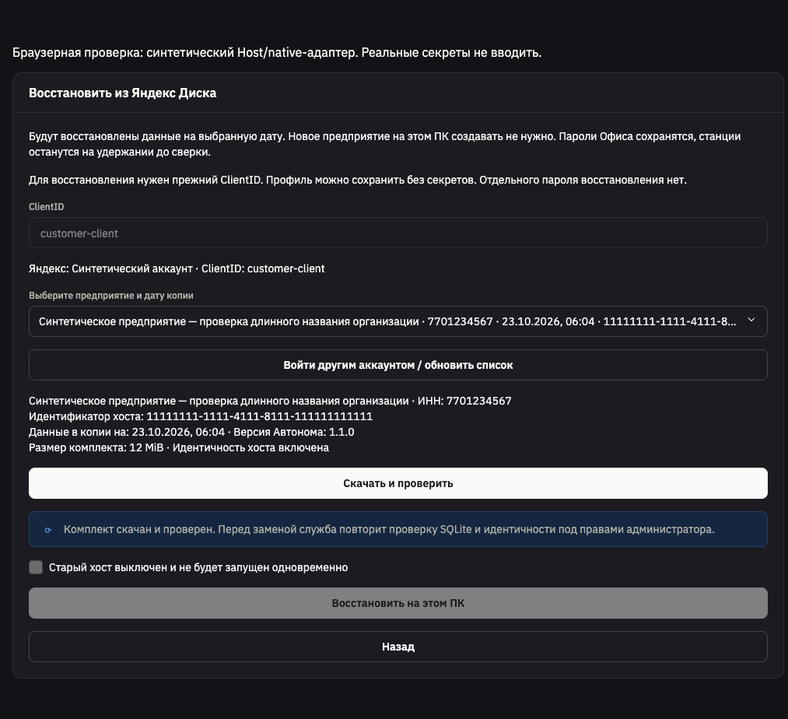
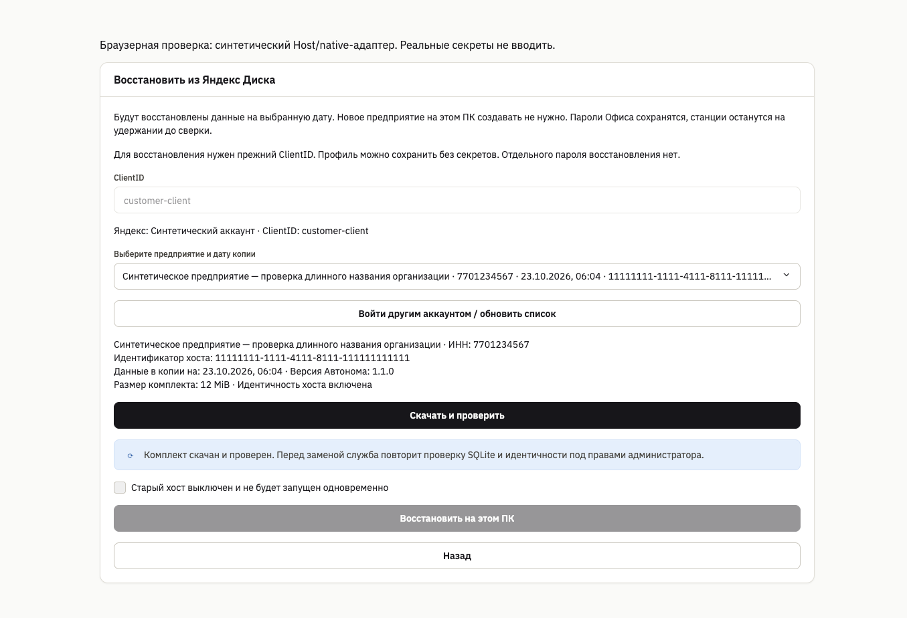

# Автоном: браузер и живой цикл Яндекс Диска

2026-10-23, macOS. Ветка `codex/autonom-yandex-disk`; без публикации.
Проверка прямо разрешена пользователем. Только синтетическая временная база, новый hostId,
прежнее тестовое OAuth-приложение клиента. Windows не проверялась.

## Результат

**PASS:** PKCE → app-folder → загрузка четырёх объектов → полный fresh GET → расшифровка
и штатный SQLite/identity verifier → публикация `complete.json` последней → fresh GET marker.
Затем отдельное чтение каталога, новое скачивание всех пяти объектов, расшифровка,
побайтное сравнение трёх native файлов и штатное восстановление в другую пустую temp-базу.
Запись `AUTONOM SYNTHETIC DISK SMOKE` прочитана из восстановленной базы.

- База: 1 064 960 байт; зашифрованный комплект без marker: 1 067 748 байт.
- Host: `48b718db-90f6-4013-9cb2-163f40713870`.
- Snapshot: `11f4dd05-b7b0-44c4-a294-13e1c4c1a0a9`.
- Путь: `app:/backups/v1/48b718db-90f6-4013-9cb2-163f40713870/11f4dd05-b7b0-44c4-a294-13e1c4c1a0a9`.
- Копия сохранена в закрытой папке приложения. Предыдущие отказавшие пробы могли оставить
  неполные синтетические комплекты без complete marker; их публикация не подтверждалась.
  Чужие папки и архивы не изменялись, remote DELETE не выполнялся.
- ClientSecret не использовался. Access/refresh tokens — только в памяти завершившегося процесса;
  DPAPI старого ПК не нужен. Реальные данные предприятия не использовались.

Безопасный [JSON результата](standalone-yandex-2026-10-23/live-result.json).

## Найдено и исправлено

1. Яндекс присылает callback с `cid`; прежний обработчик отвечал 400. Разрешён только
   bounded opaque cid; state остаётся единственным CSRF binding, duplicate/unknown keys
   и неверный state по-прежнему запрещены. RED → GREEN в `backup-cloud/tests/callback.rs`.
2. PUT прошёл с 201, но первый GET получил 302 на `s123nrg.storage.yandex.net`.
   Добавлены максимум три ручных download redirect с проверкой каждого адреса, порта,
   HTTPS, отсутствия userinfo/fragment и публичного DNS. OAuth/cookies/ClientSecret
   не прикладываются. API и token endpoints автоматических redirect не получили.
   Storage hostname допускается только одним DNS label под `storage.yandex.net`.
   Тесты проверяют переход на storage, цикл и отказ Markiro/private/HTTP/userinfo/uploader
   до следующей отправки. Временная диагностика HTTP-кодов/hostname удалена после выяснения причины.
3. В браузере длинная строка выбора обрезала hostId; теперь все реквизиты выбранной копии
   показаны отдельно с переносом длинного идентификатора. Дата использует существующий
   русский formatter, а не локаль браузера.

Storage download hosts подтверждены [официальной сетевой документацией Яндекса](https://yandex.ru/support/yandex-360/business/admin/ru/network-settings).

## Браузер

Настоящие `BackupsPage`/`YandexRestoreWizard`, стандартные UI компоненты и стили продукта;
Host/native boundary синтетическая. Путь стенда: `test/harness/yandex/index.html`,
локальный Vite `127.0.0.1:5491`. CSP разрешает только local assets/connect.
Это не доказательство Windows native prompt/IPC/DPAPI/UAC.

Проверены согласие admin до connect, reader read-only, предупреждение «подключён, копии нет»,
stale/quota/reauth, явный выбор копии, запрет restore до подтверждения старого Host,
сообщение о прежнем пароле Офиса и отдельном включении расписания. Светлая/тёмная темы,
1366/1024/480 px без горизонтального overflow. В final run page errors нет;
наблюдавшиеся network hosts стенда — только `127.0.0.1`.
Во время редактирования HMR дал повторный createRoot warning; первоначальный favicon 404
устранён локальной пустой иконкой. Это не ошибки финального production component flow.

[JSON UI](standalone-yandex-2026-10-23/ui-result.json).





## Повтор

Живой probe намеренно ignored, чтобы обычный CI не менял Диск:

```sh
AUTONOM_YANDEX_LIVE=1 cargo test --manifest-path apps/standalone/Cargo.toml -p markiro-host --test yandex_live -- --ignored --nocapture
```

После `LIVE_READY_FOR_BROWSER` открыть authorize URL из
`/private/tmp/autonom-yandex-live-authorize-url.txt` в браузере. Callback, verifier и токены
не переносить в evidence. Probe использует фиксированное тестовое приложение; новую учётную
запись/новые permissions без разрешения владельца не подключать. В raw browser-tool output
при первых переходах попали одноразовые callback URL; они не включены в файлы evidence,
последующие наблюдения редактировались. Секрет приложения и токены не выводились.

## Границы доказательства

Итоговые автоматические проверки этого продолжения:

- Cloud crate: 28 passed, strict Clippy all-targets с `-D warnings` PASS.
- Live Host probe: 1 passed. Host connection/runtime/restore/retention regressions: 13 passed.
- Frontend: 8647 passed, 3 прежних infrastructure skips (browser-fit без `PLAYWRIGHT_CORE`
  и PostgreSQL seam без `STANDALONE_HISTORY_ACCEPTANCE_OUT`). Focused UI/controls: 26 passed.
- Typecheck, lint, build, Cargo fmt/root format и diff check PASS. Перед PR полный Rust
  workspace повторён: 2732 passed/12 ignored; frontend: 8647 passed/3 skipped. Это не новая
  Windows/CI приёмка; причины пропусков и итоговые gates перечислены в матрице.

Никаких запросов к серверам Markiro в пробе: код вызывает только фиксированный OAuth/API
Яндекса и проверенные файловые destinations, API Host в probe — in-process temp router.
Произвольные destinations отклоняются до отправки. Полный системный packet trace всех
процессов macOS не выполнялся. Это не заявление о прочих сетевых функциях продукта.

Ещё открыты Windows installer/DPAPI/LocalService/SCM/UAC, работа с закрытым Office,
power-cut на Windows, реальная станция/печать, provider quota/revoke и live retention DELETE.
Синтетический комплект около 1 MiB не проверяет границы тарифа или многочасовую передачу.
